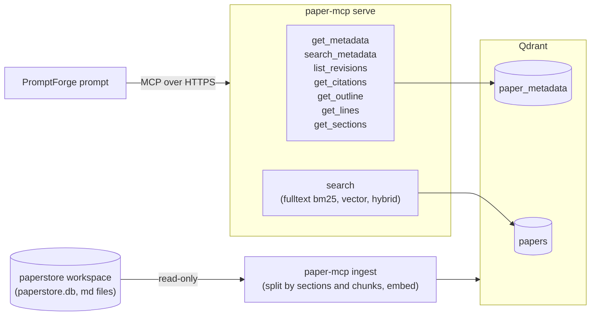

# paper-mcp — Technical Design

| | |
|---|---|
| **Package** | `wg21-paperflow/crates/paper-mcp` |
| **Status** | Draft |
| **Depends on** | paperstore (`paperstore.db` and the converted `.md` files, read by ingest), Qdrant, `fastembed-rs` with BGE-M3 |
| **Output** | MCP tools served at `/papers/mcp`, and two Qdrant collections built by `paper-mcp ingest` |

---

## 1. Summary

paper-mcp is a Rust MCP (Model Context Protocol) server that gives PromptForge prompts full access to WG21 papers: their metadata, their complete text in several shapes, their citations, and search over their text and metadata. The existing Python `paper_mcp` in `wg21-website` keeps running unchanged beside it for now.

paper-mcp is being built so that a PromptForge prompt can read whole papers. It returns paper text directly, in one call, with no size cap. A prompt's Lua receives the text through `tools.call` and writes it to the run's virtual file system (VFS), so the model never has to hold a whole paper at once. The Python `paper_mcp` does not support this, because it returns only signed download URLs.

The binary has two commands. `paper-mcp ingest` reads the paperstore and copies everything the server needs into Qdrant: every paper's metadata, citations, and full markdown, plus the paper text as retrieval chunks. `paper-mcp serve` runs the MCP server, which answers every call from Qdrant and never reads the paperstore.

## 2. Goals and Non-Goals

### Goals

- **Full text, never cut.** Any paper's complete text is available in one call, whatever its size. No tool truncates text.
- **Four views of one paper.** An outline of every heading, the whole text or a line range, the whole text as markdown sections, and the whole text as retrieval chunks inside Qdrant. Every word of the paper appears in the text, section, and chunk views.
- **Facts only.** Paper metadata, paper text, and citations, all read from the paperstore and from nothing else. Nothing produced by an LLM.
- **Search.** Full-text (BM25), vector, and hybrid search over paper text, and ranked search over paper metadata, with standard paging.
- **One splitter.** Papergate, Agora, and any later prompt see the same sections for a paper, because `get_sections` is the only place sections are made.
- **Everything in Qdrant.** The server's only data source is Qdrant. Only ingest reads the paperstore, and only ingest writes to Qdrant.

### Non-Goals

- Replacing or changing the Python `paper_mcp`, its three tools, or its download URLs.
- A database of the server's own besides Qdrant.
- Re-conversion handling. Conversions are assumed done and stable.
- Analysis tables in the paperstore (`claims`, `evidence`, `assay_*`, `findings`, `caput_causae`, `rhetoric`, `signals`, `candidates`).
- Qdrant Cloud. Qdrant is self-hosted from the start.
- Reranking with a model.
- Automatic ingest. Ingest runs only when an operator runs it.
- Changes to the prompts that consume this server (see §14).

## 3. Background and Context

paperflow discovers WG21 mailings, downloads each paper, converts it to markdown with tomd, and records it in the paperstore. The paperstore is a SQLite file, `paperstore.db`, plus one markdown file per paper under `paperstore/`, both inside the workspace named by `$WG21_DATA_DIR`. It is SQLite in every environment, including the production deployment in `wg21-website`, which bind-mounts the workspace into its containers. paperstore's factory reserves `postgres://` for a future backend, but none exists. The Postgres database in `wg21-website` belongs to Django and is unrelated.

Ingest reads two paperstore tables:

- `papers`: one row per paper with `paper_id`, `year`, `title`, `authors` (a JSON array of names), `target_group`, `intent`, `url`, `document_date`, `mailing_date` (`YYYY-MM`), `disposition`, `previous_version`, `markdown_path` (the absolute path of the paper's markdown file, empty when there is none), and `citations_extracted_at`.
- `paper_citations`: one row per (citing paper, cited paper id, mention count), produced by pattern matching paper ids in the markdown (`paperstore.citations.extract_citations`), with no LLM.

`intent` comes from tomd, which takes it from the paper's own metadata or from an "Info:"/"Ask:" title prefix (`format_front_matter` in `packages/tomd/src/tomd/lib/metadata_yaml/format.py`), so it is a fact. Images are extracted to separate files during conversion, and the markdown refers to them by filename only.

The local store holds P papers (`p3045r9`), N papers (`n5008`), and SD papers (`SD-1`). It has no D papers, but citations name D papers (`D0263R1`). The store does not use one letter case: `paper_id` is upper case and `previous_version` is lower case.

Because the server answers from Qdrant, a paper is visible in every tool only after `paper-mcp ingest` has indexed it.

## 4. Architecture Overview



**Ingest** is a batch command an operator runs after paperflow has converted a mailing. It opens `paperstore.db` read-only (`SQLITE_OPEN_READ_ONLY`, through `rusqlite`, with its own queries; it does not use the `paperstore-sqlite` crate, whose open path runs schema migrations), reads the markdown files, and writes both Qdrant collections.

**Serve** answers MCP calls from Qdrant only. It embeds search text with the same model ingest uses.

## 5. Paper Text Model

### 5.1 Paper ids

A paper id is `P<number>R<revision>`, `D<number>R<revision>`, `N<number>`, or `SD-<number>`. The server accepts ids in any letter case. Ids are stored and returned in lower case (`p3045r9`, `sd-1`). A string that is none of these forms, including one with surrounding whitespace, brackets, a file suffix, or a URL, fails with `invalid_paper_id`. A well-formed id with no record fails with `paper_not_indexed`.

A bare `P<number>` or `D<number>`, with no revision, is accepted only by `list_revisions` (§6.3). Every other tool requires an exact id.

### 5.2 Lines

A line is the text between `\n` characters. A newline at the end of the file does not create an empty last line. `\r` is an ordinary character, not a line break: tomd writes `\n` line endings, but some N papers carry stray `\r` characters inside lines from their source documents (n3768 has 594 such lines, for example `### 1.3 \r Approve \r minutes`), and treating them as breaks would shift line numbers. Lines are numbered from 1. `get_metadata`, `get_outline`, `get_lines`, `get_sections`, and search hits all use this one definition. paperstore's `line_count` column is not used, because it is `count("\n") + 1` and disagrees by one when a file ends in a newline.

Text is returned as stored, with lines joined by `\n`.

### 5.3 Headings

A heading is any line outside a code fence that is either a markdown heading (`#` to `######` followed by text) or a bold-numbered line (a number, an optional `.` or `)`, then text wrapped in `**`, and nothing else, as in `2. **Motivation and Scope**`). Heading text is cleaned before it is returned: leading and trailing `#` marks are removed, hackmd anchor links (`[#Changelog](#Changelog)`) are dropped, `[text](link)` becomes `text`, emphasis and code marks are removed, and whitespace is collapsed.

A code fence opens at a line whose first non-whitespace characters are three or more backticks or three or more tildes, and closes at the next line whose first non-whitespace characters are the same character repeated at least as many times, followed by nothing but whitespace. Leading whitespace is allowed because tomd indents fences inside list items (627 papers have indented fences). A fence left open runs to the end of the paper.

### 5.4 Sections

Sections are produced by these rules, with headings inside code fences ignored (§5.3):

1. The primary boundaries are H2 headings together with bold-numbered headings.
2. When the primary boundaries yield fewer than four sections, the first of these that yields at least four is used instead: H3 headings, H1 headings, then plain numbered lines (`3. Title`). When none yields four, the primary boundaries are used.
3. Sections tile the paper. The lines before the first boundary, if any, are the front matter and form section 1 when any of them is non-blank; when all are blank, they belong to the first boundary's section, which then starts at line 1. Each boundary starts a section that runs to the line before the next boundary. A paper with no boundaries is one section.
4. Sections are never split or shortened.

Sections are numbered from 1. The number is called `section_index` in every tool.

### 5.5 Retrieval chunks

Chunks exist only inside Qdrant and are returned as search hits. They are built per section, from blocks.

**Blocks.** A section is divided into blocks, each of one of five kinds. In this design, "block" alone means any of the five kinds, and "code block" means only the first kind.

- **Code block:** a fenced code block ("Headings" above defines fences), from its opening fence line through its closing fence line, inclusive. Everything inside it belongs to it, including blank lines and lines that look like headings, tables, or list items.
- **Table:** a run of consecutive lines beginning with `|`.
- **List item:** a line beginning with `-`, `*`, `+`, or a number followed by `.` or `)`, plus the lines after it up to the next list item, blank line, or start of another block.
- **Heading:** one heading line (§5.3).
- **Paragraph:** a run of non-blank lines that is none of the above.

Blank lines belong to the block before them; blank lines at the start of a section belong to the first block. Blocks therefore cover every line of a section with no gaps or overlaps.

**Chunks.**

- A chunk never crosses a section boundary.
- A chunk is a run of whole blocks. A block is never split, except as below.
- The target size is about 400 tokens. A chunk runs long rather than split a block.
- A code block or table that alone exceeds the embedding model's 8,192-token input limit is split at line boundaries into parts that each fit, with the opening fence (for a code block) or header row (for a table) repeated at the top of each part, so every line is embedded. This is the only case where a block is split.
- Each chunk after the first in a section starts with an overlap: the previous chunk's last block, repeated whole, when that block is at most 200 tokens. Otherwise there is no overlap. The overlap is never part of a block, so a code block is never cut by it.
- **Contextual embeddings.** A chunk on its own often does not say what it is from: a paragraph of a design section rarely names the paper or the facility it discusses. So the text that is embedded starts with a context header identifying the chunk's source, followed by a blank line and the chunk text. The header gives the chunk's `paper_id`, `title`, `heading_path`, and `section_index`, one per line:

  ```
  Paper: p3045r9
  Title: Quantities and units library
  Section 5: 4 Design › 4.2 Units
  ```

  The header is the same for every chunk of a section, so the dense vector reflects both the chunk's own content and where it sits in the paper.
- A chunk's stored `text` is exactly the paper's lines `first_line` through `last_line`, including any overlap, as `get_lines` returns them. The context header, and the fence line or header row repeated at the top of a split part, are added only to the embedded text and never to `text`, so `text` always equals `get_lines(paper, first_line, last_line)`.
- Tokens are counted with the BGE-M3 tokenizer.

The 400-token target and the 200-token overlap limit are starting values and may need tuning once real search results can be judged; both are set in configuration. Chunking is deterministic: the same markdown and settings always produce the same chunks.

## 6. Tools

Every tool declares an output schema and returns structured content with named fields. Each tool description states what the tool returns.

### 6.1 `get_metadata(paper)`

Returns one paper's metadata: `paper_id`, `title`, `authors` (list), `document_date`, `mailing_date`, `year`, `group`, `intent`, `url`, `disposition`, `previous_version`, `has_markdown`, and, when markdown exists, `total_lines` and `total_sections`. `mailing_date` is `YYYY-MM`. `document_date` is `YYYY-MM-DD`, or empty when the paperstore value is not a valid date in that form (see Filters).

### 6.2 `search_metadata(query?, papers?, start?, end?, date_field?, author?, limit?, cursor?)`

Search over the metadata of every ingested paper, including papers without markdown, in the `paper_metadata` collection (§7.5). Each result has the fields of `get_metadata`. The filters and paging are the same as `search` (§6.8, §7.6).

With `query`, results are ranked best match first and each carries a `score`. Without `query`, the call must give at least one filter, and results are ordered newest first by `document_date`, using the first day of the mailing month for papers with no document date, with ties broken by `paper_id`; they carry no `score`. The server gets this order by scrolling the matching records' `paper_id` and dates (never `markdown`) and sorting them itself, since Qdrant's `order_by` drops points that lack the ordering field and the whole collection is about 9,000 records. A call with neither fails with `invalid_argument`.

### 6.3 `list_revisions(paper)`

Returns the paper's revision chain, oldest first. `paper` is an exact id or a bare `P<number>` or `D<number>`. Each entry has `paper_id`, `document_date`, `mailing_date`, and `indexed` (whether a record for it exists in Qdrant). The chain is built from `paper_metadata` records:

1. Every revision of the paper's number, found by filtering on the record's `series` and `number` fields. N and SD papers have no revisions, so this step returns only the paper itself. D papers are their own series and are not merged into the P chain.
2. A walk backward along `previous_version`, which catches renumbered papers (p4353r0 continues p2034r9), running step 1 for each new number reached.
3. A lookup of records whose `previous_version` points into the chain, so the chain is complete from either end.

The walk stops at an empty link or an id already seen. A `previous_version` id with no record is returned with `indexed: false`. A bare number with no indexed revision fails with `paper_not_indexed`.

### 6.4 `get_outline(paper)`

Returns `total_lines`, `total_sections`, and every heading (§5.3) in order. Each heading has:

- `line`: its line number;
- `level`: 1–6 for markdown headings, 2 for bold-numbered lines;
- `text`: the cleaned heading text;
- `section_index`: the number of the `get_sections` section that contains it;
- `starts_section`: `true` if this heading begins that section.

For example, `{"line": 212, "level": 3, "text": "4.2 Units", "section_index": 5, "starts_section": false}` is a heading inside the section `get_sections(paper, 5, 5)` returns.

### 6.5 `get_lines(paper, first?, last?)`

Returns the whole paper, or a range of lines, in one call. Arguments follow Lua's `string.sub(s, i, j)`:

- `first` defaults to 1 and `last` to -1, so `get_lines(paper)` returns the whole paper.
- Both are inclusive.
- A negative value counts from the end: -1 is the last line.
- Out-of-range values clamp to the paper. A range that is empty after clamping returns empty `text`.

| Call | Returns |
|---|---|
| `get_lines("p3045r9")` | the whole paper |
| `get_lines("p3045r9", 100)` | line 100 to the end |
| `get_lines("p3045r9", 1, 50)` | lines 1–50 |
| `get_lines("p3045r9", -20)` | the last 20 lines |
| `get_lines("p3045r9", 11, -11)` | all but the first 10 and last 10 lines |

Result: `paper_id`, `text` (the lines joined with `\n`), `first` and `last` (the resolved bounds), and `total_lines`.

### 6.6 `get_sections(paper, first?, last?)`

Returns the whole paper, or a range of sections, as markdown sections (§5.4) in one call. `first` and `last` index sections exactly as `get_lines` indexes lines. Each section has `section_index`, `heading` (the cleaned heading, empty for front matter), `first_line`, `last_line`, and `text`, the section's full markdown including its heading line. The result also carries `paper_id` and `total_sections`.

### 6.7 `get_citations(paper, direction)`

`direction` is `cites`, `cited_by`, or `both`. `cites` returns the paper ids this paper mentions, each with its mention count. `cited_by` returns the papers that mention this exact paper id; a mention of another revision is not included, and a caller that wants every revision runs `get_citations` on each id from `list_revisions`. A citation records a mention, not support or rebuttal. When the paper's citations have not been extracted (its `citations_extracted_at` was empty at ingest), the result says extraction has not run instead of returning an empty list.

### 6.8 `search(query, type, papers?, start?, end?, date_field?, author?, limit?, cursor?)`

Searches paper text in the `paper_chunks` collection (§7.1). `query` and `type` are required; `type` is `fulltext`, `vector`, or `hybrid`, and a call without either fails with `invalid_argument`. All filters are optional:

- `papers`: restrict to these paper ids. Requested ids that have no markdown are listed in the response's `no_markdown` field, next to the hits from the papers that do.
- `start`, `end`: dates in ISO 8601 form, `YYYY-MM-DD`, inclusive. The date filter applies only when `start` or `end` is given. `start` alone means from that date onward; `end` alone means up to that date.
- `date_field`: `document_date` (the default) or `mailing_date`. A `mailing_date`, which is a month, compares as the first of that month. When filtering on `document_date`, papers with no document date are excluded.
- `author`: matches any author whose name contains the given text, after case and accent folding on both sides (`iebler` finds `Eric Niebler`; `cagri` finds `Murat Can Çağrı`).

Each hit is one chunk and must carry its full provenance: `paper_id`, `title`, `url`, `heading_path`, `section_index`, `first_line`, `last_line`, `match_lines`, `text`, and `score`.

- `first_line` and `last_line` are the exact lines of the paper (§5.2) the chunk covers, and `text` is exactly `get_lines(paper_id, first_line, last_line)` (§5.5), so a caller can cite the passage by line number or fetch it again.
- `match_lines` lists every line in that range that contains a query term, tokenized by the same rules as BM25 (§7.2). Serve computes it at query time from `text`. It is empty when no query term appears in the chunk, which can happen for `vector` hits and for hits that `hybrid` takes from the vector side, because a semantic match need not share any word with the query; the hit's `first_line` and `last_line` remain its provenance.

A paper can appear more than once on a page. Paging is §7.6.

### 6.9 Papers without markdown

A paper with metadata but no converted markdown still has its `paper_metadata` record, so `get_metadata`, `search_metadata`, `list_revisions`, and `get_citations` return it, with `has_markdown: false`. `get_lines`, `get_outline`, and `get_sections` fail for it with `markdown_not_converted`. `search` reports it in `no_markdown` when it is named in `papers`.

### 6.10 Errors

Errors carry a `code` and a message. Codes:

- `invalid_paper_id`: not a proper id (§5.1).
- `paper_not_indexed`: a proper id with no record in Qdrant.
- `markdown_not_converted`: the paper has no markdown.
- `invalid_argument`: a missing `query` or `type` in `search`, a `search_metadata` call with no query and no filter, a malformed date, or a cursor used with different arguments.
- `internal_error`: an unexpected failure, with no internal details exposed.

## 7. Search and Storage

### 7.1 `paper_chunks` collection

One point (Qdrant's term for a stored record) per chunk, with:

- a dense vector `dense`: BGE-M3, 1,024 dimensions, cosine distance;
- a sparse vector `bm25`: Qdrant's BM25 with the IDF modifier, generated by Qdrant from the chunk text (see BM25 settings below), so C++ keywords such as `for`, `if`, `and`, `or`, and `not` and identifiers such as `views` and `ranges` match as words. Punctuation is not indexed, so operators such as `<=>` and `::` are not searchable;
- a payload with `paper_id`, `title`, `url`, `document_date`, `mailing_date`, `mailing_date_filter`, `section_index`, `heading_path`, `first_line`, `last_line`, and `text`.

### 7.2 Embeddings

Dense vectors are computed locally with `fastembed-rs` running BGE-M3 on CPU, at ingest for chunks and at query time for the search text. `fastembed-rs` supports BGE-M3 as `EmbeddingModel::BGEM3`, but its default maximum input length is 512 tokens; both ingest and serve set it to 8,192 with `with_max_length`, so no chunk is truncated before embedding. The model weights (about 2.3 GB of ONNX) are downloaded once from Hugging Face into a cache directory and reused, and both commands hold the model in memory.

**BM25 settings.** Qdrant generates BM25 vectors itself, from a `Document` with the `qdrant/bm25` model and options sent with each request. The options are not stored in the collection, so ingest and serve send the same options from shared code. Qdrant assumes English when no language is set, applying English stopwords and stemming, so both are turned off explicitly. The options are:

- `tokenizer`: `word`;
- `lowercase`: `true`;
- `ascii_folding`: `true`;
- `stemmer`: `{"type": "none"}`;
- `stopwords`: an empty set (`{"custom": []}`);
- `avg_len`: the expected average length of the text in that vector, set per vector in configuration. Starting values: 300 for chunk text (about 400 BGE-M3 tokens), 6 for titles, 4 for author names, and 12 for the `other` field. A fixed value is used instead of a measured one so that papers ingested at different times are scored alike.

These settings need Qdrant 1.19 or later (local BM25 arrived in 1.15.2, weighted RRF in 1.17, and the explicit stemmer switch in 1.19).

### 7.3 Query types

- `fulltext`: a query on the `bm25` vector.
- `vector`: a query on the `dense` vector.
- `hybrid`: both queries as prefetches in one Qdrant query, merged by Qdrant's built-in reciprocal rank fusion (RRF) with Qdrant's default settings, returning one ranked list. A caller that wants the two lists separately runs a `fulltext` and a `vector` search.

### 7.4 Filters

Filters run inside Qdrant on payload indexes created with each collection, before any point is written: keyword on `paper_id`, and datetime on `document_date` and `mailing_date_filter`. Ingest stores `document_date` only when the paperstore value is a valid date in the form `YYYY-MM-DD`. Any other value is treated as no document date: it is not stored, the paper never matches a `document_date` range, and ingest logs a warning naming the paper and the value. Of 9,339 papers, 270 have such values today (author names, `2013-4-25`, `20130825`, dates with Unicode hyphens, or empty); fixing them is a paperstore ticket, and this server does not try to repair them. `mailing_date` holds the month as the paperstore does (`2026-01`) and is what tools return. Qdrant's datetime index needs a full date, so each record also holds `mailing_date_filter`, the first of that month (`2026-01-01`), which the `mailing_date` filter runs on and no tool returns.

The `author` filter is a substring match on `authors_folded` in `paper_metadata`, which has no full-text index so that Qdrant matches substrings. `search_metadata` applies it directly. `search` first resolves it to the set of matching paper ids in `paper_metadata`, then filters `paper_chunks` on `paper_id`.

### 7.5 `paper_metadata` collection

One point per paper. It is the source for every tool except `search`, and the index for `search_metadata`.

**Payload:** the fields `get_metadata` returns; `series` (`p`, `d`, `n`, or `sd`), `number`, and `revision` (empty for N and SD papers), parsed from the id; `authors_folded` (the author names after case and accent folding); `mailing_date_filter` (see Filters above); `cites` (a list of cited paper ids with mention counts) and `cited_ids` (the same ids alone, for the `cited_by` lookup); `citations_extracted`; and, when the paper has markdown, `markdown`, the full file, and `chunker_version` (see Ingest). Every id in the payload is lower case. Outlines and sections are computed from `markdown` by the same code ingest uses for chunking. Tools that do not need the paper text exclude `markdown` when they fetch records. Payload indexes: keyword on `paper_id`, `series`, `previous_version`, and `cited_ids`; integer on `number`; datetime on `document_date` and `mailing_date_filter`.

**Search vectors:** three BM25 sparse vectors, generated by Qdrant with the same settings as §7.1:

- `title`: the title;
- `authors`: the author names;
- `other`: `paper_id`, `target_group`, `intent`, `disposition`, `previous_version`, `document_date`, and `mailing_date`. `url` is not searched.

A `search_metadata` query runs against all three vectors as prefetches, merged by Qdrant's weighted RRF. The weights are title 3, authors 1, other 1, following the Elasticsearch documentation convention of boosting the title field 3× (`title^3`); Elasticsearch's own default boost is 1 for every field. The weights are set in configuration.

### 7.6 Paging

`search` and `search_metadata` follow the MCP specification's pagination convention. `limit` sets the page size and defaults to 10. A response includes `nextCursor` when more results exist and omits it on the last page. The caller passes `cursor` back unchanged to get the next page. The cursor is opaque; the server encodes the query, type, filters, page size, and offset in it, and rejects a cursor used with different arguments. `fulltext` and `vector` searches page by offset over one ranked list. Fused queries (`hybrid`, and `search_metadata` with a query) have each prefetch retrieve a fixed number of candidates, 1,000 by default and set in configuration, whatever the page. Every page is then cut from the same fused list, so pages never repeat or skip a result. Results end where that list ends.

## 8. Ingest

`paper-mcp ingest <targets> [--force]` takes the same targets as paperflow's commands: `all`, one or more four-digit years, or one or more paper ids. Years and ids cannot be mixed.

Ingest writes every paper id in lower case. A paper has markdown when its `markdown_path` is non-empty. Ingest reads the markdown from `markdown_path` as stored; a path that cannot be read is logged as an error naming the paper and the path, and the paper counts as failed.

For each selected paper, ingest writes its `paper_metadata` record (§7.5), whether or not the paper has markdown, replacing any existing record so metadata and citations stay current. A paper with markdown is chunked when its existing record has no `markdown`, when the record's `chunker_version` differs from the current one, or when `--force` is given. `chunker_version` is a hash of everything that shapes chunks: the splitter and chunker code version, the chunk target size, the overlap limit, the context header format, and the embedding model. Chunking a paper first deletes all of its points in `paper_chunks` by `paper_id`, then splits it into sections (§5.4), chunks them (§5.5), embeds the chunks (§7.2), and writes them. Each chunk's point id is a UUIDv5 of the paper id, section index, and chunk number within the section, so rewriting a paper never duplicates points. A paper's chunks are written before its metadata record, which then stores `markdown` and `chunker_version`; a paper whose record holds `markdown` therefore always has complete chunks, and a paper interrupted mid-ingest is chunked again on the next run. Ingest reports how many papers it indexed, skipped, and failed, and which had no markdown.

The local store holds about 470 MB of markdown, so the first full ingest embeds several hundred thousand chunks on CPU and takes hours.

Ingest runs only when an operator runs it by hand. No timer, hook, or pipeline starts it.

## 9. Server

- **MCP library.** `rmcp`, the official Rust MCP SDK, serving stateless Streamable HTTP on axum.
- **Auth.** Bearer tokens from the same keys file the Python server uses (`secrets/paper-mcp-keys`), one token per line. Tokens are compared in constant time. The server reloads the file when it receives SIGHUP (`docker compose kill -s HUP paper-mcp-rust`), so tokens can be added or removed without a restart. A reload that yields no tokens is rejected and the previous tokens stay in force, as in the Python server. A missing or invalid token gets HTTP 401 before the request reaches the MCP layer.
- **Data access.** The server reads only Qdrant. It does not open `paperstore.db` or the markdown files. The Qdrant client's message size limits, in both ingest and serve, are raised above the largest paper record (the largest markdown file, n4485, is 3.4 MB). Both collections are created with `on_disk_payload` so the roughly 470 MB of stored markdown stays on disk rather than in RAM.
- **Rust version.** The workspace `rust-version` is raised from 1.89 to what the dependencies require. The pinned toolchain is already 1.98.0.

## 10. Implementation

### 10.1 Crate layout

paper-mcp is one workspace member with `publish = false`. It inherits the workspace's package fields and its lints (`[lints] workspace = true`), which already forbid `unsafe` code and deny `unwrap` and `expect`. It stays one crate unless a measured build-time cost or a second consumer of its text code justifies a split.

The logic lives in the library. `src/main.rs` only parses the `ingest` and `serve` subcommands with `clap` and calls into the library. One module per concept:

| Module | Holds | Input and output |
|---|---|---|
| `paper_id` | `PaperId` parsing and lower-casing (§5.1) | none |
| `text` | lines, headings, fences, sections, blocks, chunks, and the context header (§5.2–§5.5) | none |
| `bm25` | the BM25 options (§7.2) and the tokenizer `match_lines` uses (§6.8) | none |
| `cursor` | encoding and checking paging cursors (§7.6) | none |
| `config` | the typed configuration, read once at startup | environment, config file |
| `embed` | the BGE-M3 model and its worker thread (§7.2, §10.4) | model cache |
| `qdrant` | collection setup, payload types, and queries (§7) | Qdrant |
| `ingest` | the ingest command (§8) | paperstore, Qdrant |
| `serve` | the MCP tools, auth, and error mapping (§6, §9) | HTTP, Qdrant |

The first four modules do no input or output. The rules that define ids, lines, sections, chunks, and paging are therefore tested without Qdrant or a model, and ingest and serve run the same code, which is what the "One splitter" goal requires.

### 10.2 Types

- `PaperId` is a newtype built only by parsing (`FromStr`) and always lower case. Every tool parses its id arguments first, so a malformed id fails with `invalid_paper_id` before any Qdrant call.
- Line numbers, section indexes, and chunk numbers are separate 1-based newtypes, so passing one where another is expected, or using a 0-based index, does not compile. `first` and `last` arguments, including negative values, are resolved once at the tool boundary into an inclusive range type (§6.5), and nothing past that point handles negative indexes.
- Closed sets of arguments (`type`, `date_field`, `direction`) are enums parsed from the tool arguments, not strings checked later.
- Configuration is parsed into a typed struct at startup. An invalid or missing setting stops startup with an error naming the setting.

### 10.3 Errors

- The library returns typed errors derived with `thiserror`. Tool errors form one enum whose variants map one-to-one to the codes in §6.10. The binary uses `anyhow` and prints the full error chain on exit.
- Every expected failure, including malformed input, a missing paper, and a bad cursor, is a `Result`. Tool handlers never panic on any input.
- An `internal_error` is logged once, with its full error chain and a request id, at the layer that turns it into a response. The response carries only the code, a generic message, and that request id.
- In ingest, a failure confined to one paper is logged with the paper id and its cause, counted, and does not stop the run. Failing to reach Qdrant or to load the model stops the run with a nonzero exit status.

### 10.4 Concurrency

- Serve runs on the multi-threaded tokio runtime under axum.
- Embedding a query is CPU-bound, so it never runs on the async executor. One worker thread owns the model and takes requests over a bounded channel, replying through a oneshot channel. A full channel makes the caller wait instead of growing an unbounded queue.
- The token set (§9) sits behind a `std::sync::RwLock` and is replaced whole on SIGHUP. The auth check releases the lock before any `.await`.
- On SIGTERM, serve stops accepting connections and lets in-flight requests finish before exiting.
- Ingest processes one paper at a time and embeds its chunks in batches. ONNX Runtime already uses every core for a batch, so ingest adds no thread pool of its own. The per-paper write order in §8 is kept by awaiting each paper's writes before starting the next paper.

### 10.5 Dependencies

| Need | Crate |
|---|---|
| MCP server | `rmcp` |
| HTTP | `axum` |
| async runtime | `tokio` |
| Qdrant | `qdrant-client` |
| embeddings | `fastembed` |
| reading the paperstore | `rusqlite`, already used in the workspace |
| command line | `clap` with derive |
| errors | `thiserror` in the library, `anyhow` in the binary |
| logging | `tracing` with `tracing-subscriber` |
| chunk point ids | `uuid` with the `v5` feature |
| accent folding | `unicode-normalization` |
| serialization | `serde`, `serde_json` |
| tests only | `proptest`, `insta` |

Each crate's name, features, and version are checked against crates.io and its repository when it is added, and no other dependency is added without the same check.

### 10.6 Observability

Serve logs one `tracing` span per tool call, with the tool name, the paper ids it was given, the result code, and the duration. Ingest logs one line per paper and a summary at the end (§8).

## 11. Testing

- **Unit tests** sit beside the code in the four pure modules (§10.1). They cover a trailing newline and stray `\r` characters (§5.2), indented and unclosed code fences and bold-numbered headings (§5.3), each step of the section fallback and the blank front-matter rule (§5.4), the chunk target, overlap, and oversized-block splits (§5.5), every row of the `get_lines` table (§6.5), and cursor round trips (§7.6).
- **Property tests** (`proptest`) generate markdown and check the text invariants of §13: sections tile the paper; chunks cover every line of their section and never cross a section boundary; each chunk's `text` equals its line range; and the same input always produces the same sections and chunks.
- **Golden files** (`insta` snapshots) record the outline, sections, and chunk boundaries of a few real papers chosen for their shape: p3045r9 (H2 headings), p4021r2 (mixed H2 and bold-numbered headings), p3248r5 (hackmd export), n3768 (stray `\r`), n4485 (the largest file), and one paper with indented fences.
- **Integration tests** live in one binary, `tests/it/main.rs`. They ingest a small fixture paperstore into a real Qdrant 1.19 and call every tool over MCP, checking the error codes of §6.10 and that every search hit's `text` equals `get_lines` over its range. They also check that every `fulltext` hit has a non-empty `match_lines`, which catches any drift between the `match_lines` tokenizer and Qdrant's BM25. These tests need Qdrant and the model cache, so they are marked `#[ignore]` with that reason and run in a separate CI job that provides both.
- **CI** runs `cargo fmt --all --check`, `cargo clippy -p paper-mcp --all-targets --all-features -- -D warnings`, `cargo test --locked -p paper-mcp`, and `cargo deny check` for paper-mcp, alongside the existing jobs.

## 12. Deployment

paper-mcp is deployed by `wg21-website`'s `docker-compose.yml` as two new services beside the existing ones:

- `paper-mcp-rust` runs `paper-mcp serve`. It mounts `secrets/` read-only and keeps the model cache on a volume. It also mounts the paperflow workspace read-only, which only ingest uses. Its settings are `WG21_DATA_DIR`, `PAPER_MCP_KEYS_FILE`, the Qdrant URL and API key, and the model cache directory. Its port is published on `127.0.0.1` only, and the host-level nginx proxies `/papers/mcp` to it. The name `paper-mcp-rust` is used for this Compose service only.
- `qdrant` runs a pinned Qdrant image, 1.19 or later (see BM25 settings), with an API key set and its storage on a volume. Its port is published on `127.0.0.1:6333` only, so the dashboard is reachable through an SSH tunnel to the server and nothing is exposed publicly.

Ingest runs by hand in the server's image: `docker compose run --rm paper-mcp-rust paper-mcp ingest <targets>`.

## 13. Invariants

- The server reads only Qdrant. Ingest is the only process that reads the paperstore or writes to Qdrant, and it never writes to the paperstore.
- No tool shortens, truncates, or windows paper text. `get_lines` and `get_sections` return everything requested in one response.
- Every word of a paper appears in `get_lines(paper)`, in the concatenation of `get_sections(paper)`, and in at least one `paper_chunks` point.
- All line numbers and `section_index` values are 1-based and agree across every tool and every search hit.
- Every search hit carries its paper id, section, and exact line range, and its `text` equals `get_lines` over that range.
- Sections tile the paper with no gaps or overlaps. Chunks never cross a section boundary.
- Only `P<number>R<revision>`, `D<number>R<revision>`, `N<number>`, and `SD-<number>` ids are accepted, in any case; bare `P<number>` and `D<number>` are accepted only by `list_revisions`. Ids are stored and returned in lower case.
- `search` rejects a call without `query` or `type`; `search_metadata` rejects a call with neither a query nor a filter.
- A date filter applies only when `start` or `end` is given.
- Every ingested paper has a `paper_metadata` record, with or without markdown.
- A paper whose record holds `markdown` has complete chunks.
- No tool returns LLM-derived data.
- The same markdown and settings always produce the same sections and chunks.
- Ingest never runs automatically.

## 14. Consumers

- **Agora author-advocacy prompt** (`/code/wg21-agora/prompts/agora-author-advocacy.md`) reads the paper under scan and the author's other papers in full, finds those papers with `search_metadata`, follows revisions with `list_revisions`, and finds responses with `get_citations`.
- **Papergate prompt** (`/code/wg21-papergate/papergate_v8.md`) gets its section fragments from `get_sections` instead of its own Lua splitter, as input to the classifier stages Vinnie proposed.
