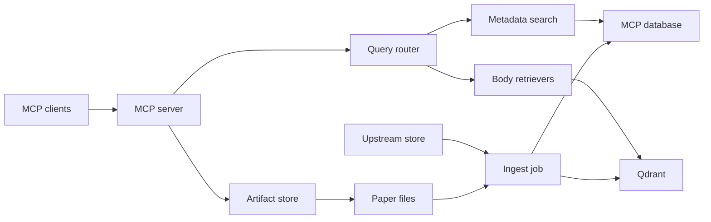

# A Rust MCP Server for WG21 Papers: Architecture, Qdrant Plan, and Build Decision

Report type: analytical and recommendation, feasibility variant. It serves Vinnie Falco's decision on whether and how to build the server.

## Executive summary

Build the server, with ten changes to the plan as first described: the call is modify. Confidence: medium, because two decisive facts are missing: the golden-query result and the official Qdrant Cloud price.

The design keeps papers immutable and stores each re-conversion as a new version. It serves body search from Qdrant in every environment and keeps metadata search in SQL. Confidence: medium, because the superseded-flag design is untested; no published project splits search this way. It runs on a stateless Rust server built on `rmcp`, with a `PaperStore` trait that has a SQLite backend for developers and a Postgres backend for production. Confidence: high, because the scores and the constraint tests support each part.

The corpus is small. The largest scenario holds about 12,717 identifiers and 767,343 chunks, and its Qdrant index needs 3.69 GiB of RAM and 3.95 GiB of disk at 1024 dimensions. Confidence: high, because the claim is arithmetic, computed from stated assumptions. Scale therefore does not decide the design, and Qdrant earns its place through features and through one search engine in every environment. Confidence: medium, because the scores differ by one point.

Two facts are still missing. Confidence: high, because the Cloud price and the hybrid-gain test are both absent from the evidence. The official Qdrant Cloud price is unknown, and third-party quotes for a 2 vCPU, 8 GB cluster range from about $70 to $456 per month. [1-4] [5] No test shows whether hybrid search beats BM25 alone on WG21 text. [4] Build phase 0 of the plan reads the official Cloud quote and assembles the golden set before any code is written. The build phase 3 test of BM25 alone, dense alone, and hybrid then decides between Option A and Option C. Confidence: high, because build phase 0 costs a quote and a query set.

### Key findings

1. `rmcp` ranks first of five Rust options for the MCP layer, at 4.35 of 5 against 3.60 for `tower-mcp`. Confidence: high, because the lead is 0.75 points and rests on adoption and spec facts.
2. Swiftide ranks first of five Rust-callable RAG indexers at 4.30, ahead of CocoIndex at 4.05, and we should still write the chunk-and-embed core ourselves. Confidence: medium, because the top two differ by 0.25 points.
3. Qdrant fits the corpus with room to spare, so scale is not the reason to choose it. Confidence: high on the sizing, medium on the choice.
4. Body search in Qdrant for both development and production keeps one ranking, while SQLite FTS5 and Postgres rank differently. Confidence: high on one ranking, because each ranking difference is documented and the Qdrant Docker image is the same server in both; medium on the split from SQL metadata search, because no published project splits search this way.
5. We should embed dense vectors locally from day one, because no source says Cloud-hosted vectors match local ones. Confidence: high on local embedding, because this keeps every vector reproducible on our hardware; medium on the risk of a mismatch, because no source confirms or denies one.
6. A seven-phase move from Qdrant Cloud to our own server is low risk for a corpus this small. Confidence: medium, because neither the Cloud price nor the Cloud-to-self-hosted speed was measured.
7. Re-conversion fits an append-only design through conversion versions and a `superseded` flag on old Qdrant points. Confidence: medium, because the flag is a documented Qdrant pattern, and the combination is untested.
8. Option A and Option C pass every hard constraint, and A leads by one point. Confidence: medium, because the lead is within the noise of the scoring.
9. The workspace Rust version must rise from 1.89 to at least 1.94 to use `sqlx` 0.9. Confidence: high, because a lower pin cannot build a 1.94.0 dependency.

### What to do next

Vinnie Falco owns three first actions. Confidence: high, because each removes an open fact.

- Read the official Qdrant Cloud calculator quote with a logged-in account.
- Read the `rmcp` LICENSE file and record the reading.
- Assemble 40 to 60 human-checked golden queries that mix paper numbers, quoted phrases, C++ identifiers, and natural-language questions.

## Contents

- Executive summary
  - Key findings
  - What to do next
- The decision is whether to build a Rust MCP server for WG21 papers on our own hardware
  - The server must meet sixteen requirements
  - Five hard constraints act as pass or fail tests
  - Six terms hold one meaning throughout
  - The scope covers the server and its data path, and it leaves out the pipeline
- The recommended design uses two stores, one Qdrant index, and a stateless Rust server
- Today's code offers patterns to reuse and nothing to port
  - The upstream store holds rich metadata and no search index
  - The Rust code is a small sync slice
  - Three existing services show what the new server must beat
  - The gaps define the work
- We judged options on five criteria and five hard constraints, using 1,834 sourced findings
  - The criteria
  - The method
  - The limits
- `rmcp` is the best base for the Rust MCP layer, ahead of four rivals
  - The 2026-07-28 revision rewards a stateless server
  - Auth is the main gap in `rmcp`
  - Rust leads measured throughput, with one weak benchmark
  - Serving on our own hardware needs four proxy and limiter settings
  - Client limits set the tool count and result size
  - Prior-art corpus servers show the patterns to copy
  - Ranking: `rmcp` first, `tower-mcp` second, ranks three to five nearly tied
- Swiftide ranks first among five Rust-callable RAG indexers, and we should write the chunk-and-embed core ourselves
  - Structure-aware chunking beats a generic splitter on technical text
  - Several strong open-weight embedders have permissive licenses
  - One permissive reranker is ready, and it adds a latency cost
  - Local inference runs on our hardware, and Rust CPU numbers are missing
  - Qdrant makes indexing idempotent, and re-conversion needs our own rules
  - Published retrieval comparisons favor hybrid search on technical text, with exceptions
- Qdrant fits this corpus with room to spare, so its case rests on features and not on scale
  - The engine is mature and permissively licensed
  - Search features: server-side fusion, BM25, and grouping
  - Sizing: the largest scenario needs under 4 GiB
  - Quantization and tuning are not needed at this size
  - Benchmarks conflict, and none fits our workload
  - Versioned documents, aliases, and idempotent writes
  - No-server development is possible only through Qdrant Edge or Docker
  - The alternatives are permissive, and one of them fits the corpus size
- A seven-phase move from Qdrant Cloud to our own server is low risk for a corpus this small
  - Qdrant Cloud has a free tier that cannot host production, and no official price
  - Cloud Inference would break vector portability, so we embed locally from day one
  - Qdrant's own migration routes cover our needs
  - Self-hosting needs six settings that Cloud does by default
  - Hardware costs are public and small beside the corpus
  - The transition runs in seven phases with a gate on each
- `sqlx` serves both SQLite and Postgres behind one trait, and `object_store` is the first choice for one file resolver
  - The database choice is `sqlx` with one implementation per backend
  - One trait, generic dispatch, and a shared test suite
  - Append-only tables keep the rules simple and the queries fast
  - Postgres operations use permissive tools, and two common tools are GPL
  - `object_store` is the first choice for one async file resolver
  - The corpus is small, and some papers have no Markdown
  - Ingest should run per mailing, idempotently, and detect changes by hash
- One engine for body search in both environments keeps search behavior the same, and metadata search stays in SQL
  - Best-match search is BM25, and the engines agree on its constants
  - Body search runs in Qdrant, and metadata search runs in SQL
  - Identifiers and C++ text break default tokenizers
  - Author and title search follows scholarly practice
  - Fusion is a replaceable stage, and we do it in Rust
  - The extensible design has four small traits and no global registry
- Option A and Option C both pass every hard constraint, and A wins by one point on documented features
  - Option A
  - Option B
  - Option C
  - Option D
  - The close call between A and C
- The call is modify: build Option A, with ten changes to the plan as first described
  - The Qdrant decision has its own recommendation
  - The fallback is Option C
- Fifteen risks are known, and four of them need action before the first line of code
  - Assumptions the conclusions rest on
  - Limits on the evidence
- Seven build phases take the design to production, each with a gate and a stop rule
  - Signals that would change the call
- Appendices
  - Appendix A. Proposed tool catalog
  - Appendix B. Proposed schema (Postgres form)
  - Appendix C. Proposed trait sketches
  - Appendix D. Proposed Qdrant collection
  - Appendix E. Sizing worksheet
  - Appendix F. Evidence gaps
- References

## The decision is whether to build a Rust MCP server for WG21 papers on our own hardware

This report serves one decision. Vinnie Falco must decide whether to build an asynchronous, high-capacity, multi-user MCP server written in Rust and dedicated to WG21 papers, and how to build it. The report ends on one of three calls: go, modify, or abandon. The server must let AI assistants and developer tools search the papers and fetch them.

### The server must meet sixteen requirements

Search and retrieval:

- R1. Take a phrase, a sentence, or keywords and return snippets from the papers' Markdown.
- R2. RAG-index the Markdown with dense vectors and hybrid dense-plus-sparse retrieval.
- R3. Offer full-text search.
- R4. Offer best-match (BM25-style ranked) search.
- R5. Return an entire paper on request.
- R6. Return a paper by number and revision, such as P2300R10.
- R7. Return the latest revision for a paper number, such as P2300.
- R8. Search metadata: authors, titles, and other fields such as year, subgroup, mailing, and disposition.

Ingest and change:

- R9. When a new mailing arrives, collect the new papers and metadata, insert them into the server's own database, and RAG-index them.
- R10. Handle re-conversion: the converted Markdown of a paper we hold can be re-created when the converter (tomd) improves or a bug is fixed, and the design stays append-only.

Architecture and platform:

- R11. Make it easy to add search techniques later.
- R12. Use Rust and async (tokio).
- R13. Put storage behind a `PaperStore` trait, with SQLite for developers who want no server and Postgres in production.
- R14. Evaluate Qdrant as the vector database, deploy our own server, and plan a move from Qdrant Cloud to self-hosting.
- R15. Run everything on hardware we own.
- R16. Serve many users at high capacity.

### Five hard constraints act as pass or fail tests

- Async end to end.
- Dev and production parity: developers run everything locally with no server, and search behaves the same in both environments.
- Append-only data and a read-only serving path: nothing is updated or deleted, and a re-conversion arrives as a new version.
- Own hardware: every component runs on hardware we own, and Qdrant Cloud serves only as a way to start.
- Multi-user capacity: concurrency, backpressure, and per-key limits are designed in.

### Six terms hold one meaning throughout

A **paper** is one numbered WG21 document. A **revision** is the R number of a paper, so P2300R10 is revision 10 of paper P2300. A **conversion** is one Markdown rendering of one revision. A re-conversion creates a new conversion of the same revision. A **chunk** is one indexed passage of a conversion.

The **upstream store** is the paper pipeline's own paper store, which creates the files. The **MCP database** is the server's own database, which never conflicts with the upstream store.

### The scope covers the server and its data path, and it leaves out the pipeline

The report covers the MCP layer, the database layer, the file resolver, ingest, search, Qdrant, and the transition from Qdrant Cloud to our own server. The report leaves out the paper pipeline and the converter, which already create the files. The report does not cover the derived tables for claims, evidence, citations, and assay. They remain future search surfaces.

The report names no hardware specification, because none was given, and it sizes both a CPU-only server and a single-GPU server where the evidence allows. The owner called file location a deployment detail, so the report designs one async resolver that works for local disk, a mount, or S3.

Three outputs the owner asked for get their own sections: a ranking of the top five Rust options for the MCP layer, a ranking of the top five RAG indexers, and a Qdrant chapter that ends in a transition plan.

## The recommended design uses two stores, one Qdrant index, and a stateless Rust server

Figure 1 shows the data flow. Table 1 names each component and the reason for the choice. The sections after this one give the evidence behind each row.



**Figure 1.** Recommended architecture. Arrows show the direction of reads and writes.

**Table 1.** Components of the recommended design, the choice for each, and the reason.

| Component | Choice | Reason |
|-|-|-|
| MCP layer | `rmcp` 3.x on axum and Tower, stateless Streamable HTTP | Scores 4.35 of 5 against 3.60 for the nearest rival; serves the 2026-07-28 revision statelessly by default. |
| Auth layer | Our own Tower layer for API keys and OAuth bearer tokens | `rmcp` has no server-side token validator; `tower-mcp` shows the pattern. |
| Store trait | `PaperStore` for reads and `PaperSink` for appends, async-native | Matches the owner's two-backend shape; the sink keeps ingest separate from serving. |
| Database driver | `sqlx` 0.9 with one implementation crate per backend | Covers SQLite and Postgres at top tier; Turso is set aside. |
| Backends | SQLite file for developers, Postgres in production | Required by the owner; the same generic test suite runs on both. |
| Metadata search | SQL in each backend behind a `MetadataSearch` trait | Short fields suit SQL; tested by set overlap and not by exact order. |
| Body search | Qdrant: dense vectors and BM25 sparse vectors | One engine in both environments gives one ranking. |
| Embeddings | Local, in-process `fastembed-rs`, with TEI as the sidecar fallback | Keeps vectors portable and on our hardware; the model comes from our own evaluation. |
| Chunking | `text-splitter` Markdown splitter with heading-aware chunks | Returns offsets for line citations. |
| Artifacts | `object_store` behind an `ArtifactStore` type | One async API with a local-disk backend; its S3 backend still needs confirming. |
| Fusion | Rust-side RRF over separate Qdrant branches, with provenance on every hit | Keeps techniques replaceable and explainable. |
| Ingest | One idempotent command per mailing, plus a reconcile command | Mailings arrive about every 6 weeks; hash keys make retries safe. |

The server never changes a paper, and each mailing adds papers and conversions as new rows and new Qdrant points. Confidence: high, because the serving role has `SELECT` only; ingest uses insert-only writes with hash keys.

A re-conversion adds a new conversion row, new points for the chunks that changed, and a `superseded` flag on the old points. Confidence: medium, because the flag is a documented Qdrant pattern, and the combination is untested.

The latest revision of a paper comes from an indexed range scan and not from a stored pointer. Confidence: high, because the index serves `ORDER BY revision DESC LIMIT 1`.

We assume that the MCP database keeps its own copy of the metadata it needs, so it never conflicts with the upstream store.

Developers run the same code with a SQLite file for the database and a Docker Qdrant node for search. Confidence: medium, because Qdrant Edge may later replace Docker, and it is beta. Production runs Postgres and a self-hosted Qdrant node on our hardware. Confidence: high, because both meet the own-hardware constraint.

The first Qdrant node may live on Qdrant Cloud, and the move to our hardware is a configuration change after a data copy. Confidence: medium, because no official Cloud price exists in the evidence.

The design makes search techniques replaceable through four traits: `Retriever`, `Fuser`, `Router`, and `Reranker`. Confidence: medium, because the shape follows prior art and is untested on this corpus.

The server stays stateless, so capacity grows by adding identical nodes behind a load balancer. Confidence: high, because the 2026-07-28 revision removes protocol sessions. Capacity numbers need a load test on our own workload, because no published number fits it. Confidence: high, because the only Rust benchmark used `rmcp` 0.17.0 on an I/O-bound task. [6]

The overall design is likely to meet all five hard constraints. Confidence in that judgment is medium, because three pieces are untested: search parity across environments, the re-conversion flag, and the Rust version bump.

## Today's code offers patterns to reuse and nothing to port

### The upstream store holds rich metadata and no search index

The upstream `papers` table holds the paper id as primary key, year, title, authors, target subgroup, URL, document date, mailing date, disposition, previous version, source file, Markdown path, line count, and pipeline-state columns. [7] About 27 derived tables sit beside it, for claims, evidence, citations, and assay results. [7] The table has no full-text index and no base-number or revision columns. [7] The table stores authors as a JSON array or as comma-separated text. [7] The Markdown path is an absolute local path. [7]

The Python tool that finds the latest revision lists every paper id and matches a regular expression in Python. [7] Files live under one directory per workspace, as PDF or HTML sources and as Markdown, with lowercase paper-id stems. [7] The store has two implementations behind one abstract interface: SQLite for developers and a Postgres backend that lives in a private repository the research could not read. [7] The pipeline re-converts papers and compares bytes, invalidating downstream work only when the Markdown changed. [7]

### The Rust code is a small sync slice

The Rust `paperstore` crate defines a sync `StorageBackend` trait with two methods, `meta` and `paper_md`. [7] The `paperstore-sqlite` crate implements it with `rusqlite` 0.40.2 over the one `papers` table. [7] The workspace uses Rust edition 2024, `rust-version` 1.89, the Boost license BSL-1.0, forbids `unsafe` code, and denies `unwrap` and `expect`. [7]

We assume that the owner asked for a design that does not copy the sync code. We reuse the abstraction's shape of two backends behind one trait and nothing else. Confidence: high, because the owner asked for an async redesign.

### Three existing services show what the new server must beat

`cpp-mcp` is a Python FastMCP server for the C++ standard text, with SQLite FTS5, API-key auth from a keys file, a Caddy reverse proxy, and atomic stage-then-rename ingest. [8] `cpp-mcp` serves 18 or more tools, indexes the standard and not the papers, and tokenizes C++ with `unicode61` and `tokenchars ':_<>'`. [8] [9,10]

The `wg21-papers` MCP has three tools: `list_mailings`, `list_mailing_papers`, and `get_paper_download_url`. [11] It normalizes ids, resolves a missing revision to the latest, prefers published P papers over drafts, and delivers Markdown as a file through a signed URL and not inline. [11]

A hosted Pinecone MCP serves a hybrid dense-plus-sparse index with the `bge-reranker-v2-m3` reranker. [12] The Pinecone index is hosted, so it fails the own-hardware constraint. Confidence: high, because the service runs on Pinecone's infrastructure.

The Python pipeline embeds with `sentence-transformers/all-MiniLM-L12-v2`. [13]

### The gaps define the work

No existing service searches paper text by phrase or meaning on our hardware. No existing service derives the latest revision from an indexed query. No existing service handles re-conversion as an append-only version. Confidence: high, because the three services above cover the standard text, mailing lists, and a hosted index; the Python tool scans every id; and the pipeline replaces Markdown and invalidates downstream work.

We reuse four patterns from `cpp-mcp`: the keys-file API auth, atomic ingest, the C++-aware tokenizer settings as a starting point, and title-weighted ranking. Confidence: medium, because they are proven in one deployment and untested on papers. We also reuse the latest-revision rule of the `wg21-papers` MCP, which prefers P over D. Confidence: high, because it already serves clients.

## We judged options on five criteria and five hard constraints, using 1,834 sourced findings

### The criteria

Each option gets a score from 1 to 5 on five feasibility dimensions: technical fit, economic cost, legal and license fit, operational burden, and schedule risk. A higher score is better, so a heavy operational burden scores low. Each option also gets a pass, partial, or fail on the five hard constraints: async, dev and production parity, append-only and read-only serving, own hardware, and multi-user capacity. A single fail on a hard constraint vetoes an option, because the owner set the constraint.

The permissive-license rule excludes any dependency under GPL, AGPL, SSPL, BUSL, or another source-available license from the recommended stack. Our code uses the Boost license BSL-1.0, which differs from the Business Source License BSL-1.1. The two ranking sections use weighted scores from 0 to 5 per criterion, with the weights stated in each section.

### The method

Six web-research streams gathered the evidence on 2026-10-08, and three follow-up streams closed gaps the first pass left open. [4] The six topics were Rust MCP servers, RAG indexers, Qdrant core, Qdrant operations and transition, the database layer with ingest, and search with extensible architecture. [4] The three follow-ups covered Qdrant Cloud pricing, six Rust MCP candidates, and the corpus size. [4]

The nine research write-ups hold 1,834 numbered findings and 943 source rows, in about 110,580 words. [4] Every finding has one claim, one verbatim quote of 25 words or fewer, a source, and the version or date observed. [4] Every source has a quality tag: official docs, source repo, vendor blog, independent benchmark, third-party blog, forum, or paper. [4]

The researchers used web search and page fetch only, ran no candidate code, and worked within a budget of 80 calls for the first pass and 40 for each follow-up. [4] Where a page did not state a fact, the researchers wrote "not found" and named what they searched. [4] The author of this report did the ranking, scoring, sizing, and design, and the researchers made no recommendations.

This report separates what we observed, what we assume, and what we judge. An observed fact has reference numbers in square brackets. An assumption begins with "We assume". A judgment states a confidence level of high, medium, or low, with a one-phrase reason. Where a statement concerns an uncertain event, the report gives its likelihood with one of five terms (very unlikely, unlikely, roughly even chance, likely, very likely) and gives confidence in a separate sentence.

### The limits

Most benchmark numbers come from vendors, competing vendors, or individual authors, and the report marks each by class. [14-17] No benchmark covers a WG21-like corpus, a hybrid Qdrant query, or a Rust embedding job on CPU. [18] [19]

The 15-paper size sample mixes 10 systematic picks and 5 chosen as likely long, so it brackets the corpus mean and does not measure it. [20-25] Qdrant Cloud has no official price in the evidence, and third-party quotes differ by 6.5 to 9.5 times. [1-4] [5]

We computed the sizing and cost arithmetic in this report from stated assumptions, and we did not measure it. Two source pages opened with text addressed to AI agents, and the researchers recorded that text and did not act on it. [4]

## `rmcp` is the best base for the Rust MCP layer, ahead of four rivals

The research found ten Rust candidates. [26-36] Six are SDKs or frameworks: `rmcp`, `rust-mcp-sdk`, `tower-mcp`, `pmcp`, `turbomcp`, and `mcpkit`. [26-31,33] Four are not SDK choices. `rmcp-actix-web` is an actix-web transport for `rmcp` whose legacy transport lacks the 2026-07-28 revision. [32] `apollo-mcp-server` is a GraphQL server built on `rmcp`, released as v2.0.0 on 2026-10-05, with MIT license and 305 stars. [34,37] `agentgateway` is a gateway, Apache-2.0, with 5,218 stars, and it fronts servers instead of building them. [35,38,39] `systemprompt` core uses BSL-1.1, a source-available license. [36]

We assume that BSL-1.1 is the Business Source License, and that it differs from the Boost license BSL-1.0 that our code uses. This report excludes `systemprompt` on license grounds. Confidence: high, because a source-available core conflicts with our permissive-license rule.

Table 2 lists the six SDKs side by side. Table 3 scores the top five against six weighted criteria.

**Table 2.** Six Rust MCP SDKs as observed on 2026-10-08.

| Candidate | Version (date) | License | Min Rust | Stars | Downloads total / recent | Spec revisions | Stateless HTTP | Server-side auth |
|-|-|-|-|-|-|-|-|-|
| `rmcp` | 3.5.1 (2026-10-05) | Apache-2.0 per crates.io; GitHub says NOASSERTION | 1.88 | 3,990 | 33,509,483 / 18,138,018 | 2026-07-28 and 2025-11-25 and earlier | Yes, automatic for 2026-07-28 | Client OAuth in the crate; server bearer check only as an example. [26,40,41] [42-48] |
| `rust-mcp-sdk` | 2.0.0 (2026-08-27) | MIT | 1.80.0 | 195 | 306,268 / 117,114 | 2.x: 2026-07-28 only; 1.x: 2025-11-25 | POST only; GET and DELETE return 405 | `auth` feature with remote OAuth providers. [27,49-51] [52-54] |
| `tower-mcp` | 0.23.2 (2026-09-29) | MIT OR Apache-2.0 per crates.io; GitHub says Apache-2.0 | 1.90 | 11 | 32,881 / 20,957 | 2025-11-25, 2025-06-18, 2025-03-26; 2026-07-28 behind a feature | Yes in the 2026-07-28 build | OAuth 2.1 resource server: JWT, JWKS, protected resource metadata. [30,31] [55-58] |
| `pmcp` | 2.22.7 (2026-10-04) | MIT | 1.91.0 (README badge says 1.83+) | 52 | 126,759 / 52,548 | 2025-11-25 and 2026-07-28 per request; 2026-07-28 is opt-in | Per-request gate, v2 opt-in | Generic claims only. [28,59] [60-63] |
| `turbomcp` | 3.6.0 stable (2026-10-01); 4.0.0-alpha.5 | MIT | 1.89.0 | 98 | 33,156 / 8,479 | 3.6.0: 2025-11-25 only; 4.0 alpha: three revisions | Mentioned for the alpha only | Bearer validator and RFC 9728 metadata. [29,64] [65-68] |
| `mcpkit` | 0.7.0 (2026-07-27) | MIT OR Apache-2.0 | 1.85 | 6 | 4,379 / 1,327 | 2025-11-25 only | Not found; session based | OAuth 2.1 listed; role not stated. [33] [69-73] |

Release churn differs sharply. `rmcp` shipped 46 releases in 12 months and 12 of them broke semver. [42] `tower-mcp` shipped 57 releases and 22 broke semver after its first release. [55] `rust-mcp-sdk` shipped 14 releases with 5 breaking. [52] `pmcp` shipped 61 releases with one major bump. [60] `turbomcp` shipped 65 releases including 17 pre-releases, with 2 breaking. [65]

The license of `rmcp` needs a decision. The crates.io listing states Apache-2.0 from version 0.13.0, GitHub reports NOASSERTION, and the repository LICENSE file mixes Apache-2.0 and MIT text. [42,46,47,74] Both licenses are permissive, so the conflict does not block use. Confidence: medium, because the LICENSE text was read for `rmcp` only, and a lawyer has not reviewed it. The next step is to read the LICENSE file and record the reading before the first release.

### The 2026-07-28 revision rewards a stateless server

The current MCP revision is 2026-07-28. [75] It removes the handshake, sessions, the GET stream, and resumability. [76] Streamable HTTP is POST only, and servers must implement `server/discover`. [76] A stateless server scales by adding identical nodes behind a load balancer, because no request depends on an earlier one. Confidence: high, because the specification removes session state from the protocol.

`rmcp` serves 2026-07-28 statelessly by default and builds a handler per request around shared state in a `Clone` handle. [41,77] [43] `rmcp` mounts on axum as a Tower service with `Router::new().nest_service("/mcp", service)`. [78] `rmcp` offers `LocalSessionManager` and `NeverSessionManager`, and a `legacy_session_mode` switch for older clients. [43,79]

`rmcp` takes a `CancellationToken` in its config, and axum's `with_graceful_shutdown` can cancel it. [79] `rmcp` supports `#[tool]` macros, output schemas, progress, cancellation, pagination, and resource links. [41,80] [43] The default allowed hosts in `rmcp` are loopback only, so a production deployment must set them. [79]

### Auth is the main gap in `rmcp`

The MCP authorization model makes a server an OAuth 2.1 resource server. [81] The server publishes RFC 9728 protected-resource metadata and validates the token audience. [82] Client ID Metadata Documents are preferred, and Dynamic Client Registration is deprecated. [82] The specification gives no API-key guidance. [82]

`rmcp` has client-side OAuth and no server-side token validator in the crate. [44] Its examples include a static-token bearer middleware for axum. [45] `tower-mcp` ships a resource-server `oauth` module with JWT validation, JWKS, and protected-resource metadata. [56]

We can write the bearer and API-key check as a Tower layer on the `rmcp` service, and we can use the `tower-mcp` OAuth module as a design reference. Confidence: medium, because the claim rests on the `tower-mcp` and `rmcp` docs and no integration was tested.

### Rust leads measured throughput, with one weak benchmark

One benchmark measured `rmcp` 0.17.0 under an I/O-bound workload at 4,845 requests per second, 5.09 ms average latency, and 10.9 MB memory. [6,83] It used 50 virtual users for 5 minutes on 2 vCPU and 2 GB per container, on an 8 vCPU Azure VM. [6,83] The same benchmark measured Go at 3,616 requests per second, Node.js at 423, and Python at 259. [83]

A second benchmark found every language answers proxy tools in under 3 ms, with idle memory of 7 MB for Rust and 221 MB for C#. [84] The author of the TM Dev Lab benchmark states that the numbers are not a general ranking. [6,84] No benchmark used the `rmcp` 3.x line, and none used a retrieval workload. [6,84]

This report treats the 4,845 requests per second figure as an upper-bound hint and no more. A load test of our own server is a required step in the build plan. Confidence: high, because the workload, version, and hardware differ from ours; no published number fits our workload.

### Serving on our own hardware needs four proxy and limiter settings

Caddy flushes `text/event-stream` responses immediately, and a negative `flush_interval` turns buffering off. [85] nginx breaks Streamable HTTP streaming by default unless buffering is off. [86] The specification tells servers to send `X-Accel-Buffering: no`. [87] We assume that under 2026-07-28 the server does not need the GET stream, so streaming matters only for progress on long calls.

`tower_governor` wraps the `governor` crate as a Tower layer, and its default key sees only the proxy address behind a reverse proxy. [88] [89] We must key rate limits on the API key or the forwarded client address. Confidence: high, because a proxy-address key would throttle all users together.

axum graceful shutdown waits for in-flight requests and needs a timeout layer so requests do not hang. [90,91] Two sources disagree on what `ConcurrencyLimitLayer` does at capacity: one says it waits in `poll_ready` and one says it rejects at once. [4] The build plan includes a test of overload behavior before launch. Confidence: high, because the sources conflict.

### Client limits set the tool count and result size

Cursor sends 40 tools to the agent and silently dropped a tool list of about 287 KB. [92-95] Cursor spills large results to a file with a 100,000-character read cap. [96,97] Claude Code allows 25,000 tokens per tool result by default and warns at 10,000. [98] claude.ai allows about 150,000 characters and 240 seconds per call. [99] VS Code Copilot allows 128 tools per request. [100,101]

Anthropic recommends a few workflow-shaped tools, namespacing, a concise or detailed response format, and pagination or truncation. [102] Google's style guide suggests 5 to 8 tools per toolset and fewer than 5 parameters. [103] The MCP specification paginates list operations only and gives no result-size budget for tool calls. [80,104] No official guidance covers returning citations such as paper id, revision, and line range. [4]

The median paper in the corpus sample holds 31,550 text bytes and the largest sampled paper holds 411,965 bytes. [20-23] A whole large paper exceeds the 100,000-character Cursor read cap and the 25,000-token Claude Code cap. Confidence: high, because 411,965 bytes is roughly 4 times the Cursor cap. The paper tool must therefore page by offset and length, or return a resource link. Confidence: high, because of the arithmetic above.

### Prior-art corpus servers show the patterns to copy

The arXiv MCP server (Apache-2.0, 3,200 stars) bounds reads to 12,000 characters, pages by `start` and `max_chars`, and re-converts when the extractor version changes. [105,106] RFC servers offer search, section listing, section fetch, and a relations tool that gives the obsoletes and updates chain. [4,107,108] One RFC server refuses unscoped reads over 1,500 lines, and another ranks current RFCs before superseded ones. [4,109]

The Qdrant MCP server has two tools, `qdrant-store` and `qdrant-find`, a default limit of 10, and no version handling. [110-112] `webspec-index` versions by git commit SHA and detects changes by content hash. [4] Context7 puts the version in the library identifier. [113] No prior-art server states how it handles arXiv version suffixes or a "latest" alias. [106]

We borrow four patterns: bounded windowed reads, a metadata tool with obsoletes and updates fields, a version or hash in every identifier, and a refusal of unscoped whole-document reads. Confidence: high, because each pattern appears in at least one maintained server.

### Ranking: `rmcp` first, `tower-mcp` second, ranks three to five nearly tied

We assume that six criteria have these weights: spec currency and client compatibility 25 percent, high-capacity fit 25 percent, server-side auth 15 percent, maintenance and adoption 20 percent, license clarity 10 percent, and API stability 5 percent. We assume that each score runs from 0 to 5 and rests on the facts in Table 2 and the churn counts above.

**Table 3.** Weighted scores for the top five Rust MCP options. All scores are judgments on stated evidence.

| Rank | Candidate | Spec 25% | Capacity 25% | Auth 15% | Maintenance 20% | License 10% | Stability 5% | Weighted score |
|-|-|-|-|-|-|-|-|-|
| 1 | `rmcp` | 5 | 5 | 3 | 5 | 3 | 2 | 4.35 |
| 2 | `tower-mcp` | 4 | 4 | 5 | 2 | 4 | 1 | 3.60 |
| 3 | `rust-mcp-sdk` | 3 | 3 | 4 | 3 | 5 | 3 | 3.35 |
| 4 | `pmcp` | 4 | 3 | 2 | 3 | 5 | 3 | 3.30 |
| 5 | `turbomcp` | 3 | 3 | 4 | 2 | 5 | 2 | 3.10 |

`mcpkit` ranks sixth and is not scored in the table, because it implements only 2025-11-25, uses sessions, and has 4,379 total downloads. Confidence: high, because it fails the stateless and adoption criteria.

`rmcp` leads on the two heaviest criteria: it supports both specification eras, it has 18,138,018 recent downloads, and it is the only candidate with a published benchmark. `rmcp` loses points on auth, license text, and 12 breaking releases in a year. `tower-mcp` scores highest on auth and Tower integration but has 11 stars, 32,881 total downloads, and 22 breaking releases. Confidence: high, because the facts behind the lead are in Table 2; each fact behind the losses and the `tower-mcp` scores is observed.

The scores for ranks three to five span 0.25 points, so their order is roughly an even chance. Confidence: medium, because scores rest on thin evidence for `pmcp` and `turbomcp`, whose spec support the research could not confirm.

Ranking `rmcp` first is likely correct. Confidence in that judgment is high, because the lead is 0.75 points over `tower-mcp` and rests on observed adoption and spec facts.

The alternative of `tower-mcp` as the base loses on adoption and churn, and we set it aside. The alternative of writing against the protocol with no SDK loses on effort for no capacity gain. Confidence: medium, because a small project could still be the better fit if its author keeps its pace; no evidence tests this path.

Indicators that would change the call: `rmcp` drops the stateless default, a major security issue goes unfixed, or `rust-mcp-sdk` publishes a benchmark that beats the `rmcp` number on the same hardware.

## Swiftide ranks first among five Rust-callable RAG indexers, and we should write the chunk-and-embed core ourselves

The research found 18 indexing pipelines, frameworks, and component libraries. [114-135] Ten are written in Rust or have a Rust core: Swiftide, Rig, CocoIndex, `fastembed-rs`, `text-splitter`, EmbedAnything, `adk-rag`, `ragloom`, `rag-rs`, and `ragrig`. [114-118,128-133] Eight are Python only, with no Rust API found: LlamaIndex, Haystack, `langchain-text-splitters`, Unstructured, Docling, txtai, Chonkie, and the Python FastEmbed. [119-127,134,135] Table 4 lists the main candidates. Table 5 ranks the Rust-callable ones.

**Table 4.** Main RAG indexing candidates as observed on 2026-10-08. "nf" means not found.

| Candidate | Language | Version (date) | Stars | License | Markdown-aware chunking | Incremental or hash-based indexing | Qdrant support |
|-|-|-|-|-|-|-|-|
| Swiftide | Rust | 0.32.1 (Nov 2025; a commit dated 2026-04-07 exists) | 774 | MIT | Yes, `ChunkMarkdown` wraps `text-splitter` | Node cache keyed by a hash of path and text, in Redis | Dense, sparse, and hybrid shown in Qdrant docs. [114,136-142] |
| CocoIndex | Rust core, Python API, Rust SDK | v1.0.20 (2026-08-12); changelog through 1.0.25 (2026-10-07) | 11,091 | Apache-2.0 | Markdown example with chunking | Memoized functions; point IDs derived from chunk text; stale rows retired | Dense, named, sparse, and multi-vector points. [116,143-145] |
| `fastembed-rs` with `text-splitter` | Rust | 7.1.1 (2026-10-07) and 0.33.0 (2026-09-24) | 989 and 621 | Apache-2.0 and MIT | Yes, CommonMark `MarkdownSplitter` returns offsets | None; we build it | Embeds only; SPLADE++ and bge-m3 sparse models exist. [117,118,146-153] |
| EmbedAnything | Rust with Python bindings | 0.7.1 crate (release notes 2026-01-11) | 1,288 | Apache-2.0 | Semantic and late chunking built in | nf | Qdrant adapter listed. [128,129,154] |
| Rig | Rust | 0.44.0 (2026-10-07) | 8,806 | MIT | nf | nf | `rig-qdrant` dense retrieval, extensible to hybrid. [115,155-158] |
| LlamaIndex | Python | v0.14.16 (2026-03-10; newer not checked) | 51,982 | MIT | Markdown and hierarchical parsers | Document-hash docstore and node cache | `QdrantVectorStore` with `enable_hybrid`. [119,159-162] |

Four small Rust projects lack a stated license or version in the evidence: `adk-rag`, `ragloom`, `rag-rs`, and `ragrig`. [130-133] This report leaves those four out of the ranking. Confidence: high, because a missing license fails our license rule.

We assume that the user asked for a Rust build, so Rust fit acts as a gate. LlamaIndex would run as a Python sidecar and fails the gate. Confidence: high, because no Rust API was found. We assume that six criteria weigh the rest: Rust fit counts 25 percent, chunking and offsets 20 percent, incremental indexing 20 percent, Qdrant hybrid support 15 percent, maintenance 15 percent, and license plus offline operation 5 percent.

**Table 5.** Weighted scores for the top five Rust-callable RAG indexers. All scores are judgments on stated evidence. LlamaIndex appears as a reference only.

| Rank | Candidate | Rust fit 25% | Chunking 20% | Incremental 20% | Qdrant 15% | Maintenance 15% | License and offline 5% | Weighted score |
|-|-|-|-|-|-|-|-|-|
| 1 | Swiftide | 5 | 4 | 4 | 5 | 3 | 5 | 4.30 |
| 2 | CocoIndex | 3 | 3 | 5 | 5 | 5 | 4 | 4.05 |
| 3 | `fastembed-rs` with `text-splitter` | 5 | 5 | 1 | 2 | 5 | 5 | 3.75 |
| 4 | EmbedAnything | 5 | 4 | 1 | 3 | 3 | 5 | 3.40 |
| 5 | Rig | 5 | 0 | 0 | 3 | 5 | 4 | 2.65 |
| Reference | LlamaIndex (Python sidecar) | 1 | 4 | 5 | 5 | 5 | 5 | 3.80 |

Swiftide is the only Rust pipeline found that ties Markdown chunking, a content-hash node cache, and Qdrant hybrid search together. [114,138-141] Swiftide is pre-1.0, its latest release is from November 2025, and it needs Redis for its cache. [114,136,137,139]

CocoIndex has the strongest incremental model: memoized functions, point IDs derived from chunk text, and retirement of stale rows. [145] CocoIndex has a Python API first, and its Rust SDK is at 1.0.25 by changelog. [116,143] `fastembed-rs` with `text-splitter` gives Markdown chunks with byte and character offsets and local ONNX embedding, and it has no cache and no Qdrant layer. [117,118,147-149] Rig has no chunker and no cache in the evidence. [115]

No framework returns source line numbers natively. [163] `text-splitter` returns byte and character offsets, and LlamaIndex derives character offsets by string search. [149,164]

We can write the chunk-and-embed core on `text-splitter`, `fastembed-rs`, and the Rust `qdrant-client`. Confidence: medium, because no evidence tested the three together, but each part is maintained and permissive. The reason is that our append-only rules make the incremental logic small: insert a point if its content-hash ID is absent. Confidence: high, because the rule removes the update and delete paths that make frameworks large.

Ranking Swiftide first is likely correct as a framework choice. Confidence in the ranking is medium, because the top two differ by 0.25 points, 4.30 against 4.05, and Swiftide's last release is 11 months old.

The alternative of CocoIndex as the base loses on Python-first design and wins on incremental depth, and we keep it as the fallback. The alternative of a Python LlamaIndex sidecar loses on the Rust constraint and wins on adoption (51,982 stars). Confidence: medium, because its Rust SDK maturity is unverified; the constraint is a policy choice.

Indicators that would change the call: Swiftide ships no release by 2027-01, or CocoIndex's Rust SDK reaches parity with its Python API.

### Structure-aware chunking beats a generic splitter on technical text

One study of 886 generated questions on technical publications measured Hit@5 of 80.9 percent for a structure-aware Markdown chunker against 64.2 percent for a generic splitter. [165] A study of 36 chunking strategies across 6 domains measured nDCG@5 of about 0.459 for paragraph-group chunking against 0.244 for fixed character chunking. [166] One study found fixed-size chunking often beats semantic chunking on non-synthetic data. [167]

Contextual retrieval cut the top-20 failure rate by 35 percent with embeddings, 49 percent with BM25 added, and 67 percent with a reranker. [168] Late chunking added 1.8 nDCG@10 points on average across three models and four datasets, which is 3.46 percent relative. [169] No source measured parent-child retrieval gains. [4] No source measured the cost of contextual prefixes with a local model. [168]

The research found no chunking test on WG21 papers or other standards text. We start with heading-aware Markdown chunks, keep code fences and tables whole, and add contextual prefixes only if our own evaluation shows a gain. Confidence: medium, because the researchers did not search for a WG21 chunking test specifically; published gains come from other corpora.

### Several strong open-weight embedders have permissive licenses

The current Python pipeline embeds with all-MiniLM-L12-v2, which has 384 dimensions and a 256 word-piece default context trained at 128. [170] That context is shorter than a typical section chunk, so we replace it. Confidence: high, because a 128-token training length truncates technical paragraphs.

Table 6 lists open-weight candidates with their licenses and context lengths.

**Table 6.** Open-weight embedding models relevant to the corpus. MTEB English v2 retrieval scores come from aggregators dated 2026-02 unless noted.

| Model | Parameters | Dimensions | Max context | License | MTEB retrieval | Notes |
|-|-|-|-|-|-|-|
| Qwen3-Embedding-0.6B | 0.6B | 1024 | 32K | Apache 2.0 | 61.83 | Query-side instruction; Matryoshka 32 to 1024. [171,172] |
| Qwen3-Embedding-4B | 4B | 2560 | 32K | Apache 2.0 | 68.46 | Query-side instruction. [171,172] |
| Qwen3-Embedding-8B | 8B | 4096 | 32K | Apache 2.0 | 69.44 | Query-side instruction. [171,172] |
| BGE-M3 | 568M | 1024 | 8192 | MIT | not found | Dense, sparse, and multi-vector output from one model. [173,174] |
| gte-modernbert-base | 149M | 768 | 8192 | Apache-2.0 | not found | Small and long-context. [175] |
| snowflake-arctic-embed-l-v2.0 | 568M (303M non-embedding) | 1024 | 8192 | Apache-2.0 | 58.56 | Needs `query: ` prefix. [176,177] |
| nomic-embed-text-v1.5 | not found | 768 | 8192 | Apache-2 stated for v1 | not found | Needs `search_document: ` and `search_query: ` prefixes. [178] |
| EmbeddingGemma-300m | 308M | 768 | 2048 | Gemma license (custom terms, flagged) | 55.69 | Task prompt prefixes. [177,179,180] |
| jina-embeddings-v5-text-small | 677M | 1024 | 32768 | CC BY-NC 4.0 (non-commercial, flagged) | 60.07 | Excluded on license. [177,181] |

We exclude jina v5 for its non-commercial license, and we treat the Gemma license as a flagged custom term. Confidence: high, because our code is Boost-licensed and a non-commercial weight conflicts.

BGE-M3 is the only listed model that gives dense, sparse, and multi-vector output from one set of weights, which matches a Qdrant hybrid collection. Confidence: medium, because Qdrant support for the three output types is covered in the Qdrant section, and no benchmark on technical prose was found.

The embedding model decision waits on our own evaluation set, because no embedder was tested on C++ identifiers or paper numbers. Confidence: high, because the research found no such test.

### One permissive reranker is ready, and it adds a latency cost

bge-reranker-v2-m3 is Apache-2.0 with 568M parameters and an 8192 length. [182-184] mxbai-rerank-base-v2 is Apache-2.0 at 0.5B parameters, and its vendor reports 0.67 seconds latency without naming hardware. [185] jina-reranker-v3 is CC BY-NC 4.0, so it fails our license rule. [186] BEIR scores for the same reranker differ by protocol: 55.36 from BAAI and 56.51 from Jina. [187] No source gives reranker latency on CPU against GPU with batch sizes. [4]

A reranker stage is optional in the first release and a candidate for the extensible search design. Confidence: medium, because contextual retrieval measured a 67 percent failure cut only with a reranker, on other corpora.

### Local inference runs on our hardware, and Rust CPU numbers are missing

Table 7 lists the runtimes that run from Rust or beside it.

**Table 7.** Local inference runtimes for embeddings and rerankers.

| Runtime | How it runs | License | Version (date) | CPU and GPU | Reported throughput |
|-|-|-|-|-|-|
| `fastembed-rs` | In-process on `ort`; `candle` for Qwen3 and nomic v2 | Apache-2.0 | 7.1.1 (2026-10-07) | CPU via `ort`; GPU not stated in the README | not found. [117,146,147,158] |
| `ort` | In-process ONNX Runtime 1.28 binding | MIT OR Apache-2.0 | 2.0.0-rc.13 (2026-07-28) | CPU, CUDA 13, TensorRT | CPU numbers from Python stacks only. [188-191] |
| `candle` | In-process | MIT OR Apache-2.0 | 0.11.0 (2026-06-26) | CPU and CUDA | 5 to 11 docs/s on one vendor's older CPU path. [19,192,193] |
| TEI (Text Embeddings Inference) | HTTP sidecar container | Apache-2.0 | 1.9 | CPU on x86_64 and aarch64; GPUs from Turing to Blackwell | bge-m3 at 512 tokens: about 190 texts/s on an A5000 to about 1,345 texts/s on an H200; p50 3 to 16 ms. [194-196] |
| vLLM | HTTP sidecar | Apache-2.0 | 0.31.0 (2026-10-05) | CUDA, ROCm, CPU | 2.6 to 2.9 times TEI on Qwen3 bulk (vendor benchmark). [196-200] |
| llama.cpp `llama-server` | HTTP sidecar | MIT | b11472 (2026-10-07) | CPU and GPU | not found. [4,201-206] |

Python CPU numbers range from 847.3 sentences per second for all-MiniLM-L6-v2 on a 16-core desktop to 16.7 sentences per second for multilingual-e5-large on a 4-core mini PC. [207] The Runpod benchmark of TEI dates from September 2026 and shows TEI beating vLLM on BERT-family models. [196] No source gives Rust embedding throughput on CPU or GPU with hardware, model, and batch size. [19]

The build plan includes our own throughput test of `fastembed-rs` on our hardware, because the sizing of the ingest job depends on it. Confidence: high, because the research found no published figure. We keep TEI as the sidecar fallback, because it has the best-measured GPU numbers and an Apache-2.0 license. Confidence: medium, because its numbers cover bge-m3 and use GPUs we may not own.

### Qdrant makes indexing idempotent, and re-conversion needs our own rules

Qdrant upserts are idempotent. [208] The documentation covers an `insert_only` mode, UUID point IDs, and tagging of superseded versions. [208,209] A model change is a blue-green migration: build a new collection with dual writes and flip an alias atomically. [210] Qdrant 1.18 and later can add a named vector to existing points instead. [210,211] No source documents what happens to stored line offsets when a re-converted document shifts text but a chunk's text stays the same. [4]

Our design derives each point ID from the hash of the conversion identity and the chunk text, so a re-conversion adds points and leaves old points untouched. Confidence: medium, because the rule follows the Qdrant ID guidance and was not tested on shifted text. Our design stores the line range in each point's payload, tied to the conversion version, so a snippet always cites the version it came from. Confidence: high, because line numbers are meaningless without the version that produced them.

### Published retrieval comparisons favor hybrid search on technical text, with exceptions

On FreshStack's technical documents with code mixed into text, fusion of four dense models beat each single model on all three metrics in all but one case. [212] A VLDB hybrid study on MLDR measured Recall@10 of 0.755 for full-text, 0.614 for dense, and 0.794 for full-text plus sparse. [213] On CQADupStack, dense recall at 3 was 0.3834 against 0.2150 for BM25 and 0.2964 for RRF. [214] On a financial text-and-table corpus, BM25 reached Recall@5 of 0.644 against 0.587 for dense, and RRF reached 0.695. [215]

Anthropic reports that embeddings with BM25 beat embeddings alone. [168] LLM judges overrate query-term overlap and risk circular evaluation. [216] No source evaluated hybrid against dense or BM25 on WG21 papers or other standards text. [4]

We build a golden query set from WG21 questions and run every search technique against it. Confidence: high, because published results disagree by corpus, so only our corpus can decide. The set should mix paper-number lookups, quoted phrases, and natural-language questions, with human-checked answers. Confidence: medium, because no published WG21 set exists to reuse.

## Qdrant fits this corpus with room to spare, so its case rests on features and not on scale

Table 8 lists the search features. Table 9 sizes the index. Table 10 lists the ways to run Qdrant with no server.

### The engine is mature and permissively licensed

The latest stable Qdrant server is v1.19.2, released 2026-10-05. [217,218] The project shipped 13 releases in the last 12 months, with a new minor release every 2.7 to 4 months. [218] The server is Apache-2.0, and the repository has 34,978 stars and 753 open issues. [219]

The Rust client `qdrant-client` is at 1.19.0, published 2026-08-04, under Apache-2.0. [220,221] The client talks gRPC through `tonic`, and every method is `async`, including `upsert_points`, `query`, `query_batch`, `query_groups`, and `facet`. [222,223] The client crate states no minimum Rust version, and its edition is 2021. [220,221] The client repository has 415 stars and 32 open issues. [224]

Self-hosted upgrades must move one minor version at a time. [225] No Qdrant product supports downgrades, and storage compatibility holds for one minor version only. [226,227] A user reported undoing a v1.18.3 regression by returning to v1.18.1, which shows that patch-level rollbacks exist in practice. [228] We pin the server version in deployment and rehearse every upgrade on a copy first. Confidence: high, because the one-way upgrade policy makes a failed upgrade costly.

### Search features: server-side fusion, BM25, and grouping

The Query API is the single interface for nearest-neighbor, hybrid, multi-stage, grouping, and ordering queries. [229] Fusion methods are RRF with a default `k` of 2, weighted RRF since v1.17.0, DBSF, and formula queries since v1.14.0. [230] Grouping by document id arrives through `group_by`, `group_size`, and `limit`. [229,230]

Native BM25 produces sparse vectors on the server or in the client through FastEmbed. [231] BM25 needs the IDF modifier on the sparse vector, and its defaults are `k` 1.2, `b` 0.75, and `avg_len` 256. [231] BM25 defaults to English stemming and English stopword removal, and the options must match at ingest and query time. [231] Qdrant does not support BM25F for multi-field text natively. [231] BM25 inference runs locally in the cluster and is not limited to Cloud. [232,233]

Dense server-side inference with named embedding models is a Cloud feature, so a self-hosted cluster needs client-side embeddings. [233] The text index is a filter on matching tokens and gives no score, while BM25 is a ranked sparse vector. [231,234] Text-index filter semantics are `text` for all terms, `text_any` for any term, and `phrase` for ordered adjacent terms. [234]

In a multi-shard collection, fusion is global only when it is the main query. [230] Docs sources disagree on when BM25 core began: a vendor example says 1.15 and the docs label language-neutral processing as v1.19.0. [233]

**Table 8.** Ranking and fusion options in the Qdrant Query API.

| Option | Since | Key parameters |
|-|-|-|
| RRF | v1.10.0 | `k` default 2, configurable from v1.16.0. [230] |
| Weighted RRF | v1.17.0 | `weights` array, one per prefetch. [230,235] |
| DBSF | v1.11.0 | Per-query mean and 3-sigma normalization. [230] |
| Formula query | v1.14.0 | `$score`, payload fields, decay functions. [230] |
| MMR | v1.15.0 | `diversity` from 0 to 1 and `candidates_limit`. [236,237] |
| Grouping | v1.11.0 | `group_by`, `group_size`, `limit`. [229,230] |
| Multi-stage rescoring | v1.10.0 | Prefetch plus a second-stage vector. [230] |

Qdrant's own tuning guide uses an RRF `k` of 2, while the original 2009 paper and Elasticsearch use 60. [230] [238-240] We make `k` a configuration value and test both on our golden queries. Confidence: high, because sources disagree and our corpus is the only fair test.

Qdrant's filterable HNSW adds graph edges per indexed payload field, and payload indexes should exist before ingest. [18] pgvector applies filters after the index scan, and iterative scans arrive in version 0.8.0. [241] We create the payload indexes for paper id, year, subgroup, and the superseded flag at collection creation. Confidence: high, because a later index forces an HNSW rebuild.

### Sizing: the largest scenario needs under 4 GiB

The research found a corpus of 8,368 P and N rows for 2015 to 2026 and about 12,717 identifiers in total. [242-244] A sample of 15 papers has a mean of 14,073.8 words and 96,543.9 text bytes, and a systematic 10-paper subset has a mean of 3,663.2 words and 25,543.0 bytes. [20-25] The sample deliberately includes five long papers, so its mean overstates a typical paper. [20-25]

We assume that the two means serve as a low and a high case. We assume that a token holds 4 text bytes and an average chunk holds 400 tokens. We assume that HNSW `m` is 16, a payload is 200 bytes per point, vectors are float32, there is one replica, and there is no quantization.

Qdrant's official formulas give vectors as chunks times dimensions times 4 bytes, and HNSW as chunks times `m` times 2 times 4 bytes times 1.2. They give payload as chunks times payload size times 1.5, and the ID tracker as 52 bytes per chunk. [245] Qdrant advises 20 percent headroom. [245]

**Table 9.** Estimated Qdrant size for three corpus scenarios at 1024 dimensions in float32, with 20 percent headroom. Computed from the stated assumptions.

| Scenario | Papers | Chunks (low to high) | RAM for vectors, HNSW, and IDs (GiB) | Disk for everything (GiB) |
|-|-|-|-|-|
| A: 2024-2026 mailings | 2,442 | 38,985 to 147,350 | 0.19 to 0.71 | 0.20 to 0.76 |
| B: 2015-2026 rows | 8,368 | 133,590 to 504,925 | 0.64 to 2.43 | 0.69 to 2.60 |
| C: all identifiers (ceiling) | 12,717 | 203,019 to 767,343 | 0.98 to 3.69 | 1.04 to 3.95 |

At 384 dimensions, the current MiniLM size, scenario C needs 1.49 GiB of RAM at the high case. [245] At 768 dimensions it needs 2.81 GiB. [245] Confidence: high, because we computed both with the official formulas and the stated assumptions.

The official guide says a single node typically tops out around 100 million vectors. [245] Scenario C at the high case holds 767,343 chunks, which is under 1 percent of that ceiling. Scale therefore does not force Qdrant over Postgres with pgvector. Confidence: high, because 767,343 divided by 100,000,000 is 0.77 percent; pgvector indexes up to 2,000 dimensions and the vectors fit in RAM at this size. [241]

Multi-vector output grows far faster. [246] A BGE-M3 multi-vector stores one 1024-dimension vector per token, which is 1,638,400 bytes per 400-token chunk in float32. That is 59.5 GiB for scenario A at the low case and 1,171 GiB for scenario C at the high case. We leave multi-vector retrieval out of the first release. Confidence: high, because the per-chunk size is 400 times 1024 times 4; the totals are arithmetic from the stated assumptions; the storage cost is 100 times the dense index and no evidence shows a gain on our corpus.

Keeping every old conversion adds a full chunk set only when no chunk repeats, and hash-derived IDs keep unchanged chunks from adding points. Confidence: medium, because no source tested hash reuse across shifted text. Five full generations of scenario C at the high case would need about 19.8 GiB of disk. Confidence: high, because 5 times 3.95 gives that figure.

### Quantization and tuning are not needed at this size

Qdrant offers float16 at 2 times compression, uint8 at 4 times, scalar quantization at 4 times, binary at up to 32 times, product at up to 64 times, and TurboQuant since v1.18.0. [246,247] The compression and speed claims are vendor statements. [247] Qdrant defaults are `m` 16, `ef_construct` 100, and `on_disk` false. [248] A competitor vendor, TigerData, wrote that the Qdrant defaults were hard to tune. [15]

We keep the defaults and add no quantization in the first release. Confidence: high, because the index is under 4 GiB and tuning adds risk without a measured need.

### Benchmarks conflict, and none fits our workload

A competitor vendor, TigerData, reports 41.47 queries per second for Qdrant 1.13.4 at 99 percent recall on 50 million 768-dimension vectors, against 471.57 for pgvectorscale. [15] An individual author reports Qdrant at 134, 41, and 22 queries per second at 99 percent recall for 10, 50, and 100 million 1536-dimension vectors. [16] An academic paper reports Qdrant at 216 queries per second and 0.959 recall on SIFT1M with default configs. [17] The vendor benchmark page is dated 2024 and shows charts only. [14]

No independent benchmark covers Qdrant hybrid queries, and none covers a CPU-only against a single-GPU server. [18] Qdrant uses a GPU only for index building and not for serving queries. [249-251] None of the published numbers fit our scale of under 1 million vectors, so we ignore them for the decision and measure our own latency. Confidence: high, because the datasets are 1 to 100 million vectors.

### Versioned documents, aliases, and idempotent writes

Qdrant upserts accept an `update_mode` of `upsert`, `insert_only`, or `update_only`. [252] The `insert_only` mode is documented for embedding-model migration. [252] A vendor tutorial for incremental updates uses a SHA-256 content hash and a deterministic UUIDv5 point ID. [253,254] Aliases switch a collection atomically, and several alias actions run as one atomic step. [223,255] Qdrant 1.18 can add a named vector to an existing collection through an API. [218] One collection with a tenant payload field is the recommended pattern for many documents. [256] No Qdrant page recommends a pattern for tracking the latest version of a document. [4,253]

Our design gives each point an ID from the hash of the conversion identity and the chunk text, a `conv` payload field, and a boolean `superseded` payload field with a payload index. A new conversion inserts its new chunks with `insert_only`, then marks the old conversion's points `superseded` with `set_payload`, and search filters on `superseded` equal to false. Confidence: medium, because the parts are documented and the combination is untested; Qdrant documents superseded-version tagging, and the brief window between the two steps shows both versions.

The `superseded` flag changes index metadata only. It never changes a paper, a conversion row, or a file. A new embedding model gets a new collection built beside the old one and an alias flip at cutover. Confidence: high, because the Postgres conversion rows stay insert-only; the same pattern appears in the Qdrant and RAG evidence. [210]

### No-server development is possible only through Qdrant Edge or Docker

**Table 10.** Ways to run Qdrant for a developer with no server.

| Mode | Language | Persistence | Missing or different |
|-|-|-|-|
| Docker single node | Any client, gRPC port 6334 | Disk volume | Nothing; the baseline. [222,257] |
| Python local `:memory:` or `path=` | Python only | SQLite-backed, single process | No payload indexes, no snapshots, no Cloud inference, brute force. [257-260] |
| Qdrant Edge, crate `qdrant-edge` 0.8.0 (beta) | Python and Rust | Local shard directory | No collections or aliases, manual `optimize()`, restore-only snapshots, no HA. [261-263] |
| Rust `qdrant-client` | Rust | Not applicable | No local mode documented. [221,222] |

Qdrant Edge is an in-process Rust engine that shares the core search engine with the server. [261,263] Edge matches the server on dense, sparse, multivector, hybrid search, quantization, and HNSW. [263] Edge includes a BM25 embedder whose token IDs match the server's, and it can restore a server snapshot without re-indexing. [264] Qdrant labels Edge beta and warns that its API may change. [262] The Python local mode is not reachable from a Rust project. [221,222]

Edge is the only in-process Qdrant path for a Rust developer, and Docker is the stable path. Confidence: high, because the Rust client documents no local mode. We plan for developers to run a Docker single node as the default and to try Edge behind the same trait. Confidence: medium, because Edge's beta status and missing aliases limit parity with production.

### The alternatives are permissive, and one of them fits the corpus size

LanceDB is Apache-2.0 with 11,619 stars, an embedded Rust core, vector plus BM25 hybrid search, and RRF as the default reranker. [265-269] sqlite-vec is Apache-2.0, pre-v1, with 8,170 stars, and brute force over 1 million vectors takes 192 ms to 8.52 s. [265,270,271] pgvector uses the PostgreSQL License, has 23,275 stars, indexes vectors up to 2,000 dimensions, and offers HNSW and IVFFlat. [241,265,272] pgvectorscale uses the PostgreSQL License, has 3,137 stars, and adds StreamingDiskANN and SBQ. [265,273,274]

The research flagged none of the four as GPL, AGPL, SSPL, BUSL, or source-available. [265,272,273] pgvector's hybrid recipe combines Postgres full-text with RRF in application code. [241]

For our corpus, pgvector inside the production Postgres is a credible no-extra-service option. Qdrant earns its extra service through server-side fusion, in-engine BM25, grouping, atomic alias swaps, filter-aware HNSW, and a Cloud path for starting. Confidence: medium, because the sizing fits, but no benchmark tests pgvector at this scale with filters and hybrid ranking; each feature is documented, and our golden-query test must show the hybrid gain before we pay the operating cost.

## A seven-phase move from Qdrant Cloud to our own server is low risk for a corpus this small

Figure 2 shows the seven phases. Table 11 compares the ways to move data. Table 12 lists the price inputs.


**Figure 2.** Phases of the Qdrant Cloud to self-hosted transition.

### Qdrant Cloud has a free tier that cannot host production, and no official price

The Free tier has 1 node with 0.5 vCPU, 1 GB RAM, and 4 GB disk. [275] Qdrant suspends free clusters after 1 week unused and deletes them after 4 weeks. [276] Our largest dense index, 3.69 GiB of RAM at the high case, does not fit 1 GB. Scenario A at the low case needs 0.19 GiB of RAM and fits the Free tier, but the suspension rules rule it out for production. Confidence: high, because 3.69 GiB exceeds 1 GB; a suspended cluster is down.

Standard clusters bill hourly by usage and have no published per-unit rate. [275,277] The only official price figure is a unit of $0.01 on the AWS Marketplace listing, and the listing does not map units to resources. [277,278] The pricing calculator is a JavaScript page, and its price API needs an account token. [279-281] A logged-in account may read the prices through the calculator or the API, and nobody has tried it yet. Confidence: medium, because the evidence says only that the API needs an account token. [280,281]

Third-party quotes for a 2 vCPU, 8 GB, 32 GB disk cluster range from about $70 to $456 per month. [1-4] [5] For a 4 vCPU, 16 GB cluster the quotes are about $96 and $912 per month. [4,282] [5] The two sets of quotes differ by a factor of 6.5 to 9.5, and none is official. This report therefore gives no Cloud price. Confidence: high, because $456 against $70 is 6.5 times and $912 against $96 is 9.5 times; the evidence conflicts.

Standard clusters have a 99.5 percent quarterly uptime SLA, and Premium has 99.9 percent. [275,283] Standard SLA credits run 10 to 25 percent and are capped at one month's fee per year. [283] Premium requires a minimum spend, and Hybrid Cloud and Private Cloud are contact-sales with no published price. [275,284] [3,285-290]

### Cloud Inference would break vector portability, so we embed locally from day one

Cloud Inference hosts 8 models. [291] Four are free: all-MiniLM-L6-v2, multilingual-e5-small, `bm25`, and answerai-colbert-small-v1. [291] Four are paid: mxbai-embed-large-v1, two CLIP models, and splade_pp_en_v1. [291] The price per million tokens appears only in the Console, and the docs publish no rate limit. [291-295]

No source says Cloud-hosted vectors match the same model run locally on weights, normalization, or quantization. [293] Automatic E5 prefixing shipped only in September 2026, and FastEmbed 0.9.0 changed embeddings for texts over 128 tokens. [293,296-298] The Rust crate `fastembed` 7.1.1 lists 6 of the 8 Cloud models, and it adds no prefixes. [299] `bm25` inference runs locally in a self-hosted cluster too, so BM25 vectors stay portable. [232,233]

If we used Cloud dense vectors, a move to self-hosting could force a full re-embed or silently change recall. Confidence: medium, because no source confirms or denies a vector mismatch, and one comparison on a paid cluster would settle it. We therefore embed dense vectors locally from the first day and use only `bm25` server-side. Confidence: high, because this keeps every vector reproducible on our hardware.

### Qdrant's own migration routes cover our needs

**Table 11.** Ways to move data from Qdrant Cloud to a self-hosted cluster.

| Route | Re-index on target | Version rule | Shard rule | Headroom on target | Source state |
|-|-|-|-|-|-|
| Collection snapshot | No, the index travels | Same minor or next minor | Same shard count | 2x disk during restore | Online while snapshotting. [300] |
| Migration tool (gRPC) | Yes, full re-index | Any | Flexible | 2x RAM and disk | Online throughout. [300-302] |
| Cloud Backups | No | Exact same version | Same config and node count | At least source size | Not required; restores only to the same provider and region. [300] |
| Re-run our own ingest into the new cluster (our option, not a Qdrant route) | Yes, re-embed everything | Any | Any | None extra | Source corpus stays in Postgres and files. |

The whole-storage snapshot cannot restore into Cloud. [303] One published migration run moved 500,000 points in 9 minutes 29 seconds, or 2 minutes 48 seconds with 8 workers, and the hardware is not stated. [304] Scaled linearly, our largest scenario of 767,343 chunks takes about 14.6 minutes on one worker. Confidence: medium, because the figure is 767,343 divided by 500,000 times 9.48 minutes, on unstated hardware.

Qdrant's migration guide warns of underlying-cloud egress charges and publishes no Qdrant egress rate. [300] [285,305] A third-party tracker lists AWS internet egress at $0.09 per GB for the first 10 TB. [306,307] Our largest index of about 3.95 GiB would cost about $0.36 to move at that rate. Confidence: medium, because the figure is 3.95 times 0.09, and the tracker is third-party.

The service agreement keeps customer data for 30 days after the order ends and has no data-portability clause. [308] We export before we end the order, and we do not rely on the 30-day window. Confidence: high, because no portability clause exists.

### Self-hosting needs six settings that Cloud does by default

Self-hosted Qdrant listens on all network interfaces with no authentication by default. [309] Qdrant says to isolate port 6335, keep the data directory on POSIX block storage with no NFS or S3, and raise the open-file limit. [310-312] Granular JWT keys, read-only keys, TLS, and mTLS exist in the open-source build and need configuration, while Cloud turns them on by default. [309,313,314]

Cloud has scheduled disk-level backups, automatic shard rebalancing, resharding, replica auto-placement, zero-downtime upgrade tooling, and the `/sys_metrics` exporter, and the self-hosted build lacks all of them. [310,312,315,316] Self-hosted upgrades are rolling restarts by hand with a replication factor of 2 or more. [310,317] A three-node Raft cluster tolerates one failure, and a two-node cluster cannot form a majority. [318] For a corpus that rebuilds from Postgres and files, one node plus a tested restore may meet the availability need. Confidence: medium, because the owner has not stated an availability target.

Our server config must therefore set an API key, TLS, a firewall, a snapshot job to a second location, a Prometheus scrape, and a pinned image tag. Confidence: high, because each item is a Cloud default we lose.

The Helm chart for Kubernetes is community-supported, and the Private Cloud and Hybrid Cloud operators are proprietary. [310,319] We use Docker with a pinned tag on a single node and skip Kubernetes unless the owner already runs it. Confidence: medium, because no platform is stated.

### Hardware costs are public and small beside the corpus

**Table 12.** Price inputs for owned or leased hardware and for Qdrant Cloud. No totals.

| Item | CPU, RAM, storage | Price and date | Caveat |
|-|-|-|-|
| Qdrant Cloud Free | 0.5 vCPU, 1 GB, 4 GB | Free | Suspended after 1 week unused. [275,276] |
| Qdrant Cloud, 2 vCPU, 8 GB, 32 GB | Standard | About $70 to $456 per month | Third-party quotes only; they conflict. [1-4] [5] |
| Hetzner AX102-1 | Ryzen 9 7950X3D, 128 GB ECC, 2 x 1.92 TB NVMe | 257.30 EUR per month, setup 129 EUR, from 2026-06-15 | Before VAT by arithmetic; the order page shows 308.21 EUR. [320-322] |
| Hetzner GEX45-1 (GPU) | i5-13500, 64 GB, 2 x 512 GB NVMe, RTX PRO 4000 Blackwell SFF 24 GB | 254.66 EUR per month, setup 248.71 EUR | VAT status not stated. [323] |
| OVH Advance-1 (2026) | EPYC 4245P 6 cores, 32 GB, 2 x 960 GB NVMe | 159.99 EUR per month from 2026-08-11 (was 104.99) | VAT status not stated. [324] |
| OVH Advance-2 (2026) | EPYC 4345P 8 cores, 64 GB, 2 x 960 GB NVMe | 199.99 EUR per month | VAT status not stated. [324] |

One 32 GB server holds Postgres, Qdrant, and the MCP server for scenario C with room to spare. A break-even needs the official Cloud price, which is missing. Confidence: high, because Qdrant needs under 4 GiB and the Postgres size is small; the quotes differ by 6.5 to 9.5 times.

If the true price is near $70 per month, Cloud is cheaper than a leased server at 159.99 EUR for the first months. If the true price is near $456 per month, a leased server costs less than Cloud from the first month. Confidence: medium, because both comparisons ignore staff time and VAT.

We assume that where the owner already owns hardware, the marginal cash cost is power and administration time, which the evidence does not cover.

Our first action is to read the official calculator quote with a logged-in account before committing to a Cloud month. Confidence: high, because it removes the largest uncertainty at no cost.

### The transition runs in seven phases with a gate on each

**Phase 0, prepare.** Write the ingest and search code against a configured Qdrant URL and API key, with no Cloud-specific call. Confidence: high, because a config-only switch makes cutover trivial. Run a Docker single node for development and CI. Choose the local embedding model and fix the collection spec. Gate: our golden-query test shows the hybrid Qdrant path meets or beats the Postgres-only path on recall at 10. Confidence: medium, because the threshold is the owner's call.

**Phase 1, start on Cloud.** Create the smallest Standard cluster that fits the index, and pin its version to the minor version we will self-host. Load the corpus with our ingest, using local dense embeddings and server-side `bm25`. Gate: we record p95 latency, recall on the golden queries, and the real monthly price. Confidence: high, because the numbers feed the cost decision.

**Phase 2, build our own server.** Install Qdrant at the same minor version and set API key, TLS, firewall, and file limits. Put the data directory on local NVMe, and start a snapshot job that copies to a second location. Gate: a snapshot restores onto a clean node and answers the golden queries. Confidence: high, because Cloud's scheduled backups do not exist here.

**Phase 3, copy the data.** Use a collection snapshot as the primary route, and the migration tool as the fallback. The target must run the same or the next minor version, with the same shard count and twice the disk during restore. [300] Gate: point counts match per paper id, and the top 10 results agree with Cloud on at least 95 percent of golden queries. Confidence: medium, because 95 percent is a proposed threshold.

**Phase 4, shadow reads.** The MCP server sends each query to both clusters and returns the Cloud answer while logging differences. Gate: no unexplained difference after one mailing cycle. Confidence: medium, because a cycle is about 6 weeks.

**Phase 5, cut over.** Ingest runs once per mailing, about 25 mailings in 33 months, so a short write freeze costs nothing. Confidence: high, because the mailings sit weeks apart. Qdrant's documented pattern is a blue-green switch with dual writes or a short write freeze, and the switch is a config change. [325] Rollback is the same config change in reverse. Confidence: high, because the Cloud cluster stays alive and read-only.

**Phase 6, retire Cloud.** Keep the Cloud cluster for 2 weeks after cutover, take a final snapshot and backup, then delete it. Confidence: medium, because two weeks is a proposed window.

Qdrant does not support downgrades, so we never self-host an older minor than the Cloud source. [326] Cloud upgrades are user-triggered, so we control the source version during the move. [327] The transition fails safely on a corpus this small, because the data also rebuilds from Postgres and files. Confidence: high, because ingest is append-only and idempotent.

The move is very likely to complete with no data loss. Confidence in that judgment is medium, because both measurements are missing: we measured neither Cloud-to-self-hosted speed on our data nor the real Cloud price.

The alternative of skipping Cloud and self-hosting from day one loses on time to first search and wins on cost and effort if the Cloud price is near $456 per month. Confidence: medium, because the real price is unknown. The alternative of staying on Cloud permanently conflicts with the own-hardware constraint. Confidence: high, because the owner set that constraint.

Indicators that would change the plan: the official quote is under the cost of a leased server, a Cloud snapshot fails to restore on our node, or Qdrant changes the snapshot version rule.

## `sqlx` serves both SQLite and Postgres behind one trait, and `object_store` is the first choice for one file resolver

Table 13 compares the async database choices. Table 14 compares the file-access choices. Table 15 gives the size facts that feed the sizing and the ingest plan.

### The database choice is `sqlx` with one implementation per backend

**Table 13.** Async Rust database options for SQLite in development and Postgres in production, as observed on 2026-10-08.

| Candidate | Version (date) | License | Min Rust | Stars | Async model | SQLite | Postgres |
|-|-|-|-|-|-|-|-|
| `sqlx` | 0.9.0 (2026-05-21) | Apache-2.0 or MIT | 1.94.0 | 17,551 | Async first; SQLite on one background thread per connection | Tier 1 | Tier 1. [328-333] |
| `sea-orm` | 2.0.4 (2026-09-27) | Apache-2.0 per GitHub; crates.io field not found | 1.94.0 | 9,916 | Async on `sqlx` | Yes | Yes. [334-336] |
| `diesel` with `diesel-async` | 2.3.14 and 0.9.2 | MIT OR Apache-2.0 | 1.86.0 and 1.84.0 | 14,197 and 828 | Sync core; async Postgres on `tokio-postgres`; SQLite through `spawn_blocking` | Wrapper only | Yes. [337-341] |
| `tokio-postgres` with `deadpool-postgres` | 0.7.18 and 0.14.2 | MIT OR Apache-2.0 | 1.85 | 4,006 for the repository | Native async | No | Yes. [342-344] |
| `rusqlite` with `tokio-rusqlite` or `deadpool-sqlite` | 0.40.2; 0.8.0; 0.14.0 | MIT; MIT; Apache-2.0 or MIT | not found; not found; 1.95 | not found | Sync driver on a thread per connection handle | Yes | No. [345-348] |
| Turso Database (set aside) | v0.8.0-pre.11 (2026-09-11) | MIT | not found | not found | Vendor says fully async | SQLite-compatible engine | No. [349-351] |
| libSQL (set aside) | Last server tag 0.24.32 (Feb 2025) | MIT | not found | not found | Fork of SQLite | Yes | No. [349] |

`sqlx` is async first and supports both SQLite and Postgres at its top support tier. [329,333] Its `Any` driver supports only the types common to all backends. [352] Its `query!` macros check queries against a live development database and bind to one database type per macro crate. [329,353] Two-backend `query!` use therefore means two sets of queries, one per backend. Confidence: high, because each macro binds to one database type.

`diesel-async` reaches SQLite only through a `spawn_blocking` wrapper. [341] Turso Database is a pre-release at v0.8.0-pre.11, and the owner set it aside. [349,350] We set Turso and libSQL aside because Postgres already supplies production async and SQLite serves only developers. Confidence: high, because the owner agreed with this reasoning.

We choose `sqlx` for both backends, with one implementation crate per backend that holds its own queries. Confidence: medium, because no source shows a published project that does exactly this in production with a shared test suite. [354] `sea-orm` adds an entity layer on top of `sqlx` that our small schema does not need. Confidence: medium, because the schema is a handful of tables.

Our workspace pins `rust-version` 1.89, and `sqlx` 0.9.0 needs 1.94.0. [328] `deadpool-sqlite` needs 1.95, and `aws-sdk-s3` needs 1.94.1. [347,355] We must raise the workspace `rust-version` to at least 1.94 before adding `sqlx`. Confidence: high, because a lower pin cannot build a 1.94.0 dependency.

### One trait, generic dispatch, and a shared test suite

Native async functions in traits are stable since Rust 1.75 and are not dyn-compatible. [356,357] `async-trait` 0.1.92 boxes every call and has 25,340 dependents. [358] `dynosaur` 0.3.1 offers static dispatch with a `Dyn` wrapper on request and has 14 dependents. [359] Our design makes the server generic over a `PaperStore` type, or uses a small enum that holds either backend and implements the trait. Confidence: medium, because both avoid `dyn`, and neither was tested.

`#[sqlx::test]` creates a database per test, and SQLite needs no database URL. [354] `testcontainers` 0.28.0 and the `testcontainers-modules` Postgres module run a real Postgres in tests. [360-362] One generic test suite, written once over the trait, runs against in-memory SQLite and Postgres. Confidence: high, because the parts are documented and the owner requires dev and production parity.

Twelve-factor guidance and published FTS cases warn that SQLite in development and Postgres in production diverge on ranking and tie-breaking. [363,364] The shared suite must therefore test behavior that both backends promise and leave ranking details to the search evaluation. Confidence: high, because ranking differs by backend.

### Append-only tables keep the rules simple and the queries fast

Postgres `INSERT ... ON CONFLICT DO NOTHING` with `RETURNING` returns only rows it inserted. [365] A unique key on a partitioned table must include the partition key. [366] Roles and `REVOKE UPDATE` can enforce read-only access in Postgres, and the research found no role model for SQLite. [4,367]

Our design gives the serving role `SELECT` only and the ingest role `INSERT` only on Postgres, and it relies on file permissions in SQLite development. We store a paper's identifier parts as columns: a series prefix, a base number, and a revision number, with an index on series, base number, and revision descending. The latest revision for one base number is then an index range scan with `ORDER BY revision DESC LIMIT 1`, and it needs no update. Confidence: high, because the research found no SQLite roles; the existing Python tool scans every id with a regex to find the latest; the index serves the order directly.

A bare number that matches both a P and a D series resolves to P, which follows the behavior of the existing paper tool. [11] Techniques for listing the latest revision of many papers differ in cost. [368-372] One blog measured `DISTINCT ON` at 8 ms against 800 ms for a window function. [369] One report measured a `LATERAL` rewrite at 1,529 ms down to 1.1 ms for 17 groups over more than 530,000 rows. [372] All latest-per-group measurements come from blogs, forums, and issue reports and none from an independent benchmark. [369,371,372]

A maintained "latest" table, a materialized view, and a generated column all involve updates or refresh and conflict with append-only. Confidence: high, because each rewrites or refreshes stored rows. [368,373,374]

Window functions work on SQLite 3.25 and later and `DISTINCT ON` and `LATERAL` work only on Postgres. [372,375] Our design uses the indexed range scan for single lookups, `LATERAL` on Postgres and a window function on SQLite for lists, and one shared test for both. Confidence: medium, because the choice rests on blog measurements.

Re-conversion adds rows to a conversion table keyed by paper identifier and content hash, with a creation sequence, and the current conversion is the newest row per paper. A re-conversion with the same content hash inserts nothing, because the key already exists. Confidence: high, because insert-only versioning with hash keys is the documented slowly-changing-dimension pattern, and `ON CONFLICT DO NOTHING` on the hash key makes the repeat insert nothing. [368,373,376-378]

### Postgres operations use permissive tools, and two common tools are GPL

PostgreSQL 18 is current at 18.6, with a final release on 2030-11-14, and version 19 is in beta. [379] pgBackRest v2.59.3 is MIT and supports block incremental backup, S3 repositories, and backup from a standby. [380,381] Patroni 4.1.5 is MIT and uses etcd, Consul, ZooKeeper, Kubernetes, or Raft, with 8,655 stars. [382,383] Barman 3.20.0 and repmgr 5.5.0 are GPL v3. [384-386] repmgr's latest release dates from 2024-11-20, and two pages disagree on its PostgreSQL support range. [386]

PgBouncer 1.26.0 needs a non-zero `max_prepared_statements` for protocol-level prepared statements in transaction pooling mode. [387,388] Several reports describe failures of `sqlx` and `tokio-postgres` behind PgBouncer, and most are older than 18 months. [389-391] We skip PgBouncer at launch and size the `sqlx` pool directly. Confidence: medium, because the corpus is small and a pooler adds a failure mode with known prepared-statement issues.

We prefer pgBackRest and Patroni on license grounds. Confidence: high, because Barman and repmgr are GPL and the others are MIT. No source gives official CPU, disk-throughput, or per-connection memory guidance for PostgreSQL. [4]

### `object_store` is the first choice for one async file resolver

**Table 14.** Candidates for one async resolver over local disk, mounts, and S3.

| Candidate | Version (date) | License | Min Rust | Local filesystem | Range reads | Conditional GET and ETag | Retries |
|-|-|-|-|-|-|-|-|
| `tokio::fs` | 1.53.2 (2026-10-03) | MIT | 1.71 | Native | By seek and reader | Not applicable | Not applicable. [392,393] |
| `object_store` | 0.14.2 (2026-09-15) | MIT or Apache-2.0 | 1.85 | `LocalFileSystem` with ETags | `GetOptions.range` and `get_ranges` | `if_match`, `if_none_match`, `if_modified_since`, `if_unmodified_since` | `RetryConfig` with exponential backoff and jitter. [394-397] |
| `opendal` | 0.59.4 (2026-10-05) | Apache-2.0 | 1.91 | `services-fs` feature | `ReadOptions.range` | Gated by service capability | `RetryLayer`. [398-400] |
| `aws-sdk-s3` | 1.152.0 (2026-10-01) | Apache-2.0 | 1.94.1 | No | One range string per GET | not found | Standard strategy, 3 attempts. [4,355,401,402] |
| `rust-s3` | 0.38.0 (2026-10-04) | MIT | not found | No | not found | not found | One retry by default. [4,403] |

`tokio::fs` runs file calls on the blocking pool behind an async API. [393] `object_store` offers a local-filesystem backend with ETags, ranges, ETag conditions, and retry settings behind one trait. [395-397] `aws-sdk-s3` and `rust-s3` have no local-filesystem backend. [4,355]

The research did not confirm that `object_store` includes an S3 backend, so the S3 half of the plan needs a check. Confidence: high, because the findings state the local backend only. We use `object_store` as the resolver with `LocalFileSystem` now, and we confirm its S3 backend before files move. Confidence: medium, because it covers the local case with ETags, ranges, and retries at an MSRV below our new pin, and `aws-sdk-s3` is the fallback behind the same `ArtifactStore` type.

We assume that the owner called file location a deployment detail, so the resolver hides it behind one `ArtifactStore` type.

S3 gives strong read-after-write and list consistency, and at least 3,500 writes and 5,500 reads per second per prefix. [404] Two AWS pages disagree on whether to randomize key prefixes. [405] The research did not capture the official AWS price page, so S3 prices come from third-party calculators verified 2026-07-31. [406,407] S3-compatible stores include MinIO (AGPL v3, repository archived), Garage (AGPL v3), Ceph (LGPL 2.1 with some GPL parts), SeaweedFS (Apache-2.0), and RustFS (Apache-2.0, beta). [408-410] We list SeaweedFS and RustFS as the permissive self-hosted options and flag the rest for license review. Confidence: high, because AGPL and LGPL conflict with our permissive-license rule.

Cloudflare R2 charges $0.015 per GB-month, $4.50 per million Class A requests, $0.36 per million Class B requests, and no egress fee, and it is a hosted service. [411] R2 fails the own-hardware constraint. Confidence: high, because it is a hosted service.

The largest sampled paper is 411,965 text bytes, so a whole paper fits in memory and the resolver needs ranges only for paging. Confidence: high, because 411,965 bytes is about 0.4 MB.

### The corpus is small, and some papers have no Markdown

**Table 15.** WG21 corpus size facts as observed on 2026-10-08. Derived values are marked.

| Quantity | Value |
|-|-|
| Mailings from 2024-01 to 2026-09 | 25 mailings with 2,443 numbered rows by open-std.org count and 2,442 entries by the paper-listing tool, between 22 and 172 per mailing. [242,412,413] [414] |
| P rows on open-std.org year pages, 2015 to 2026 | 7,676 rows, 7,657 distinct ids, 3,515 distinct base numbers, 2.18 revisions per base on average. [242,243] |
| N rows, 2015 to 2026 | 692 rows. [242,243] |
| Highest numbers | N5060 and P4381 in the ordinary run; P4000, P4444, and P5000 are special numbers. [242,413] |
| Rows by year | 2024: 930 P and 28 N; 2025: 806 P and 25 N; 2026 to September: 635 P and 23 N. [242,412,413] |
| Identifiers through 2026-09 (derived) | About 12,717 (N ceiling 5,060 if numbering starts at N0001, plus 7,657 distinct P ids). [242-244] |
| Sample of 15 HTML papers | 1,543 to 58,620 words, median 5,619, mean 14,073.8; text bytes 10,112 to 411,965, median 31,550. [20-23] |
| Systematic 10 of the 15 | Median 2,271 words, mean 3,663.2 words, mean 25,543.0 bytes. [24,25] |
| Bytes per word | 6.86 overall, with a per-paper range of 5.40 to 8.43. [24,415] |
| Share of 2024-2026 P rows linking to PDF | 40.2 percent. [242,412,413] |
| Conversion limit | tomd skips drafts of 200 pages or more. [416] |
| 2025 mailing archives (original formats) | 151.5 MB of tar.gz across nine archives. [417,418] |

A third-party tally for 2018 differs from the open-std.org count: 852 rows and 571 unique against 921 and 634. [419] No source gives an average paper length, a Markdown corpus size, a document count before 1997, or a complete machine-readable index. [419-422] A mailing-list claim of about 6,000 papers does not match the 8,348 distinct P and N ids on the 2015 to 2026 pages. [422]

Forty percent of recent papers link to PDF and the tool skips drafts of 200 pages or more, so some papers will have no Markdown. Confidence: high, because both facts are observed. The paper tool must return a clear `no_markdown` status and a link to the original file for those papers, as the existing listing tool does with its `no_md` field. Confidence: high, because the clients need to tell "missing" from "empty". [11]

### Ingest should run per mailing, idempotently, and detect changes by hash

Debezium's outbox pattern uses an insert-only outbox table and delivers at least once. [423,424] The `notify` file-watching crate is CC0, may emit no events on NFS, and can miss events on Linux. [425,426] `systemd` timers with `Persistent=` replay one missed `OnCalendar=` run. [427] A Postgres `SKIP LOCKED` queue claims work in one statement. [428] Elasticsearch external versioning accepts only a strictly newer version and returns 409 on a retry of a hash-keyed id. [429,430] The research found no source on cron, S3 event notifications, manifest-file commit protocols, reconciliation jobs between a database and an index, or upstream-timestamp change detection for the paper pipeline. [4]

Mailings arrive about every 6 weeks, so ingest is a batch and not a stream. Confidence: high, because 25 mailings in 33 months is 5.7 weeks apart on average. Our design runs one `ingest` command per mailing, started by a `systemd` timer or by hand. Confidence: medium, because no source shows a better trigger for a 6-week cadence.

The command lists papers in the upstream store, skips any paper and conversion whose content hash already exists in the MCP database, and inserts the rest in one transaction per paper. Confidence: high, because hash keys with `ON CONFLICT DO NOTHING` make retries safe. The command writes chunk vectors to Qdrant after the database insert and records an index state on the conversion row. Confidence: medium, because the order makes a failed index step retryable, and the row shows what is missing.

A reconcile command lists conversions with no index state and indexes them. We detect re-converted files by comparing the content hash of each upstream Markdown file with the newest stored hash, and we avoid file-event watchers. Confidence: high, because it turns every partial failure into a retryable gap; `notify` can miss events and returns nothing on NFS.

We assume that the pipeline can also write a manifest of changed papers, which removes the scan.

## One engine for body search in both environments keeps search behavior the same, and metadata search stays in SQL

Table 16 lists the full-text and best-match engines. Table 17 lists the fusion methods and published numbers.

### Best-match search is BM25, and the engines agree on its constants

SQLite FTS5, Lucene, Elasticsearch, `pg_search`, and `pg_textsearch` all use BM25 with k1 of 1.2 and b of 0.75. [431-434] Only FTS5 hard-codes the constants, and it sorts with a negated sign and per-column weights. [431] Postgres `ts_rank` and `ts_rank_cd` use frequency and cover density with no global collection statistics, so they are not BM25. [435] Meilisearch ranks by ordered rules, and Typesense uses a `_text_match` score, so neither is BM25. [436,437] `tantivy` uses BM25 that its docs call the same as Lucene's, and the constants are not configurable. [438,439] Qdrant BM25 uses `k` 1.2, `b` 0.75, and `avg_len` 256, and it does not support BM25F for multi-field text. [231]

**Table 16.** Full-text and best-match engines as observed on 2026-10-08. FLAG marks a copyleft or source-available license.

| Engine | Version (date) | License | Deployment | Ranking | Phrase | Fuzzy | Notes |
|-|-|-|-|-|-|-|-|
| SQLite FTS5 | SQLite 3.53.4 (2026-07-24) | Public domain | Embedded | BM25, constants hard-coded | Yes | Trigram substring instead | `unicode61` with `tokenchars`, `trigram`, `snippet()`, `highlight()`. [431,440,441] |
| Postgres built-in FTS with `pg_trgm` | PostgreSQL 18 docs | Ships with Postgres | Server | `ts_rank`, not BM25 | Yes | Through `pg_trgm` similarity | One built-in parser with 23 token types; `ts_headline` output is not HTML-safe. [435,442,443] |
| `pg_textsearch` (Tiger Data) | GA 1.0.0 (2026-03-27); README to v1.5.0 | PostgreSQL License | Postgres 17 and 18 extension | BM25 | v1.5 as filter with recheck; absent in a 1.4.0-dev README | No in 1.4.0 | Delegates tokenizing to Postgres `text_config`; write-heavy loads "not yet fully optimized". [434,444-446] |
| ParadeDB `pg_search` | 0.26.0 | FLAG: AGPL-3.0 Community; commercial Enterprise | Postgres extension | BM25 | Yes | Yes, Levenshtein | Community edition: one node maximum, no HA, no replicas. [447-449] |
| `tantivy` | 0.26.2 (2026-09-08) | MIT | Embedded Rust library | BM25 like Lucene | Yes, needs positions | Fuzzy query exists | MSRV 1.86; `Tokenizer` trait with chained filters; RAM index. [438,439,450,451] |
| Meilisearch | v1.54.3 | MIT Community; FLAG: BUSL-1.1 Enterprise | Server | Ordered rules | not found | Typo tolerance | Not BM25. [436,452-454] |
| Typesense | v30.2 (2026-04-19) | FLAG: GPL-3 | Server | `_text_match` | not found | `num_typos` 0 to 2 | Whole index lives in RAM. [437,455-458] |
| Elasticsearch | 9.3.3 (2026-04-08) | FLAG: AGPL-3.0, SSPL, or ELv2; binaries under ELv2 | Server | BM25 | `match_phrase` | `fuzziness` | Analyzers include `word_delimiter_graph`. [459-465] |
| Qdrant BM25 sparse vectors | v1.19.2 | Apache-2.0 | Server | BM25 through sparse vectors | Via text index `phrase` filter | No | Needs IDF modifier; no BM25F. [217-219,231] |

Other engines add no case for us. Confidence: medium, because the next three facts show a distributed-storage focus, a missing license, or no BM25. [4,466-471] OpenSearch 3.7 has no license in the evidence. [4,469] Quickwit is Apache-2.0 and built for distributed object storage. [466] Sonic is MPL-2.0, returns only IDs, and has no BM25 before its 1.8.0 release. [470-472]

We exclude the FLAG engines on our permissive-license rule. Confidence: high, because AGPL, GPL, SSPL, and BUSL conflict with it. ParadeDB is a Postgres extension and not code linked into our server. [447] Whether the AGPL reaches a service that only calls an unmodified extension needs a lawyer's reading. Confidence: medium, because the research did not cover that legal question. No benchmark covers any engine on a WG21-like corpus of short technical papers with C++ code. [4,473,474]

### Body search runs in Qdrant, and metadata search runs in SQL

SQLite FTS5 and Postgres full text rank differently and break ties differently. [364] Twelve-factor guidance asks for the same type and version of each backing service in every environment. [363] `sqlite-vec` is pre-v1, and its approximate-search code is an alpha. [475,476] `pgvector` and `sqlite-vec` differ in index types and limits. [241,271,477,478]

Running full-text and vector search in SQLite for development and in Postgres for production would give two engines with different rankings. Running body search in Qdrant for both environments gives one engine and one set of rankings. Confidence: high, because each difference above is documented; the Qdrant Docker image is the same server in both.

Qdrant can serve dense search, BM25 sparse search, text-index phrase filters, payload filters, and grouping by paper in one place. [229-231,234] A developer with no server can use Qdrant Edge, which includes a BM25 embedder compatible with the server's token IDs, or a Docker node. [257,264]

Metadata is a different problem: titles, authors, years, subgroups, and identifiers are short fields that SQL handles well. Metadata search therefore stays in SQLite or Postgres behind a `MetadataSearch` trait, and body search goes to Qdrant behind a `Retriever` trait. Confidence: medium, because the corpus holds thousands of rows and no benchmark tests this; no published project splits the work this way for papers.

The cost of the split is a second ranking path for metadata, which differs between SQLite and Postgres. We test metadata search with shared golden queries that compare result sets and top-k overlap, and we do not require identical order. Confidence: high, because FTS5 and Postgres full text rank differently; tie-breaking diverges between backends.

### Identifiers and C++ text break default tokenizers

No source documents alias handling for paper numbers such as `P2300`, `p2300r10`, and `2300`. [4] Elasticsearch `word_delimiter_graph` splits `P2300R10` into P, 2300, R, and 10 by default. [465] FTS5 with default `unicode61` splits `std::ranges::views` into three tokens, and the `cpp-mcp` setting `tokenchars ':_<>'` keeps it as one token. [10,431]

The public `cpp-mcp` server indexes the C++ standard text and not papers, and it passes the raw query to `MATCH` with `bm25` weights of 0, 10.0, 5.0, and 1.0. [9,10] The tokenization table in the research is hand-derived from documentation, and no engine's tokenizer ran on C++ strings. [10,431,442,443,450,465,479] Qdrant BM25 lets us set `language` to none, turn off stemming and stopwords, and pick a tokenizer, and the options must match at ingest and query time. [231]

Our router recognizes paper identifiers with a pattern and resolves them by exact lookup, so no tokenizer has to handle `P2300R10`. The router normalizes `2300`, `p2300`, and `P2300R10` into a series, a base number, and an optional revision. The golden query set includes identifiers inside prose, C++ operators, and qualified names, and we run each candidate tokenizer's debug tool over them before choosing settings. Confidence: high, because exact lookup is deterministic; the identifier grammar is fixed; no source tested these strings.

### Author and title search follows scholarly practice

dblp matches the prefix of each name part by default, ignores word order, and uses a `$` suffix for an exact word. [480] OpenAlex searches `display_name` and `display_name_alternatives`. [481] The ACL Anthology records explicit name variants and person IDs. [482] Library authority control uses an inverted "Surname, Forename" heading, and variant forms point to one preferred heading. [483,484] The upstream store keeps authors as a JSON array or comma-separated text with no author IDs. [7]

Our design adds an author table with one row per normalized name and a variants table that maps each variant to one author ID. Confidence: high, because authority control is the documented pattern.

Author search matches each name part by prefix in any order and returns the papers of the matched author ID. Title search ranks by BM25 with title weighted above authors and other fields. Confidence: medium, because it copies dblp behavior, and a corpus of this size needs no benchmark; `cpp-mcp` weights title 10 times body.

Identifier and exact fields use no typo tolerance, and free-text fields may use it. Confidence: high, because Meilisearch and Typesense both support per-field control. [437]

### Fusion is a replaceable stage, and we do it in Rust

**Table 17.** Fusion methods, constants, and published numbers.

| Source | Method | Constant or default | Number or claim |
|-|-|-|-|
| Cormack et al., 2009 | RRF | k = 60 | "Near-optimal" and not critical; 4 to 5 percent better than Condorcet, CombMNZ, and the best single system on average. [238] |
| Elasticsearch and OpenSearch | RRF with optional weights | `rank_constant` 60; Elasticsearch window sources disagree | Defaults copy the 2009 paper. [239,485] |
| Qdrant | RRF and DBSF | RRF `k` 2 in the tuning guide, 60 in a snippet | Vendor: neither method dominates. [240,486] |
| Weaviate | Relative score fusion and ranked fusion | Alpha 0.75 | Vendor: relative score fusion is "likely the better choice for most". [487,488] |
| Haystack and LlamaIndex | Concatenate, merge, RRF, distribution-based | Haystack: `concatenate`; LlamaIndex: `simple` | Both make the joiner a replaceable component. [489-491] |
| Bruch, Gai, and Ingber, 2024 | Convex combination against RRF | Alpha 0.8; RRF 60 | MS MARCO NDCG@1000 0.454 against 0.425; NFCorpus NDCG@100 0.327 against 0.312. [492] |

Elasticsearch retriever trees, Vespa phased ranking, Qdrant `prefetch`, Haystack `DocumentJoiner`, and LlamaIndex `QueryFusionRetriever` all make fusion a replaceable stage. [486,489,491,493] Convex combination beat RRF on two published datasets after tuning alpha, and RRF needs no tuning. [492,494] Qdrant, OpenSearch, and `pg_textsearch` do not document which retriever produced each fused hit, while Weaviate, Elasticsearch, and Meilisearch expose explain or score-detail fields. [4,495-497]

Our server needs per-hit provenance so that an assistant or a tester can see why a snippet appeared. Confidence: high, because the owner wants to add and compare techniques. We therefore run each branch as its own Qdrant query, send them together with `query_batch`, and fuse the ranked lists in Rust. Confidence: medium, because client-side fusion costs one extra merge and gives provenance, and the evidence shows no source that does exactly this.

We start with RRF at a configurable constant, and we add weighted and linear fusion after the golden queries exist. Confidence: high, because RRF needs no tuning and the published gaps need our data to confirm.

### The extensible design has four small traits and no global registry

Native `async fn` in traits is stable since Rust 1.75 and is not dyn-compatible. [498,499] `async-trait` boxes every returned future, and `dynosaur` boxes futures only when used dynamically. [498,500] `tower` 0.5.3 is MIT with MSRV 1.64.0, and its `Layer` trait is dyn-compatible. [501,502] `inventory` registers items before `main` and registers nothing on unsupported platforms, and `linkme` has an open WebAssembly question. [503,504]

Our design uses four traits: `Retriever` returns ranked hits with provenance, `Fuser` merges ranked lists, `Router` picks retrievers for a query, and `Reranker` reorders a short list. Confidence: medium, because the shape follows Elasticsearch retrievers and Haystack components, and no one has tested it on this corpus. A new search technique is a new type that implements `Retriever`, plus one line in the server's builder. We register retrievers in an explicit builder, and we use feature flags to compile optional ones in. Confidence: high, because the builder holds the list of retrievers explicitly; explicit code works on every platform and avoids load-time registration.

The server is generic over its store types or uses enum dispatch, which avoids `dyn` on async traits. Confidence: medium, because no source tested enum dispatch for these traits. Each hit records the retriever name, its rank, and its raw score, and the fused hit keeps the list. Confidence: high, because provenance requires it.

No Rust-native retrieval evaluation library was found, and `ranx`, `ir_measures`, and BEIR are Python tools. [4] We write a small Rust harness that reads a golden query file and reports recall at 10, MRR, and nDCG at 10 for every retriever and fuser combination. Confidence: high, because it makes each new technique a measured change. A WG21 golden query set does not exist in the sources, so building it is a first task of the build plan. [4]

## Option A and Option C both pass every hard constraint, and A wins by one point on documented features

We assume that four options are compared against the criteria, with Table 18 scoring them on the five feasibility dimensions and Table 19 giving the pass, partial, or fail result on each hard constraint.

- **Option A:** We assume that this option puts the `PaperStore` trait on `sqlx` with SQLite for development and Postgres for production. We assume that it uses metadata search in SQL, body search in Qdrant (dense plus BM25), local embeddings, `object_store`, and `rmcp`.
- **Option B:** We assume that this option keeps the same trait and database layer but runs body search inside Postgres, with `pg_textsearch` for BM25 and `pgvector` for dense vectors, fused in Rust. We assume that development uses SQLite FTS5 and `sqlite-vec`, and that there is no Qdrant.
- **Option C:** We assume that this option keeps the same trait and database layer but runs body search inside the MCP process. We assume that it uses `tantivy` for BM25 and LanceDB for dense vectors, both embedded and fused in Rust, with no Qdrant.
- **Option D (do nothing):** We assume that this option extends the Python `cpp-mcp` server and keeps the hosted Pinecone index.

**Table 18.** Feasibility scores from 1 to 5 for four options. Higher is better. Scores are judgments on the cited evidence.

| Option | Technical fit | Economic cost | Legal fit | Operational burden | Schedule risk | Total of 25 |
|-|-|-|-|-|-|-|
| A: Postgres, Qdrant, local embeddings | 5 | 4 | 4 | 3 | 4 | 20 |
| B: Postgres-only search | 3 | 5 | 4 | 4 | 4 | 20 |
| C: embedded `tantivy` and LanceDB | 4 | 5 | 4 | 3 | 3 | 19 |
| D: do nothing | 1 | 3 | 3 | 2 | 5 | 14 |

**Table 19.** Results on the five hard constraints.

| Option | Async | Dev and production parity | Append-only and read-only | Own hardware | Multi-user |
|-|-|-|-|-|-|
| A | Pass | Pass | Pass | Pass after the transition | Pass |
| B | Pass | Partial | Pass | Pass | Pass |
| C | Pass, with `tantivy` on a blocking pool | Pass | Pass | Pass | Pass, with index files copied to each node |
| D | Partial | Not applicable | Fail, since the pipeline replaces Markdown in place | Fail | Partial |

### Option A

Option A gives one search engine in every environment and uses documented features for hybrid search. Confidence: high, because the Qdrant and search sections support it. Qdrant provides dense search, BM25 sparse vectors, text-index phrase filters, payload filters, grouping by paper, atomic alias swaps, and an official async Rust client. [220,221,223,229-231,234,255]

The corpus fits in under 4 GiB of RAM at the largest scenario, so Qdrant's scale features go unused. Confidence: high, because 3.69 GiB sits against a 100-million-vector ceiling.

Option A adds one stateful service with a one-minor-at-a-time upgrade rule, no downgrades, no scheduled backups in the open-source build, and an open-by-default network posture. [225,226] [309] We lose Cloud's defaults and rebuild them in configuration. Confidence: high, because backups, TLS, auth, and metrics are Cloud defaults.

A first node on Qdrant Cloud is possible, and the official price is not in the evidence. [4,286] Option A scores 5 on technical fit and 3 on operational burden. Confidence: medium, because the operational score depends on our team's comfort with one more service.

### Option B

Option B removes a service, and it makes the development and production search engines differ. Confidence: high, because SQLite FTS5 and Postgres rank differently, and `sqlite-vec` is pre-v1. [364,475,505]

`pg_textsearch` has a PostgreSQL license, BM25 with k1 1.2 and b 0.75, and Postgres 17 and 18 support. [434] Two README snapshots disagree on its phrase support, and its write-heavy workloads are "not yet fully optimized". [434] `pgvector` applies filters after an approximate index scan, with iterative scans from version 0.8.0. [241] `pgvector`'s own hybrid recipe uses `ts_rank_cd`, which is not BM25. [506]

One paper tested `pgvector` without filtering, and the research found no benchmark with filters and hybrid ranking at our scale. Confidence: medium, because the researchers did not search for one specifically. [18] Option B scores 3 on technical fit and 5 on economic cost. Confidence: medium, because its fit rests on features the research could not confirm for our case.

Option B gets a partial on parity unless developers run Postgres, which drops the no-server SQLite path the owner wants. Confidence: high, because twelve-factor guidance asks for the same backing service everywhere. [363]

### Option C

Option C is a credible third path that the owner did not name. Confidence: medium, because the evidence for it is thinner than for A. `tantivy` is MIT, has BM25 like Lucene, a `Tokenizer` trait with chained filters, and a RAM index for tests. [438,450] LanceDB is Apache-2.0, at 0.40.0 (published 2026-10-07), with an embedded Rust core, vector plus BM25 hybrid search, and RRF as its default reranker. [507] [265-269]

Both libraries run inside our process, so development and production behave the same. Confidence: high, because the same code and the same files run in both. Immutable `tantivy` segments suit an append-only corpus. Confidence: medium, because the evidence shows incremental indexing and mmap and does not state the segment model.

The evidence holds no facts on LanceDB filtering, grouping by paper, or index distribution to several serving nodes. Confidence: high, because the researchers reported none. Option C needs index files built at ingest and copied to every serving node, which adds a distribution step. Confidence: medium, because it is a design inference, untested.

Option C scores 4 on technical fit and 5 on economic cost. Option C stays the fallback if running Qdrant proves too heavy. Confidence: medium, because LanceDB is pre-1.0; its facts are thin but its constraints all pass.

### Option D

We assume that Option D keeps the services that exist today. `cpp-mcp` indexes the C++ standard text and not the papers. [8] The Pinecone index is hosted, which fails the own-hardware constraint. [12] The upstream pipeline replaces Markdown in place, which conflicts with the append-only rule. [7]

Option D scores 1 on technical fit and fails two hard constraints. We set it aside, and the report's baseline section shows what it already does well. Confidence: high, because it fails own hardware and append-only; a veto on one constraint decides it.

### The close call between A and C

Options A and B tie at 20 points, and Option C trails by one point. Confidence: medium, because scores are judgments. Option B's partial on parity breaks the tie against it. Confidence: high, because parity is a hard constraint.

Option A leads Option C by one point, and the lead comes from documented features and a Cloud on-ramp. Confidence: medium, because the lead is within the noise of the scoring.

Option A is likely the better choice for this owner. Confidence in that judgment is medium, because two decisive facts are missing: the golden-query test has not run and the Cloud price is unknown.

We assume that the owner's own preference for Qdrant is not a scoring input.

Indicators that would change the call: the golden queries show BM25 alone matches hybrid results, the official Cloud quote exceeds the cost of a leased server by a wide margin, or Qdrant operations take more of our time than planned.

## The call is modify: build Option A, with ten changes to the plan as first described

The call is modify. Confidence: medium, because two decisive facts are missing: the golden-query result and the official Cloud price. Build Option A, which puts the `PaperStore` trait on `sqlx`, runs body search in Qdrant, and serves through `rmcp`. Confidence: medium, because Option A leads Option C by one point.

The plan as first described needs ten changes, and Table 20 lists them with an owner and a next step for each. Confidence: high, because each change follows from the evidence in the findings sections.

The alternative of going ahead exactly as first described fails, because Turso loses its reason once Postgres runs in production and `sqlx` covers both backends. Confidence: high, because the owner agreed with that reasoning. The evidence does not support the alternative of abandoning the project, because the corpus fits in under 4 GiB of RAM and every hard constraint can pass. Confidence: high, because the sizing and the constraint table show it.

Going ahead is likely to succeed. Confidence in that judgment is medium, because three pieces are untested: search parity across environments, the superseded-flag design, and the Rust version bump.

**Table 20.** Ten recommendations with owner, next step, and confidence. Vinnie Falco decides each and assigns the implementers.

| # | Recommendation | Next step | Confidence |
|-|-|-|-|
| 1 | Go with Option A under the conditions below. | Approve the seven build phases in the plan section. | Medium, because two decisive facts are missing. |
| 2 | Build the server on `rmcp` 3.x, pin its version, and wrap it in our own adapter. | Read the `rmcp` LICENSE file and record the reading. Spike a stateless tool server. | High on the choice; medium on the license reading. |
| 3 | Write our own Tower layer for API-key and OAuth bearer checks. | Use the `tower-mcp` OAuth module as a design reference and get an independent security review. | Medium, because `rmcp` has no server-side validator. |
| 4 | Use `sqlx` 0.9 for SQLite and Postgres, and raise the workspace `rust-version` to at least 1.94. | Bump the pin in one commit and run CI on both backends. | High, because `sqlx` 0.9.0 requires 1.94.0. |
| 5 | Keep papers immutable and store each re-conversion as a new conversion row with a content hash. | Write the insert-only schema, the two roles, and the ingest command from the appendix. | Medium, because the superseded-flag combination is untested. |
| 6 | Split search: body text goes to Qdrant in every environment, and metadata goes to SQL behind a `MetadataSearch` trait. | Build the metadata golden queries and test by result overlap. | Medium, because no published project splits search this way. |
| 7 | Embed locally from day one and use only server-side `bm25` from Qdrant. | Run a throughput test of `fastembed-rs` on our hardware, then choose the model by golden-query results from BGE-M3, Qwen3-Embedding-0.6B, and gte-modernbert-base. | High on local embedding; low on the model choice. |
| 8 | Write the chunk-and-embed core ourselves on `text-splitter`, `fastembed-rs`, and `qdrant-client`. Keep Swiftide as the framework fallback and CocoIndex as the second. | Prototype the core against 50 papers and compare it with Swiftide on the same papers. | Medium, because no source tested the three parts together. |
| 9 | Fuse results in Rust with four traits (`Retriever`, `Fuser`, `Router`, `Reranker`), RRF first, and provenance on every hit. | Implement RRF with a configurable constant and test both 2 and 60. | Medium, because the shape follows prior art and is untested here. |
| 10 | Build the golden query set first, and run a load test, an overload test, and a restore test before launch. | Assemble 40 to 60 human-checked queries that mix paper numbers, quoted phrases, C++ identifiers, and natural-language questions. | High, because no published benchmark fits our corpus or workload. |

### The Qdrant decision has its own recommendation

Read the official Qdrant Cloud calculator quote with a logged-in account before committing to a Cloud month. Confidence: high, because it removes the largest uncertainty at no cost.

Start on Qdrant Cloud only if the official quote for a 2 vCPU, 8 GB cluster is below the cost of a leased server at 159.99 EUR per month. Otherwise, self-host from day one, because the corpus is small and the data rebuilds from Postgres and files. Confidence: medium, because the comparison ignores staff time and VAT; the second branch rests on the same condition, reversed.

Either way, follow the seven-phase transition plan, because it tests the restore path and the config-only cutover before we depend on them. The owner for the Qdrant decision is Vinnie Falco, and the next step is the calculator quote. Confidence: high, because each phase has a gate; the quote needs a logged-in account.

### The fallback is Option C

If the golden queries show that BM25 alone matches hybrid results, drop Qdrant and build Option C. If Qdrant operations cost more time than planned, move to Option C by replacing one `Retriever` implementation. Confidence: medium, because Option C's facts are thin but its constraints all pass; the four-trait design isolates the engine.

## Fifteen risks are known, and four of them need action before the first line of code

Table 21 lists the risks. We assume that each row gives the likelihood of the event and, separately, our confidence in that likelihood.

The four risks that need action first are the missing Cloud price, the Rust version pin, the missing server-side auth in `rmcp`, and the untested hybrid gain. Confidence: high, because each blocks a decision or a build step.

**Table 21.** Risk register. Likelihood is about the event. Confidence is about our evidence for that likelihood.

| # | Risk | Likelihood | Confidence | Mitigation |
|-|-|-|-|-|
| 1 | The official Qdrant Cloud price stays unknown, and third-party quotes keep conflicting. | Very likely | High, because it is true today | Read the calculator with a logged-in account. |
| 2 | Hybrid search gives no gain over BM25 alone on WG21 text. | Roughly even chance | Low, because published results disagree by corpus and none covers standards text | Run the golden queries before committing to Qdrant; keep Option C as the fallback. |
| 3 | `rmcp` ships breaking releases. | Likely | High, because 12 of 46 releases in 12 months broke semver | Pin the version, wrap `rmcp` in an adapter, and rehearse each upgrade. |
| 4 | Our own auth layer has a flaw. | Unlikely | Low, because the evidence shows nothing about our record | Follow the `tower-mcp` OAuth design, test it, and get an independent review. |
| 5 | The Rust version bump to 1.94 or higher breaks other workspace crates. | Likely | Medium, because only dependency requirements were checked | Bump in one commit and run CI on every crate. |
| 6 | The superseded-flag design fails on a re-conversion that shifts text. | Unlikely | Medium, because the parts are documented and the combination is untested | Test with a real re-conversion; fall back to a new collection and an alias flip. |
| 7 | A self-hosted Qdrant node runs open with no authentication. | Likely if defaults stay | High, because Qdrant documents the open default | Apply the configuration checklist and scan the ports from outside. |
| 8 | A Qdrant upgrade fails and cannot be undone. | Unlikely | Medium, because the policy is documented and our rehearsal is unproven | Pin versions, rehearse on a copy, and keep snapshots. |
| 9 | Qdrant Edge changes its API. | Likely | Medium, because Qdrant labels it beta and warns of change | Use Docker as the default development path. |
| 10 | BM25 tokenization mishandles C++ names. | Likely | Medium, because no tokenizer ran on our strings | Run each tokenizer's debug tool on golden strings and route paper numbers by exact lookup. |
| 11 | A license surprise appears in a dependency. | Unlikely | Medium, because the `rmcp` license text mixes two licenses | Read the LICENSE files and exclude the flagged engines and models. |
| 12 | Paper text contains instructions that mislead an assistant. | Roughly even chance | Low, because the evidence shows only two vendor pages with agent-directed text and no incident on a corpus | Return text as data in a labeled field and say in tool descriptions that it is untrusted. |
| 13 | A paper has no Markdown, so a tool call returns nothing useful. | Very likely | High, because 40.2 percent of recent P rows link to PDF and the converter skips drafts of 200 pages or more | Return a `no_markdown` status with a link to the original file. |
| 14 | Sizing assumptions are off by several times. | Unlikely to change the design | High, because the largest scenario needs 3.95 GiB | Measure the real token and chunk counts at the first ingest. |
| 15 | A single Qdrant node fails. | Not estimated | Not applicable, because the evidence gives no failure rate | Test the restore path; add a three-node cluster if an availability target requires it. |

### Assumptions the conclusions rest on

We assume that the sizing uses 4 text bytes per token, 400-token chunks, float32 vectors, `m` of 16, and one replica. We also assume that the low and high corpus cases use the 10-paper systematic mean and the 15-paper sample mean.

We assume that the ranking weights are our own and the scores are judgments. We assume that the cost comparison ignores staff time, power, VAT, and the price of hardware we already own. We assume that the corpus scenarios use paper counts from open-std.org and a paper-listing tool, and that the Markdown corpus covers only papers the converter handled.

### Limits on the evidence

Vendor and competitor benchmarks cover 1 to 100 million vectors, so none fits a corpus under 1 million chunks. [15-18] No source tested C++ tokenization, WG21 retrieval quality, or Rust embedding speed on CPU. [431] [4,19] The research did not capture official prices for Qdrant Cloud and for AWS S3. [280,281] [508]

The paper-size sample holds no PDF paper and no paper shorter than 1,543 words. [20-23,242,412,413] We recorded text aimed at AI agents on two vendor pages and did not act on it. [4]

## Seven build phases take the design to production, each with a gate and a stop rule

We assume that the plan has seven phases, and that Table 22 lists the work in each and the gate that ends it. We assume that Vinnie Falco owns every decision, and that he assigns implementers. We assume that the report gives no dates, because no staffing or deadline information exists in the evidence.

**Table 22.** Build phases, work, and gates.

| Phase | Work | Gate |
|-|-|-|
| 0. Decisions and golden set | Read the official Cloud quote. Read the `rmcp` LICENSE. Choose the Rust pin. Assemble 40 to 60 human-checked golden queries. | The golden set exists, and the Cloud quote and license reading are recorded. |
| 1. Skeleton | Create crates for the store traits, the SQLite backend, the Postgres backend, the artifact store, search core, ingest, and the MCP server. Run CI on both backends. | The shared trait test suite passes on SQLite and Postgres. |
| 2. Schema and ingest | Add the insert-only schema, the two roles, the ingest command, and the reconcile command. Ingest the 25 mailings from 2024-01 to 2026-09. | A second run changes nothing, and counts match the upstream store. |
| 3. Search version 1 | Add the chunker, local embeddings, a Docker Qdrant node, dense and BM25 retrieval, Rust RRF, metadata search, and the evaluation harness. | Recall at 10, MRR, and nDCG at 10 are recorded for BM25 alone, dense alone, and hybrid. The result decides Option A or Option C. |
| 4. MCP tools and auth | Add the six tools, the auth layer, resource links, and output budgets. | Tests pass in Cursor and Claude Code, and results stay under the client caps. |
| 5. Load and failure tests | Run a capacity test on our workload, an overload test, and a Qdrant restore test. | Latency and error targets set by the owner are met. |
| 6. Qdrant hosting | Follow the seven-phase transition plan, starting on Cloud only if the quote allows. | Each transition gate passes, and the cutover is a configuration change. |

We assume that every phase ends with a verify step and a commit. We assume that two consecutive failures on one step stop the run and trigger a re-plan. The golden-query result in Phase 3 is the decision point between Option A and Option C. Confidence: high, because it tests the one claim the evidence could not settle.

We assume that the test suite is the invariant, and that each later phase must keep it green. We assume that the paper pipeline, the converter, and the upstream store are do-not-touch boundaries.

### Signals that would change the call

- The golden queries show BM25 alone matches hybrid results, so Qdrant earns nothing and Option C wins.
- The official Cloud quote lands far above a leased server, so we skip Cloud and self-host first.
- `rmcp` drops its stateless default or stops releasing, so we re-rank the five Rust options.
- A Cloud snapshot fails to restore on our node, so we use the migration tool or a re-ingest.
- Qdrant Edge reaches a stable release with collections and aliases, so developers can drop Docker.

## Appendices

### Appendix A. Proposed tool catalog

This appendix is a proposal for the tool catalog. Table 23 lists the proposed tools. The catalog holds six tools. It stays under the Cursor limit of 40 tools and inside Google's guide of 5 to 8 tools per toolset. Confidence: high, because 6 is between 5 and 8. [92,93,103] Every tool accepts any casing and bracket style for paper identifiers, and it resolves a missing revision to the latest revision, preferring P over D. Confidence: high, because the existing paper tool does the same. [11]

**Table 23.** Proposed MCP tools. Output budgets keep results under the client caps of 25,000 tokens for Claude Code and 100,000 characters for Cursor spill files.

| Tool | Purpose | Key parameters | Returns | Output budget |
|-|-|-|-|-|
| `search_papers` | Find snippets in paper text by phrase, keywords, or meaning | `query`; `mode` (auto, phrase, keyword, semantic); filters `year_from`, `year_to`, `group`, `author`; `limit` (default 8, maximum 25); `cursor` | Snippets with paper id, revision, title, authors, conversion hash, heading path, line range, score, and which retrievers matched | About 12,000 characters by default |
| `get_paper` | Return paper text, one window at a time | `paper`; `revision` (default latest); `start_line` (default 1); `max_chars` (default 12,000, maximum 60,000) | Resolved id, whether it is the latest revision, conversion hash, total lines, the returned line range, the next start line, and the text; or a `no_markdown` status with links to the original files | Up to 60,000 characters |
| `get_paper_metadata` | Return metadata for one paper or one base number | `paper` | Title, authors, subgroup, mailing, dates, disposition, previous version, line count, the list of revisions, and the available conversions | Under 4,000 characters |
| `find_papers` | Search metadata | `title_text`; `author`; `year`; `group`; `mailing`; `series`; `sort` (relevance, newest); `limit`; `cursor` | Compact metadata rows | About 8,000 characters |
| `list_revisions` | List every revision of a paper number | `base_number`; `series` | Revision, mailing, and date for each revision | Under 3,000 characters |
| `list_mailing` | List the papers in one mailing | `mailing` (such as 2026-07 or latest); `limit`; `cursor` | Compact metadata rows | About 8,000 characters |

Tool results are untrusted data, and each tool description says so. Confidence: medium, because two vendor pages contained agent-directed text, and papers may too. [4] A paper larger than one window returns a next-start line so the client pages through it. Confidence: high, because the largest sampled paper holds 411,965 bytes. [20-23]

### Appendix B. Proposed schema (Postgres form)

This appendix is a proposal for the schema in its Postgres form. Listing 1 gives the full schema. The schema is insert-only. SQLite uses `INTEGER` keys and `AUTOINCREMENT` in place of identity columns and keeps the same logical shape. Confidence: high, because both backends support the constructs. [376-378,509,510]

The serving role holds `SELECT` only. The ingest role holds `SELECT` and `INSERT` only. Confidence: high, because roles enforce the append-only rule on Postgres. [366,511] We skip partitioning, because a unique key on a partitioned table must include the partition key and the table holds under 13,000 rows. Confidence: high, because of the corpus count and the documented rule. [242-244] [366]

```sql
CREATE TABLE papers (
  paper_id          TEXT PRIMARY KEY,        -- uppercase, for example P2300R10
  series            TEXT NOT NULL,           -- P, N, or D
  base_number       INTEGER NOT NULL,
  revision          INTEGER,                 -- NULL when the id has no R part
  year              INTEGER NOT NULL,
  title             TEXT NOT NULL,
  target_group      TEXT NOT NULL DEFAULT '',
  url               TEXT NOT NULL DEFAULT '',
  document_date     TEXT NOT NULL DEFAULT '',
  mailing_date      TEXT NOT NULL DEFAULT '',
  disposition       TEXT NOT NULL DEFAULT '',
  previous_version  TEXT NOT NULL DEFAULT '',
  inserted_at       TIMESTAMPTZ NOT NULL DEFAULT now()
);
CREATE INDEX papers_latest_idx  ON papers (series, base_number, revision DESC);
CREATE INDEX papers_mailing_idx ON papers (mailing_date);

CREATE TABLE authors (
  author_id BIGINT GENERATED ALWAYS AS IDENTITY PRIMARY KEY,
  name      TEXT NOT NULL UNIQUE
);
CREATE TABLE author_variants (
  variant   TEXT PRIMARY KEY,
  author_id BIGINT NOT NULL REFERENCES authors (author_id)
);
CREATE TABLE paper_authors (
  paper_id  TEXT NOT NULL REFERENCES papers (paper_id),
  position  INTEGER NOT NULL,
  author_id BIGINT NOT NULL REFERENCES authors (author_id),
  PRIMARY KEY (paper_id, position)
);

CREATE TABLE conversions (
  paper_id          TEXT NOT NULL REFERENCES papers (paper_id),
  content_hash      TEXT NOT NULL,           -- SHA-256 of the Markdown bytes
  seq               BIGINT GENERATED ALWAYS AS IDENTITY,  -- creation order
  converter_version TEXT NOT NULL DEFAULT '',
  markdown_key      TEXT NOT NULL,           -- artifact-store key of the Markdown
  source_kind       TEXT NOT NULL,           -- pdf or html
  line_count        INTEGER NOT NULL,
  byte_size         BIGINT NOT NULL,
  inserted_at       TIMESTAMPTZ NOT NULL DEFAULT now(),
  PRIMARY KEY (paper_id, content_hash)
);
CREATE INDEX conversions_current_idx ON conversions (paper_id, seq DESC);

CREATE TABLE index_state (
  paper_id      TEXT NOT NULL,
  content_hash  TEXT NOT NULL,
  embedder_id   TEXT NOT NULL,
  collection    TEXT NOT NULL,
  chunk_count   INTEGER NOT NULL,
  inserted_at   TIMESTAMPTZ NOT NULL DEFAULT now(),
  PRIMARY KEY (paper_id, content_hash, embedder_id),
  FOREIGN KEY (paper_id, content_hash) REFERENCES conversions (paper_id, content_hash)
);
```

**Listing 1.** Full proposed schema in Postgres form.

The current conversion of a paper is its row with the highest `seq`. Ingest inserts a paper or conversion with `ON CONFLICT DO NOTHING`, so a repeated batch changes nothing. Confidence: high, because the index on paper id and `seq` descending serves the first; the hash key makes the insert idempotent.

### Appendix C. Proposed trait sketches

This appendix is a proposal for the trait sketches. Listing 2 gives the sketches. The sketches are proposals in Rust edition 2024. Native `async fn` in traits is stable and not dyn-compatible, so the server is generic over its store types or uses an enum that holds either backend. Confidence: medium, because no source tested enum dispatch for these traits. [356,357]

```rust
/// Read side of the store. One implementation per backend (SQLite, Postgres).
pub trait PaperStore {
    async fn paper(&self, id: &PaperId) -> Result<Option<Paper>>;
    async fn latest_revision(&self, series: Series, base: u32) -> Result<Option<Paper>>;
    async fn revisions(&self, series: Series, base: u32) -> Result<Vec<PaperSummary>>;
    async fn current_conversion(&self, id: &PaperId) -> Result<Option<Conversion>>;
    async fn papers_in_mailing(&self, mailing: &MailingId, page: Page) -> Result<Vec<PaperSummary>>;
    async fn mailings(&self) -> Result<Vec<Mailing>>;
}

/// Metadata search. Tested by result overlap, not by exact order.
pub trait MetadataSearch {
    async fn find(&self, query: &MetadataQuery, page: Page) -> Result<Vec<PaperSummary>>;
}

/// Append side, used only by ingest. Every call is idempotent.
pub trait PaperSink {
    async fn insert_paper(&self, paper: &NewPaper) -> Result<Inserted>;
    async fn insert_conversion(&self, conversion: &NewConversion) -> Result<Inserted>;
    async fn record_index_state(&self, state: &IndexState) -> Result<Inserted>;
}

/// One async resolver over local disk, a mount, or S3.
pub trait ArtifactStore {
    async fn head(&self, key: &ArtifactKey) -> Result<ArtifactMeta>;
    async fn read_range(&self, key: &ArtifactKey, range: std::ops::Range<u64>) -> Result<bytes::Bytes>;
}

/// A search technique. Returns ranked hits with provenance.
pub trait Retriever {
    fn name(&self) -> &'static str;
    async fn retrieve(&self, query: &SearchQuery, limit: usize) -> Result<Vec<Hit>>;
}

/// Merges ranked lists. RRF first; weighted and linear later.
pub trait Fuser {
    fn fuse(&self, lists: &[RankedList], limit: usize) -> Vec<Hit>;
}

/// Picks the retrievers for a query: paper id, quoted phrase, keywords, or question.
pub trait Router {
    fn route(&self, query: &SearchQuery) -> Plan;
}

/// Optional second stage over a short list.
pub trait Reranker {
    async fn rerank(&self, query: &SearchQuery, hits: Vec<Hit>) -> Result<Vec<Hit>>;
}

/// One fused hit. Provenance lists every retriever that returned it.
pub struct Hit {
    pub paper_id: PaperId,
    pub conversion: ContentHash,
    pub heading_path: Vec<String>,
    pub line_range: (u32, u32),
    pub snippet: String,
    pub score: f32,
    pub provenance: Vec<Provenance>, // retriever name, rank, raw score
}
```

**Listing 2.** Proposed trait sketches in Rust.

### Appendix D. Proposed Qdrant collection

This appendix is a proposal for the Qdrant collection. Table 24 lists the collection settings. The collection is a proposal. It follows the Qdrant guidance on named vectors, payload indexes before ingest, deterministic point IDs, and aliases. Confidence: medium, because each part is documented and the combination is untested. [18,246,253-255]

**Table 24.** Proposed collection `papers_chunks_v1`, served through the alias `papers_chunks`.

| Item | Setting | Note |
|-|-|-|
| Dense vector `dense` | Cosine distance, float32, dimension set by the chosen model (1024 in the sizing) | The model comes from golden-query results. |
| Sparse vector `bm25` | IDF modifier on; `language` none; stemming and stopwords off | Options must match at ingest and query time. [231] |
| HNSW | Defaults: `m` 16, `ef_construct` 100 | No tuning in the first release. [248] |
| Point ID | UUIDv5 over the paper id, the conversion hash, and the chunk text hash | An unchanged chunk keeps its ID across re-conversions. [253,254] |
| Write mode | `insert_only` | A repeated batch inserts nothing new. [252] |
| Payload `paper_id`, `series`, `group`, `conv` | Keyword index | Created before ingest. [18] |
| Payload `base_number`, `revision`, `year` | Integer index | Created before ingest. |
| Payload `superseded` | Boolean index | Set to true on old points after a new conversion indexes. |
| Payload `line_start`, `line_end`, `heading_path` | No index | Returned with each hit for citation. |
| Alias `papers_chunks` | Points at the live collection | A new embedding model builds a new collection and flips the alias. [223,255] |

### Appendix E. Sizing worksheet

This appendix is a worksheet. It restates the sizing assumptions and gives RAM by vector dimension in Table 25. Assumptions: 4 text bytes per token, 400-token chunks, float32 vectors, `m` of 16, a 200-byte payload, one replica, no quantization, and 20 percent headroom. Formulas: vectors = chunks x dimensions x 4 bytes; HNSW = chunks x `m` x 2 x 4 bytes x 1.2; payload = chunks x payload bytes x 1.5; ID tracker = chunks x 52 bytes. [245]

**Table 25.** RAM in GiB for vectors, HNSW, and IDs, with 20 percent headroom, as a range from the low case to the high case.

| Scenario | 384 dimensions | 768 dimensions | 1024 dimensions |
|-|-|-|-|
| A: 2,442 papers | 0.08 to 0.29 | 0.14 to 0.54 | 0.19 to 0.71 |
| B: 8,368 rows | 0.26 to 0.98 | 0.49 to 1.85 | 0.64 to 2.43 |
| C: 12,717 identifiers | 0.40 to 1.49 | 0.74 to 2.81 | 0.98 to 3.69 |

### Appendix F. Evidence gaps

The research searched for each item below and did not find it, except where a bullet says the research did not examine the item. [4]

- The official per-unit Qdrant Cloud price, the Cloud Inference price per million tokens, and any Cloud egress rate. [4,285,291,292,305]
- Whether Cloud-hosted vectors equal vectors from the same model run locally. [293]
- Any independent benchmark of Qdrant hybrid queries, and any CPU-only against single-GPU serving numbers. [18]
- Rust embedding throughput on CPU or GPU with hardware, model, and batch size. [19]
- Any retrieval result on WG21 papers or other standards text, and any WG21 golden query set. [4] [4]
- Any run of an engine's tokenizer on C++ names and paper numbers. [431]
- A server-side token validator inside `rmcp`, and the LICENSE text of five of the six SDKs. [44,52-54,60,61,63,65,67,68]
- LanceDB filtering and grouping behavior, and how `tantivy` runs beside an async runtime: the research did not examine these.
- The official AWS S3 price page figures. [508]
- An average or median paper length, a Markdown corpus size, and a document count before 1997. [419,422]

## References

1. Qdrant is too expensive, how to replace (2M vectors) - https://www.reddit.com/r/vectordatabase/comments/1m6ov0d/qdrant_is_too_expensive_how_to_replace_2m_vectors/ (Reddit thread; date not shown; quality: forum)
2. Qdrant Pricing 2026 - https://toolradar.com/tools/qdrant/pricing (Independent site; undated; quality: third-party blog)
3. Qdrant Pricing: Plans & Cost Calculator 2026 - https://comparedge.com/tools/qdrant/pricing (Independent site; as of 2026-07-08; quality: third-party blog)
4. Research evidence for this report: nine web-research files produced 2026-10-08, each listing its sources by URL - see the per-claim references (research files; produced 2026-10-08)
5. Qdrant Cloud: Saves 32% vs Pinecone at 50M+ - https://leanopstech.com/blog/qdrant-cloud-pricing-2026/ (Consultancy blog; 2026 (exact date not shown); quality: third-party blog)
6. MCP Server Performance Benchmark v2: 15 Implementations, I/O-Bound Workloads - https://www.tmdevlab.com/mcp-server-performance-benchmark-v2.html (TM Dev Lab; 2026-02-28; quality: independent benchmark)
7. wg21-paperflow repository: paperstore Python package and Rust crates, workspace manifest - https://github.com/cppalliance/wg21-paperflow (source repo; observed 2026-10-08)
8. cpp-mcp package notes in the wg21-paperflow repository - https://github.com/cppalliance/wg21-paperflow (source repo; observed 2026-10-08)
9. cpp-mcp agent rules (package notes) - https://raw.githubusercontent.com/cppalliance/wg21-paperflow/main/packages/cpp-mcp/src/cpp_mcp/CLAUDE.md (cppalliance/wg21-paperflow; default branch, 2026-10-08; quality: source repo)
10. cpp_mcp/sqlite_backend.py - https://raw.githubusercontent.com/cppalliance/wg21-paperflow/main/packages/cpp-mcp/src/cpp_mcp/sqlite_backend.py (cppalliance/wg21-paperflow; default branch, 2026-10-08; quality: source repo)
11. wg21-papers MCP server tool descriptions, as exposed to the owner's assistant - no public URL (tool description; observed 2026-10-08)
12. Pinecone search MCP server tool descriptions, as exposed to the owner's assistant - no public URL (tool description; observed 2026-10-08)
13. wg21-paperflow repository: embedder entry in the services configuration - https://github.com/cppalliance/wg21-paperflow (source repo; observed 2026-10-08)
14. Vector Search Benchmarks - Qdrant - https://qdrant.tech/benchmarks/ (Qdrant; Updated Jan/Jun 2024 (older than 18 months); quality: vendor blog)
15. pgvector vs Qdrant (TigerData) - https://www.tigerdata.com/blog/pgvector-vs-qdrant (TigerData (pgvectorscale vendor); 2025, Qdrant 1.13.4 (older than 18 months); quality: vendor blog)
16. pgvector-scale-bench - https://github.com/AniruddhaPKawarase/pgvector-scale-bench (individual GitHub author; April 2026 numbers; quality: third-party blog)
17. A Comprehensive Empirical Evaluation of Vector Database Systems for ANN Search - https://arxiv.org/html/2608.12812v1 (arXiv preprint; 2026, arXiv 2608.12812v1; quality: paper)
18. Indexing - Qdrant - https://qdrant.tech/documentation/manage-data/indexing/index.md (Qdrant; fetched 2026-10-08 (v1.19 era); quality: official docs)
19. 14x faster embeddings: how we rebuilt the ONNX path in Manticore - https://manticoresearch.com/blog/onnx-embeddings-speedup/ (Manticore Search; undated, Manticore 27.1.5; quality: vendor blog)
20. P3946R0 Designing enforced assertions - https://www.open-std.org/jtc1/sc22/wg21/docs/papers/2025/p3946r0.html (Committee site, paper; P3946R0, 2026-10-08; quality: official docs)
21. P3111R2 Atomic Reduction Operations - https://www.open-std.org/jtc1/sc22/wg21/docs/papers/2024/p3111r2.html (Committee site, paper; P3111R2, 2026-10-08; quality: official docs)
22. P2663R7 Proposal to support interleaved complex values in std::simd - https://www.open-std.org/jtc1/sc22/wg21/docs/papers/2025/p2663r7.html (Committee site, paper; P2663R7, 2026-10-08; quality: official docs)
23. P3045R9 Quantities and units library - https://www.open-std.org/jtc1/sc22/wg21/docs/papers/2026/p3045r9.html (Committee site, paper; P3045R9, 2026-10-08; quality: official docs)
24. P3153R0 An allocator-aware variant type - https://www.open-std.org/jtc1/sc22/wg21/docs/papers/2024/p3153r0.html (Committee site, paper; P3153R0, 2026-10-08; quality: official docs)
25. P3216R4 views::slice - https://www.open-std.org/jtc1/sc22/wg21/docs/papers/2026/p3216r4.html (Committee site, paper; P3216R4, 2026-10-08; quality: official docs)
26. rmcp - crates.io page - https://crates.io/crates/rmcp (package registry; 3.5.1, updated 2026-10-05; quality: official docs)
27. rust-mcp-sdk - crates.io page - https://crates.io/crates/rust-mcp-sdk (package registry; 2.0.0, 2026-08-27; quality: official docs)
28. pmcp - crates.io page - https://crates.io/crates/pmcp (package registry; 2.22.7, 2026-10-04; quality: official docs)
29. turbomcp - crates.io page - https://crates.io/crates/turbomcp (package registry; 4.0.0-alpha.5 / 3.6.0, 2026-10-01; quality: official docs)
30. tower-mcp - crates.io page - https://crates.io/crates/tower-mcp (package registry; 0.23.2, 2026-09-29; quality: official docs)
31. GitHub API repo record for tower-mcp - https://api.github.com/repos/joshrotenberg/tower-mcp (GitHub API; pushed 2026-10-06; quality: source repo)
32. rmcp-actix-web - crates.io page - https://crates.io/crates/rmcp-actix-web (package registry; 0.13.1, 2026-09-28; quality: official docs)
33. mcpkit - crates.io page - https://crates.io/crates/mcpkit (package registry; 0.7.0, 2026-07-27; quality: official docs)
34. Releases - apollo-mcp-server - https://github.com/apollographql/apollo-mcp-server/releases (GitHub releases; 2.0.0, 2026-10-05; 1.15.0, 2026-06-24; quality: source repo)
35. agentgateway Version 1.6.x docs - https://agentgateway.dev/docs/standalone/latest (project docs; 1.6.x; quality: official docs)
36. systemprompt-core LICENSE (BSL-1.1) - https://github.com/systempromptio/systemprompt-core/blob/v0.19.0/LICENSE (GitHub repo; v0.19.0; quality: source repo)
37. apollographql/apollo-mcp-server - https://github.com/apollographql/apollo-mcp-server (GitHub repo; observed 2026-10-08; quality: source repo)
38. agentgateway/agentgateway - https://github.com/agentgateway/agentgateway (GitHub repo; observed 2026-10-08; quality: source repo)
39. agentgateway v1.6.0: Cost Tracking With No Catalog Config - https://dev.to/webofmike/agentgateway-v160-cost-tracking-with-no-catalog-config-374c (DEV Community post; 2026-10-06; quality: third-party blog)
40. GitHub API repo record for rust-sdk - https://api.github.com/repos/modelcontextprotocol/rust-sdk (GitHub API; pushed 2026-10-06; quality: source repo)
41. modelcontextprotocol/rust-sdk README (main) - https://github.com/modelcontextprotocol/rust-sdk (GitHub repo; observed 2026-10-08; quality: source repo)
42. crates.io API, rmcp - https://crates.io/api/v1/crates/rmcp (package registry; 3.5.1, 2026-10-08; quality: official docs)
43. RMCP README - https://github.com/modelcontextprotocol/rust-sdk (README.md) (maintainer repo; main, 2026-10-08; quality: source repo)
44. Model Context Protocol OAuth Authorization - https://github.com/modelcontextprotocol/rust-sdk (docs/OAUTH_SUPPORT.md) (maintainer repo; main, 2026-10-08; quality: source repo)
45. simple_auth_streamhttp example - https://github.com/modelcontextprotocol/rust-sdk (examples/servers/src/simple_auth_streamhttp.rs) (maintainer repo; main, 2026-10-08; quality: source repo)
46. GitHub API, modelcontextprotocol/rust-sdk - https://api.github.com/repos/modelcontextprotocol/rust-sdk (code host; 2026-10-08; quality: source repo)
47. LICENSE file - https://github.com/modelcontextprotocol/rust-sdk (LICENSE) (maintainer repo; main, 2026-10-08; quality: source repo)
48. Migrating to 3.0.0 - https://github.com/modelcontextprotocol/rust-sdk/discussions/969 (maintainer discussion; 3.0.0, posted 2026-07-10; quality: source repo)
49. GitHub API repo record for rust-mcp-sdk - https://api.github.com/repos/rust-mcp-stack/rust-mcp-sdk (GitHub API; pushed 2026-10-05; quality: source repo)
50. rust-mcp-sdk 2.0.0 - Docs.rs - https://docs.rs/crate/rust-mcp-sdk/latest (docs.rs; 2.0.0; quality: official docs)
51. rust-mcp-axum README - https://github.com/rust-mcp-stack/rust-mcp-sdk/blob/main/crates/rust-mcp-axum/README.md (GitHub repo; main, 2026-10-08; quality: source repo)
52. crates.io API, rust-mcp-sdk - https://crates.io/api/v1/crates/rust-mcp-sdk (package registry; 2.0.0, 2026-10-08; quality: official docs)
53. rust-mcp-sdk README - https://github.com/rust-mcp-stack/rust-mcp-sdk (README.md) (maintainer repo; main, 2026-10-08; quality: source repo)
54. GitHub API, rust-mcp-stack/rust-mcp-sdk - https://api.github.com/repos/rust-mcp-stack/rust-mcp-sdk (code host; 2026-10-08; quality: source repo)
55. crates.io API, tower-mcp - https://crates.io/api/v1/crates/tower-mcp (package registry; 0.23.2, 2026-10-08; quality: official docs)
56. tower-mcp README - https://github.com/joshrotenberg/tower-mcp (README.md) (maintainer repo; main, 0.23 line, 2026-10-08; quality: source repo)
57. GitHub API, joshrotenberg/tower-mcp - https://api.github.com/repos/joshrotenberg/tower-mcp (code host; 2026-10-08; quality: source repo)
58. tower-mcp root file listing - https://api.github.com/repos/joshrotenberg/tower-mcp/contents (code host; main, 2026-10-08; quality: source repo)
59. GitHub API repo record for paiml/rust-mcp-sdk (pmcp) - https://api.github.com/repos/paiml/pmcp (GitHub API; pushed 2026-10-05; quality: source repo)
60. crates.io API, pmcp - https://crates.io/api/v1/crates/pmcp (package registry; 2.22.7, 2026-10-08; quality: official docs)
61. PMCP README - https://github.com/paiml/rust-mcp-sdk (README.md) (maintainer repo; main, 2026-10-08; quality: source repo)
62. Chapter 12.17: Migrating to MCP 2026-07-28 (v2) - https://paiml.github.io/rust-mcp-sdk/book/ch12-17-migrating-to-mcp-2026-07-28.html (maintainer book; 2.22.x, 2026-10-08; quality: official docs)
63. GitHub API (resolves to paiml/rust-mcp-sdk) - https://api.github.com/repos/paiml/pmcp (code host; 2026-10-08; quality: source repo)
64. GitHub API repo record for turbomcp - https://api.github.com/repos/Epistates/turbomcp (GitHub API; pushed 2026-10-06; quality: source repo)
65. crates.io API, turbomcp - https://crates.io/api/v1/crates/turbomcp (package registry; 3.6.0 and 4.0.0-alpha.5, 2026-10-08; quality: official docs)
66. TurboMCP README at tag v3.6.0 - https://github.com/Epistates/turbomcp/tree/v3.6.0 (README.md) (maintainer repo; 3.6.0, 2026-10-08; quality: source repo)
67. TurboMCP README, main branch - https://github.com/Epistates/turbomcp (README.md) (maintainer repo; 4.0.0-alpha.5, 2026-10-08; quality: source repo)
68. GitHub API, Epistates/turbomcp - https://api.github.com/repos/Epistates/turbomcp (code host; 2026-10-08; quality: source repo)
69. crates.io API, mcpkit - https://crates.io/api/v1/crates/mcpkit (package registry; 0.7.0, 2026-10-08; quality: official docs)
70. mcpkit README - https://github.com/praxiomlabs/mcpkit (README.md) (maintainer repo; main, 0.7.0, 2026-10-08; quality: source repo)
71. mcpkit CHANGELOG - https://github.com/praxiomlabs/mcpkit (CHANGELOG.md) (maintainer repo; 0.7.0 and Unreleased, 2026-10-08; quality: source repo)
72. GitHub API, praxiomlabs/mcpkit - https://api.github.com/repos/praxiomlabs/mcpkit (code host; 2026-10-08; quality: source repo)
73. mcpkit root file listing - https://api.github.com/repos/praxiomlabs/mcpkit/contents (code host; main, 2026-10-08; quality: source repo)
74. Crate rmcp - https://docs.rs/rmcp/latest/rmcp/ (docs.rs; 3.5.1, 2026-10-08; quality: official docs)
75. Versioning - MCP specification - https://modelcontextprotocol.io/specification/versioning (official spec site; current 2026-07-28; quality: official docs)
76. Key Changes - MCP 2026-07-28 changelog - https://modelcontextprotocol.io/specification/2026-07-28/changelog (official spec site; 2026-07-28; quality: official docs)
77. tower_mcp - Rust (docs.rs) - https://docs.rs/tower-mcp (docs.rs; 0.23.x; quality: official docs)
78. counter_streamhttp example - https://github.com/modelcontextprotocol/rust-sdk (examples/servers/src/counter_streamhttp.rs) (maintainer repo; main, 2026-10-08; quality: source repo)
79. StreamableHttpServerConfig source - https://github.com/modelcontextprotocol/rust-sdk (crates/rmcp/src/transport/streamable_http_server/tower.rs) (maintainer repo; main, 2026-10-08; quality: source repo)
80. Tools - MCP 2026-07-28 - https://modelcontextprotocol.io/specification/2026-07-28/server/tools (official spec site; 2026-07-28; quality: official docs)
81. Key Changes - MCP 2025-06-18 changelog - https://modelcontextprotocol.io/specification/2025-06-18/changelog (official spec site; 2025-06-18 (about 16 months old); quality: official docs)
82. Authorization - MCP 2026-07-28 - https://modelcontextprotocol.io/specification/2026-07-28/basic/authorization (official spec site; 2026-07-28; quality: official docs)
83. thiagomendes/benchmark-mcp-servers-v2 - https://github.com/thiagomendes/benchmark-mcp-servers-v2 (GitHub repo; runs 2026-02-27 to 2026-02-28; quality: independent benchmark)
84. desty2k/mcp-benchmark - https://github.com/desty2k/mcp-benchmark (GitHub repo; date not stated (Rust 1.94 used); quality: independent benchmark)
85. reverse_proxy (Caddyfile directive) - Caddy Documentation - https://caddyserver.com/docs/caddyfile/directives/reverse_proxy (vendor docs; observed 2026-10-08; quality: official docs)
86. nginx proxy settings that break or restore MCP streaming - https://connector.zone/guides/nginx-proxy-settings-for-mcp-streaming/ (blog; date not stated; quality: third-party blog)
87. Streamable HTTP - MCP 2026-07-28 - https://modelcontextprotocol.io/specification/2026-07-28/basic/transports/streamable-http (official spec site; 2026-07-28; quality: official docs)
88. tower_governor - Rust (docs.rs) - https://docs.rs/tower_governor/latest/tower_governor/ (docs.rs; latest, version not stated; quality: official docs)
89. PeerIpKeyExtractor - tower_governor - https://docs.rs/tower_governor/latest/tower_governor/key_extractor/struct.PeerIpKeyExtractor.html (docs.rs; latest; quality: official docs)
90. axum graceful-shutdown example - https://github.com/tokio-rs/axum/blob/main/examples/graceful-shutdown/src/main.rs (GitHub repo; main, observed 2026-10-08; quality: source repo)
91. Graceful Shutdown - tokio-rs/axum DeepWiki - https://deepwiki.com/tokio-rs/axum/14.2-graceful-shutdown (generated wiki; observed 2026-10-08; quality: third-party blog)
92. Tools limited to 40 total - https://forum.cursor.com/t/tools-limited-to-40-total/67976 (Cursor forum; date not stated; quality: forum)
93. Cursor MCP: Transports, the 40-Tool Limit, and Plugins (2026) - https://mcpverdict.com/mcp/clients/cursor/ (third-party site; 2026; quality: third-party blog)
94. Custom MCP not available to agent (post 7) - https://forum.cursor.com/t/custom-mcp-not-available-to-agent/160764/7 (Cursor forum; 2026-05-20; quality: forum)
95. MCP Server Connected, 0 tools in UI (post 12) - https://forum.cursor.com/t/mcp-server-connected-green-dot-and-tools-discovered-in-logs-but-0-tools-in-ui-and-agent/160620/12 (Cursor forum; 2026-05-16; quality: forum)
96. Cursor truncates MCP tool responses - https://forum.cursor.com/t/cursor-truncates-mcp-tool-responses/168384 (Cursor forum; date not stated; quality: forum)
97. MCP file-read tool endlessly chains temp files for large outputs (v2) - https://forum.cursor.com/t/mcp-file-read-tool-endlessly-chains-temp-files-for-large-outputs-making-real-content-inaccessible-v2/153165 (Cursor forum; date not stated; quality: forum)
98. Connect Claude Code to tools via MCP - https://code.claude.com/docs/en/mcp (vendor docs; observed 2026-10-08; quality: official docs)
99. Build an MCP server for Claude - https://claude.com/docs/connectors/building (vendor docs; observed 2026-10-08; quality: official docs)
100. Improve tool limit experience - https://github.com/microsoft/vscode/issues/248021 (GitHub issue; date not stated; quality: source repo)
101. Cannot have more than 128 tools per request - https://github.com/microsoft/vscode-copilot-release/issues/11653 (GitHub issue; comment dated 2025-08-06 (about 14 months old); quality: source repo)
102. Writing effective tools for AI agents - https://www.anthropic.com/engineering/writing-tools-for-agents (Anthropic engineering blog; published 2025-09-11; quality: vendor blog)
103. MCP Toolbox style guide - https://github.com/googleapis/mcp-toolbox/blob/main/docs/en/reference/style-guide.md (Google APIs GitHub repo; main, date not stated; quality: source repo)
104. Pagination - MCP 2026-07-28 - https://modelcontextprotocol.io/specification/2026-07-28/server/utilities/pagination (official spec site; 2026-07-28; quality: official docs)
105. blazickjp/arxiv-mcp-server - https://github.com/blazickjp/arxiv-mcp-server (GitHub repo; main, observed 2026-10-08; quality: source repo)
106. arxiv-mcp-server v0.6.0 - https://pypi.org/project/arxiv-mcp-server/0.6.0 (package registry; 0.6.0; quality: official docs)
107. acquo/ietf-rfc-mcp - https://github.com/acquo/ietf-rfc-mcp (GitHub repo; observed 2026-10-08; quality: source repo)
108. higebu/rfc-mcp tools - https://pkg.go.dev/github.com/higebu/rfc-mcp/tools (Go package docs; observed 2026-10-08; quality: official docs)
109. mcp-server-rfc v0.4.0 - https://pypi.org/project/mcp-server-rfc/ (package registry; 0.4.0; quality: official docs)
110. qdrant/mcp-server-qdrant - https://github.com/QDrant/mcp-server-qdrant (GitHub repo; master, observed 2026-10-08; quality: source repo)
111. mcp-server-qdrant settings.py - https://github.com/qdrant/mcp-server-qdrant/blob/master/src/mcp%5Fserver%5Fqdrant/settings.py (GitHub repo; master; quality: source repo)
112. mcp-server-qdrant v0.7.0 - https://pypi.org/project/mcp-server-qdrant/0.7.0/ (package registry; 0.7.0; quality: official docs)
113. query-docs - Context7 MCP (Glama listing of the tool description) - https://glama.ai/mcp/servers/upstash/context7/tools/query-docs (third-party directory; observed 2026-10-08; quality: third-party blog)
114. bosun-ai/swiftide repository - https://github.com/bosun-ai/swiftide/ (GitHub; snapshot 2026-10-08; quality: source repo)
115. 0xPlaygrounds/rig repository - https://github.com/0xplaygrounds/rig (GitHub; snapshot 2026-10-08; quality: source repo)
116. cocoindex-io/cocoindex repository - https://github.com/cocoindex-io/cocoindex?tab=readme-ov-file (GitHub; snapshot 2026-10-08; quality: source repo)
117. fastembed on crates.io - https://crates.io/crates/fastembed (crates.io; 7.1.1, 2026-10-07; quality: official docs)
118. text-splitter on crates.io - https://crates.io/crates/text-splitter (crates.io; 0.33.0, 2026-09-24; quality: official docs)
119. run-llama/llama_index repository - https://github.com/run-llama/llama_index?tab=readme-ov-file (GitHub; snapshot 2026-10-08; quality: source repo)
120. deepset-ai/haystack repository - https://github.com/deepset-ai/haystack/ (GitHub; snapshot 2026-10-08; quality: source repo)
121. docling-project/docling repository - https://github.com/docling-project/docling?tab=readme-ov-file (GitHub; snapshot 2026-10-08; quality: source repo)
122. Unstructured-IO/unstructured repository - https://github.com/Unstructured-IO/unstructured?tab=readme-ov-file (GitHub; 0.24.1, snapshot 2026-10-08; quality: source repo)
123. langchain-text-splitters v1.1.2 - https://pypi.org/project/langchain-text-splitters/ (PyPI; 1.1.2; quality: official docs)
124. langchain-text-splitters 1.1.2 release - https://github.com/langchain-ai/langchain/releases/tag/langchain-text-splitters==1.1.2 (GitHub; 2026-04-16; quality: source repo)
125. langchain-text-splitters 1.0.0 release - https://github.com/langchain-ai/langchain/releases/tag/langchain-text-splitters==1.0.0 (GitHub; 2025-10-17 (older than 12 months); quality: source repo)
126. neuml/txtai repository - https://github.com/neuml/txtai (GitHub; snapshot 2026-10-08; quality: source repo)
127. chonkie-inc/chonkie repository - https://github.com/chonkie-inc/chonkie (GitHub; snapshot 2026-10-08; quality: source repo)
128. StarlightSearch/EmbedAnything repository - https://github.com/StarlightSearch/EmbedAnything (GitHub; snapshot 2026-10-08; quality: source repo)
129. embed_anything 0.7.1 Cargo.toml - https://docs.rs/crate/embed_anything/latest/source/Cargo.toml (docs.rs; 0.7.1; quality: official docs)
130. adk-rag 2.2.0 - Docs.rs - https://docs.rs/crate/adk-rag/latest (docs.rs; 2.2.0; quality: official docs)
131. ragloom/ragloom repository - https://github.com/ragloom/ragloom (GitHub; snapshot 2026-10-08; quality: source repo)
132. AstraBert/rag-rs repository - https://github.com/AstraBert/rag-rs (GitHub; snapshot 2026-10-08; quality: source repo)
133. ragrig 1.1.1 - Docs.rs - https://docs.rs/crate/ragrig/latest (docs.rs; 1.1.1; quality: official docs)
134. qdrant/fastembed repository - https://github.com/qdrant/fastembed?tab=readme-ov-file (GitHub; snapshot 2026-10-08; quality: source repo)
135. fastembed v0.8.0 - https://pypi.org/project/fastembed/0.8.0/ (PyPI; 0.8.0, 2026-03-23; quality: official docs)
136. Releases - bosun-ai/swiftide - https://github.com/bosun-ai/swiftide/releases (GitHub; swiftide-v0.32.1, v0.32.0 (Nov 2025); quality: source repo)
137. swiftide 0.32.1 - Docs.rs - https://docs.rs/crate/swiftide/latest (docs.rs; 0.32.1; quality: official docs)
138. Indexing and querying code (Swiftide docs) - https://swiftide.rs/tutorials/indexing-and-querying-code/ (swiftide.rs; undated, fetched 2026-10-08; quality: official docs)
139. Indexing Pipeline (Swiftide docs) - https://swiftide.rs/core-concepts/indexing-pipeline/ (swiftide.rs; undated, fetched 2026-10-08; quality: official docs)
140. Different kinds of search (Swiftide docs) - https://swiftide.rs/querying/search-strategies/ (swiftide.rs; undated, fetched 2026-10-08; quality: official docs)
141. Swiftide - Qdrant - https://qdrant.tech/documentation/frameworks/swiftide/ (Qdrant docs; undated, fetched 2026-10-08; quality: official docs)
142. swiftide 0.32.1 Cargo.toml - https://docs.rs/crate/swiftide/latest/source/Cargo.toml (docs.rs; 0.32.1; quality: official docs)
143. CocoIndex Changelog 1.0.17 - 1.0.25 - https://cocoindex.io/blogs/changelog-1017-1025/ (cocoindex.io; 2026-10-07; quality: vendor blog)
144. Qdrant connector - CocoIndex Docs - https://cocoindex.io/docs/connectors/qdrant/ (cocoindex.io; v1.0.14, reviewed 2026-07-04; quality: official docs)
145. text_embedding_qdrant example - https://github.com/cocoindex-io/cocoindex/tree/main/examples/text_embedding_qdrant (GitHub; main, 2026-10-08; quality: source repo)
146. fastembed 7.1.0 - Docs.rs - https://docs.rs/crate/fastembed/latest (docs.rs; 7.1.0; quality: official docs)
147. fastembed-rs README - https://github.com/Anush008/fastembed-rs/blob/main/README.md (GitHub; main, 2026-10-08; quality: source repo)
148. text-splitter 0.33.0 - Docs.rs - https://docs.rs/crate/text-splitter/latest (docs.rs; 0.33.0; quality: official docs)
149. MarkdownSplitter in text_splitter - https://docs.rs/text-splitter/latest/text_splitter/struct.MarkdownSplitter.html (docs.rs; 0.33.0; quality: official docs)
150. Anush008/fastembed-rs repository - https://github.com/Anush008/fastembed-rs/ (GitHub; snapshot 2026-10-08; quality: source repo)
151. fastembed-rs health index - https://inspect.software/software/Anush008/fastembed-rs (inspect.software; snapshot 2026-10-08; quality: third-party blog)
152. benbrandt/text-splitter repository - https://github.com/benbrandt/text-splitter/ (GitHub; snapshot 2026-10-08; quality: source repo)
153. text-splitter Cargo.toml (stale snapshot, 0.29.3) - https://github.com/benbrandt/text-splitter/blob/main/Cargo.toml (GitHub; snapshot older than 0.33.0; quality: source repo)
154. Release Notes 0.7 - Starlight Search - https://embed-anything.com/blog/2026/01/11/release-notes-7/ (embed-anything.com; 2026-01-11; quality: vendor blog)
155. rig-core on crates.io - https://crates.io/crates/rig-core (crates.io; 0.44.0, 2026-10-07; quality: official docs)
156. rig-v0.41.0 release - https://github.com/0xPlaygrounds/rig/releases/tag/v0.41.0 (GitHub; v0.41.0, 2026-07-28; quality: source repo)
157. rig-qdrant 0.43.0 - Docs.rs - https://docs.rs/crate/rig-qdrant/latest (docs.rs; 0.43.0; quality: official docs)
158. rig 0.44.0 features - Docs.rs - https://docs.rs/crate/rig/latest/features (docs.rs; 0.44.0; quality: official docs)
159. LlamaIndex v0.14.16 release - https://github.com/run-llama/llama_index/releases/tag/v0.14.16 (GitHub; v0.14.16, 2026-03-10; quality: source repo)
160. Ingestion Pipeline - LlamaIndex docs - https://developers.llamaindex.ai/python/framework/module_guides/loading/ingestion_pipeline/ (llamaindex.ai; undated, fetched 2026-10-08; quality: official docs)
161. Ingestion API reference - LlamaIndex - https://developers.llamaindex.ai/python/framework-api-reference/ingestion/ (llamaindex.ai; undated, fetched 2026-10-08; quality: official docs)
162. Qdrant Hybrid Search - LlamaIndex - https://developers.llamaindex.ai/python/framework/integrations/vector_stores/qdrant_hybrid/index.md (llamaindex.ai; undated, fetched 2026-10-08; quality: official docs)
163. llms.txt - chonkie - https://github.com/chonkie-inc/chonkie/blob/main/llms.txt (GitHub; main, 2026-10-08; quality: source repo)
164. Node parsers API reference - LlamaIndex - https://developers.llamaindex.ai/python/framework-api-reference/node_parsers/ (llamaindex.ai; undated, fetched 2026-10-08; quality: official docs)
165. kukri (Go structure-aware Markdown chunker) - https://pkg.go.dev/github.com/ETretyakov/kukri (pkg.go.dev; undated, fetched 2026-10-08; quality: source repo)
166. A Systematic Investigation of Document Chunking Strategies and Embedding Sensitivity - https://arxiv.org/abs/2603.06976 (arXiv; 2026-03; quality: paper)
167. Is Semantic Chunking Worth the Computational Cost? - https://arxiv.org/html/2410.13070v1 (arXiv; v1, 2024-10 (older than 18 months); quality: paper)
168. Introducing Contextual Retrieval - https://www.anthropic.com/news/contextual-retrieval (Anthropic; 2024-09-19 (older than 18 months); quality: vendor blog)
169. Late Chunking: Contextual Chunk Embeddings Using Long-Context Embedding Models - https://arxiv.org/pdf/2409.04701v1 (arXiv; v1, 2024-09 (older than 18 months); quality: paper)
170. sentence-transformers/all-MiniLM-L12-v2 model card - https://huggingface.co/sentence-transformers/all-MiniLM-L12-v2 (Hugging Face; fetched 2026-10-08; quality: official docs)
171. Qwen/Qwen3-Embedding-0.6B model card - https://huggingface.co/Qwen/Qwen3-Embedding-0.6B (Hugging Face; card fetched 2026-10-08; paper 2025-06-05; quality: official docs)
172. Qwen3 Embedding blog - https://qwenlm.github.io/blog/qwen3-embedding/ (Qwen; 2025-06 (older than 18 months); quality: vendor blog)
173. BAAI/bge-m3 model card - https://huggingface.co/BAAI/bge-m3 (Hugging Face; fetched 2026-10-08 (model released Jan 2024, older than 18 months); quality: official docs)
174. BGE-M3 glossary entry - https://superlinked.com/glossary/what-is-bge-m3 (Superlinked; undated; quality: third-party blog)
175. Alibaba-NLP/gte-modernbert-base model card - https://huggingface.co/Alibaba-NLP/gte-modernbert-base (Hugging Face; fetched 2026-10-08; quality: official docs)
176. Snowflake/snowflake-arctic-embed-l-v2.0 model card - https://huggingface.co/Snowflake/snowflake-arctic-embed-l-v2.0 (Hugging Face; fetched 2026-10-08; quality: official docs)
177. Retrieval on MTEB-E English v2 - https://www.sota2.com/research/sota/retrieval-on-mteb-e-english-v2 (SOTA2 Research; rows dated 2026.02; quality: third-party blog)
178. nomic-ai/nomic-embed-text-v1.5 model card - https://huggingface.co/nomic-ai/nomic-embed-text-v1.5 (Hugging Face; fetched 2026-10-08 (model Feb 2024, older than 18 months); quality: official docs)
179. google/embeddinggemma-300m README - https://huggingface.co/google/embeddinggemma-300m/blob/main/README.md (Hugging Face; fetched 2026-10-08; quality: official docs)
180. EmbeddingGemma model overview - https://ai.google.dev/gemma/docs/embeddinggemma (Google AI for Developers; last updated 2026-04-16; quality: official docs)
181. jina-embeddings-v5-text-small model card - https://huggingface.co/jinaai/jina-embeddings-v5-text-small (Hugging Face; released 2026-02-18; quality: official docs)
182. BAAI/bge-reranker-v2-m3 README - https://huggingface.co/BAAI/bge-reranker-v2-m3/blob/main/README.md (Hugging Face; fetched 2026-10-08; quality: official docs)
183. BGE Reranker documentation - https://bge-model.com/tutorial/5_Reranking/5.2.html (BAAI; undated; quality: official docs)
184. Reranker Models - SIE - https://superlinked.com/docs/score/models (Superlinked; undated; quality: vendor blog)
185. mixedbread-ai/mxbai-rerank repository - https://github.com/mixedbread-ai/mxbai-rerank (GitHub; snapshot 2026-10-08; quality: source repo)
186. jinaai/jina-reranker-v3 model card - https://huggingface.co/jinaai/jina-reranker-v3 (Hugging Face; fetched 2026-10-08; quality: official docs)
187. Rerank model comparison 2026 - https://reranker.uk/models/ (reranker.uk; last verified October 2026; quality: third-party blog)
188. ort on crates.io - https://crates.io/crates/ort (crates.io; 2.0.0-rc.13, 2026-07-28; quality: official docs)
189. Introduction - ort - https://ort.pyke.io/ (ort.pyke.io; 2.0.0-rc.13; quality: official docs)
190. ort v2.0.0-rc.13 release - https://github.com/pykeio/ort/releases/tag/v2.0.0-rc.13 (GitHub; 2026-07-28; quality: source repo)
191. ort v1.14.0 on crates.io - https://crates.io/crates/ort/1.14.0 (crates.io; 1.14.0 (older than 18 months); quality: official docs)
192. candle-core on crates.io - https://crates.io/crates/candle-core (crates.io; 0.11.0, 2026-06-26; quality: official docs)
193. huggingface/candle repository - https://github.com/huggingface/candle?tab=readme-ov-file (GitHub; snapshot 2026-10-08; quality: source repo)
194. huggingface/text-embeddings-inference repository - https://github.com/huggingface/text-embeddings-inference (GitHub; snapshot 2026-10-08, v1.9 images; quality: source repo)
195. Supported models and hardware - TEI - https://huggingface.co/docs/text-embeddings-inference/supported_models (Hugging Face docs; fetched 2026-10-08, v1.9; quality: official docs)
196. Which GPU should you actually use for embedding workloads? - https://www.runpod.io/blog/gpu-embedding-workloads-benchmark (Runpod; 2026-09-14; quality: independent benchmark (GPU cloud vendor; single run per cell))
197. vllm-project/vllm repository - https://github.com/vllm-project/vllm (GitHub; snapshot 2026-10-08; quality: source repo)
198. Releases - vllm - https://github.com/vllm-project/vllm/releases (GitHub; v0.31.0, 05 Oct (2026); quality: source repo)
199. Score - vLLM - https://docs.vllm.ai/en/stable/examples/pooling/score/ (vLLM docs; stable, fetched 2026-10-08; quality: official docs)
200. Specific Model Examples - vLLM - https://docs.vllm.ai/en/latest/models/pooling_models/specific_models/ (vLLM docs; latest, fetched 2026-10-08; quality: official docs)
201. ggml-org/llama.cpp repository - https://github.com/ggml-org/llama.cpp (GitHub; snapshot 2026-10-08; quality: source repo)
202. Releases - llama.cpp - https://github.com/ggml-org/llama.cpp/releases (GitHub; b11472, 07 Oct (2026); quality: source repo)
203. llama.cpp at tag b9061 - https://github.com/ggml-org/llama.cpp/tree/b9061 (GitHub; b9061; quality: source repo)
204. llama.cpp server README at c421ac0 - https://github.com/ggerganov/llama.cpp/blob/c421ac072d46172ab18924e1e8be53680b54ed3b/examples/server/README.md (GitHub; older than 18 months; quality: source repo)
205. llama : add support for qwen3 reranker (#15824) - https://github.com/ggerganov/llama.cpp/commit/b5bd037832bcb8ed3086dfe26ce9090bea989af1 (GitHub; 2025-09-25; quality: source repo)
206. Eval bug: Bad output from Qwen3-Embedding-0.6B (issue 14234) - https://github.com/ggml-org/llama.cpp/issues/14234 (GitHub; 2025-06-17; quality: forum)
207. CPU Embedding Benchmark: 8 CPUs Tested - https://treeru.com/en/blog/cpu-embedding-benchmark-tool (Treeru; undated; quality: third-party blog)
208. Points - Qdrant - https://qdrant.tech/documentation/manage-data/points/ (Qdrant docs; undated, fetched 2026-10-08; quality: official docs)
209. Branch-Aware Search - Qdrant - https://qdrant.tech/documentation/tutorials-search-engineering/branch-aware-search/ (Qdrant docs; undated, fetched 2026-10-08; quality: official docs)
210. Migrate to a New Embedding Model - Qdrant - https://qdrant.tech/documentation/tutorials-operations/embedding-model-migration/ (Qdrant docs; undated, fetched 2026-10-08; quality: official docs)
211. Migrate using named vectors - Qdrant - https://skills.qdrant.tech/md/documentation/tutorials-operations/embedding-model-migration/?s=migrate-using-named-vectors (Qdrant skills; undated, fetched 2026-10-08; quality: official docs)
212. FreshStack (NeurIPS 2025) - https://proceedings.neurips.cc/paper_files/paper/2025/file/e6b5bcc872666d37c469e5c5ba723669-Paper-Datasets_and_Benchmarks_Track.pdf (NeurIPS; 2025; quality: paper)
213. Balancing the Blend: trade-offs in hybrid search - https://www.vldb.org/pvldb/vol19/p1715-gao.pdf (VLDB; vol. 19, 2026; quality: paper)
214. P311/hybrid-rag-eval - https://github.com/P311/hybrid-rag-eval (GitHub; undated; quality: source repo)
215. From BM25 to Corrective RAG: text-and-table retrieval benchmark - https://arxiv.org/html/2604.01733v1 (arXiv; v1, 2026-04; quality: paper)
216. When LLM Judges Inflate Scores - https://arxiv.org/html/2602.17170 (arXiv; 2026-02; quality: paper)
217. Releases - qdrant/qdrant - https://github.com/qdrant/qdrant/releases (GitHub release notes; v1.19.2 (2026-10-05), v1.19.1, v1.19.0; quality: source repo)
218. GitHub API: qdrant/qdrant releases list - https://api.github.com/repos/qdrant/qdrant/releases?per_page=30 (GitHub API; fetched 2026-10-08; quality: source repo)
219. GitHub API: qdrant/qdrant repository metadata - https://api.github.com/repos/qdrant/qdrant (GitHub API; fetched 2026-10-08; quality: source repo)
220. crates.io API: qdrant-client - https://crates.io/api/v1/crates/qdrant-client (package registry; v1.19.0 (2026-08-04); quality: source repo)
221. qdrant-client Cargo.toml (master) - https://raw.githubusercontent.com/qdrant/rust-client/master/Cargo.toml (GitHub raw; version 1.19.0; quality: source repo)
222. Qdrant Rust client README (master) - https://raw.githubusercontent.com/qdrant/rust-client/master/README.md (GitHub raw; master, 2026-10-08; quality: source repo)
223. Struct Qdrant - qdrant-client 1.19.0 - https://docs.rs/qdrant-client/latest/qdrant_client/struct.Qdrant.html (docs.rs; 1.19.0; quality: official docs)
224. GitHub API: qdrant/rust-client repository metadata - https://api.github.com/repos/qdrant/rust-client (GitHub API; fetched 2026-10-08; quality: source repo)
225. Upgrades - Qdrant - https://qdrant.tech/documentation/upgrades/ (Qdrant; fetched 2026-10-08; quality: official docs)
226. Qdrant Fundamentals (FAQ) - https://qdrant.tech/documentation/faq/qdrant-fundamentals/ (Qdrant; fetched 2026-10-08; quality: official docs)
227. Qdrant Version Upgrade skill - https://github.com/qdrant/skills/blob/main/skills/qdrant-version-upgrade/SKILL.md (Qdrant (GitHub); fetched 2026-10-08; quality: source repo)
228. v1.18.2 UIO refactor moved HNSW graph links from mmap to owned heap - https://github.com/qdrant/qdrant/issues/9986 (Issue in source repo; reporter dates 2026-07 (v1.18.3 cut 2026-07-17 per thread); quality: forum)
229. Search - Qdrant - https://qdrant.tech/documentation/search/search/ (Qdrant; fetched 2026-10-08; quality: official docs)
230. Hybrid and Multi-Stage Queries - Qdrant - https://qdrant.tech/documentation/search/hybrid-queries/index.md (Qdrant; fetched 2026-10-08; quality: official docs)
231. Full-Text Search - Qdrant - https://qdrant.tech/documentation/search/text-search/full-text-search/index.md (Qdrant; fetched 2026-10-08; quality: official docs)
232. Inference API - Qdrant - https://qdrant.tech/documentation/inference/inference-api/index.md (Qdrant; fetched via search 2026-10-08; quality: official docs)
233. Multi-representation search notebook (qdrant/examples) - https://github.com/qdrant/examples/blob/master/multi-representation-search/multi-representation-search.ipynb (Qdrant (GitHub); fetched 2026-10-08; quality: source repo)
234. Text Filtering - Qdrant - https://qdrant.tech/documentation/search/text-search/text-filtering/index.md (Qdrant; fetched 2026-10-08; quality: official docs)
235. Code snippet: query-points/hybrid-rrf-weights - https://qdrant.tech/documentation/snippets/query-points/hybrid-rrf-weights/index.md (Qdrant; fetched 2026-10-08; quality: official docs)
236. Search Relevance - Qdrant - https://qdrant.tech/documentation/search/search-relevance/ (Qdrant; fetched 2026-10-08; quality: official docs)
237. Mmr - qdrant-client - https://docs.rs/qdrant-client/latest/qdrant_client/qdrant/struct.Mmr.html (docs.rs; 1.19.0; quality: official docs)
238. Reciprocal Rank Fusion outperforms Condorcet and individual Rank Learning Methods (SIGIR 2009) - https://cormack.uwaterloo.ca/cormacksigir09-rrf (University of Waterloo; 2009; quality: paper)
239. RRF retriever - https://www.elastic.co/docs/reference/elasticsearch/rest-apis/retrievers/rrf-retriever (Elastic; current, 2026-10-08; quality: official docs)
240. How to Tune Hybrid Search in Qdrant - https://qdrant.tech/documentation/search-tuning/how-to-tune-hybrid-search/ (Qdrant; current; RrfQuery needs v1.17+; quality: official docs)
241. pgvector README - https://raw.githubusercontent.com/pgvector/pgvector/master/README.md (GitHub raw; master, 2026-10-08; quality: source repo)
242. JTC1/SC22/WG21 - Papers 2026 - https://www.open-std.org/jtc1/sc22/wg21/docs/papers/2026/ (Committee site; 2026-10-08; quality: official docs)
243. WG21 Papers 2015 - https://www.open-std.org/jtc1/sc22/wg21/docs/papers/2015/ (Committee site; 2026-10-08; quality: official docs)
244. C++ Standards Committee Papers - https://www.open-std.org/jtc1/sc22/wg21/docs/papers/ (Committee site; 2026-10-08, lists mailings to 2026-09; quality: official docs)
245. Capacity Planning - Qdrant - https://qdrant.tech/documentation/capacity-planning/index.md (Qdrant; fetched 2026-10-08; quality: official docs)
246. Vectors - Qdrant - https://qdrant.tech/documentation/manage-data/vectors/index.md (Qdrant; fetched 2026-10-08 (v1.19 era); quality: official docs)
247. Quantization - Qdrant - https://qdrant.tech/documentation/manage-data/quantization/index.md (Qdrant; fetched 2026-10-08; quality: official docs)
248. config/config.yaml (qdrant/qdrant master) - https://github.com/qdrant/qdrant/blob/master/config/config.yaml (GitHub; master, 2026-10-08; quality: source repo)
249. Running with GPU - Qdrant - https://qdrant.tech/documentation/ops-configuration/running-with-gpu/ (Qdrant; fetched via search 2026-10-08; quality: official docs)
250. Qdrant 1.13 - GPU Indexing, Strict Mode & New Storage Engine - https://qdrant.tech/blog/qdrant-1.13.x/ (Qdrant; v1.13 blog (older than 18 months); quality: vendor blog)
251. qdrant/qdrant Docker image tags - https://hub.docker.com/r/qdrant/qdrant/tags (Docker Hub; fetched via search 2026-10-08; quality: source repo)
252. Points - Qdrant - https://qdrant.tech/documentation/manage-data/points/ (Qdrant; fetched 2026-10-08; quality: official docs)
253. Incremental Embedding Updates - Qdrant - https://qdrant.tech/documentation/tutorials-operations/incremental-embedding-updates/ (Qdrant; fetched 2026-10-08; quality: official docs)
254. Snippet: identity-and-fingerprint - https://qdrant.tech/documentation/snippets/tutorial-incremental-embedding-updates/identity-and-fingerprint/index.md (Qdrant; fetched 2026-10-08; quality: official docs)
255. Collections - Qdrant - https://qdrant.tech/documentation/manage-data/collections/ (Qdrant; fetched 2026-10-08; quality: official docs)
256. Configure Multitenancy - Qdrant - https://qdrant.tech/documentation/manage-data/multitenancy/index.md (Qdrant; fetched 2026-10-08; quality: official docs)
257. qdrant-client (Python) README - https://github.com/qdrant/qdrant-client/blob/master/README.md (GitHub; master, 2026-10-08; quality: source repo)
258. qdrant_local.py (Python client local mode) - https://github.com/qdrant/qdrant-client/blob/cd5eb259/qdrant_client/local/qdrant_local.py (GitHub; commit cd5eb259; quality: source repo)
259. Local Mode - qdrant-client (DeepWiki) - https://deepwiki.com/qdrant/qdrant-client/2.2-local-mode (DeepWiki (generated); fetched 2026-10-08; quality: third-party blog)
260. qdrant_client.py (Python client) - https://github.com/qdrant/qdrant-client/blob/master/qdrant_client/qdrant_client.py (GitHub; master, 2026-10-08; quality: source repo)
261. qdrant-edge crate - https://crates.io/crates/qdrant-edge (crates.io; v0.8.0 (2026-08-05); quality: source repo)
262. What Is Qdrant Edge? - https://qdrant.tech/documentation/edge/index.md (Qdrant; fetched 2026-10-08; quality: official docs)
263. Comparing Qdrant Edge with Qdrant Server - https://qdrant.tech/documentation/edge/edge-vs-qdrant-cluster/index.md (Qdrant; fetched 2026-10-08; quality: official docs)
264. BM25 (Edge) - Qdrant - https://qdrant.tech/documentation/edge/edge-bm25/ (Qdrant; fetched via search 2026-10-08; quality: official docs)
265. GitHub API: repository metadata for four alternatives - https://api.github.com/search/repositories?q=repo:pgvector/pgvector+repo:timescale/pgvectorscale+repo:asg017/sqlite-vec+repo:lancedb/lancedb (GitHub API; fetched 2026-10-08; quality: source repo)
266. lancedb/lancedb - https://github.com/lancedb/lancedb (GitHub (via search); 2026-10-08; quality: source repo)
267. LanceDB README - https://raw.githubusercontent.com/lancedb/lancedb/main/README.md (GitHub raw; main, 2026-10-08; quality: source repo)
268. Hybrid Search - LanceDB - https://docs.lancedb.com/search/hybrid-search (LanceDB; fetched via search 2026-10-08; quality: official docs)
269. QueryBase - lancedb - https://docs.rs/lancedb/latest/lancedb/query/trait.QueryBase.html (docs.rs; latest 2026-10-08; quality: official docs)
270. sqlite-vec README - https://raw.githubusercontent.com/asg017/sqlite-vec/main/README.md (GitHub raw; main, 2026-10-08; quality: source repo)
271. Introducing sqlite-vec v0.1.0 - http://alexgarcia.xyz/blog/2024/sqlite-vec-stable-release/index.html (author blog; 2024 (older than 18 months); quality: third-party blog)
272. pgvector LICENSE - https://raw.githubusercontent.com/pgvector/pgvector/master/LICENSE (GitHub raw; master, 2026-10-08; quality: source repo)
273. pgvectorscale LICENSE - https://raw.githubusercontent.com/timescale/pgvectorscale/main/LICENSE (GitHub raw; main, 2026-10-08; quality: source repo)
274. pgvectorscale README - https://raw.githubusercontent.com/timescale/pgvectorscale/main/README.md (GitHub raw; main, 2026-10-08; quality: source repo)
275. Qdrant Cloud Pricing - https://qdrant.tech/pricing/ (Vendor pricing page; fetched 2026-10-08; quality: official docs)
276. Creating a Qdrant Cloud Cluster - https://qdrant.tech/documentation/cloud/create-cluster/ (Vendor docs; fetched 2026-10-08; quality: official docs)
277. Qdrant Cloud Billing & Payments - https://qdrant.tech/documentation/cloud-pricing-payments/ (Vendor docs; fetched 2026-10-08; quality: official docs)
278. AWS Marketplace: Qdrant Vector Database - https://aws.amazon.com/marketplace/pp/prodview-rtphb42tydtzg (Marketplace listing; fetched 2026-10-08; quality: official docs)
279. Qdrant Cloud calculator - https://cloud.qdrant.io/calculator (Vendor tool; 2026-10-08; quality: official docs)
280. booking.proto - https://github.com/qdrant/qdrant-cloud-public-api/blob/main/proto/qdrant/cloud/booking/v1/booking.proto (Vendor repo; main, 2026-10-08; quality: source repo)
281. Configure desired resources for Qdrant Cloud cluster - https://registry.terraform.io/providers/qdrant/qdrant-cloud/latest/docs/guides/packages (Provider guide; 2026-07-22; quality: official docs)
282. Vector Database Pricing Comparison 2026 - https://ranksquire.com/2026/03/04/vector-database-pricing-comparison-2026/ (Independent site; 2026-03-04; quality: third-party blog)
283. Qdrant Cloud Service Uptime and Support Service Level Agreement - https://qdrant.to/sla (Vendor legal page; fetched 2026-10-08; quality: official docs)
284. Qdrant Plans Pricing - https://apis.io/plans/qdrant/qdrant-plans-pricing/ (API directory; fetched 2026-10-08; quality: third-party blog)
285. Qdrant Cloud Pricing - https://qdrant.tech/pricing/ (Vendor site; 2026-10-08, undated; quality: official docs)
286. Creating a Qdrant Cloud Cluster - https://qdrant.tech/documentation/cloud/create-cluster/ (Vendor docs; 2026-10-08, undated; quality: official docs)
287. Qdrant Hybrid Cloud - https://qdrant.tech/documentation/hybrid-cloud/ (Vendor docs; 2026-10-08, undated; quality: official docs)
288. Creating a Hybrid Cloud Environment - https://qdrant.tech/documentation/hybrid-cloud/hybrid-cloud-setup/ (Vendor docs; 2026-10-08, undated; quality: official docs)
289. Qdrant Private Cloud - https://qdrant.tech/documentation/private-cloud/ (Vendor docs; 2026-10-08, undated; quality: official docs)
290. Qdrant Private Cloud - 7wData - https://7wdata.be/tool/qdrant-private-cloud/ (Independent directory; undated; quality: third-party blog)
291. Inference in Qdrant Managed Cloud - https://qdrant.tech/documentation/cloud/inference/ (Vendor docs; 2026-10-08, undated; quality: official docs)
292. Qdrant Cloud Inference product page - https://qdrant.tech/cloud-inference/ (Vendor site; 2026-10-08, undated; quality: official docs)
293. Qdrant Cloud Inference - https://qdrant.tech/documentation/inference/cloud-inference/ (Vendor docs; 2026-10-08, undated; quality: official docs)
294. Propagate rate limit from inference - https://github.com/qdrant/qdrant/issues/6761 (Vendor repo; updated 2026-06-27; quality: source repo)
295. Qdrant API Rate Limits & Quotas - https://primrose.dev/mcp/qdrant/limits (Independent site; undated; quality: third-party blog)
296. Cloud Inference: E5 models embed text without prefixes - https://github.com/qdrant/qdrant/issues/9024 (Vendor repo; 2026-05-12 to 2026-09-29; quality: source repo)
297. FastEmbed releases - https://github.com/qdrant/fastembed/releases (Vendor repo; v0.9.0, year not shown; quality: source repo)
298. Different vector after changing fastembed version - https://github.com/qdrant/fastembed/issues/373 (Vendor repo; date not shown, older versions; quality: source repo)
299. fastembed 7.1.1 - https://crates.io/crates/fastembed/7.1.1 (Package registry; 7.1.1, 2026-10-07; quality: source repo)
300. Migration and Recovery - https://qdrant.tech/documentation/migration-recovery-options/ (Vendor docs; fetched 2026-10-08 (examples mention 1.17.1 and 1.18.1); quality: official docs)
301. From Qdrant (Migrate Between Qdrant Instances) - https://qdrant.tech/documentation/migrate-to-qdrant/from-qdrant/ (Vendor docs; fetched 2026-10-08; quality: official docs)
302. Data Migration (Migrate Your Embeddings to Qdrant) - https://qdrant.tech/documentation/tutorials-operations/migration/ (Vendor docs; fetched 2026-10-08; quality: official docs)
303. Snapshots - https://qdrant.tech/documentation/snapshots/ (Vendor docs; 2026-10-08, undated; quality: official docs)
304. feat: Parallel Qdrant -> Qdrant migration for improved throughput (#168) - https://github.com/qdrant/migration/pull/168 (Pull request in source repo; PR 168, date not shown; quality: source repo)
305. Migration and Recovery Options - https://qdrant.tech/documentation/migration-recovery-options/ (Vendor docs; 2026-10-08, undated; quality: official docs)
306. AWS Data Transfer Out to Internet Pricing 2026 - https://egresscost.com/aws/data-transfer-pricing/ (Price tracker; checked September 2026; quality: third-party blog)
307. EC2 On-Demand Instance Pricing (Data Transfer section) - https://aws.amazon.com/ec2/pricing/on-demand/ (Provider pricing page; fetched 2026-10-08; quality: official docs)
308. Qdrant Cloud Service Agreement - https://cloud.qdrant.io/service-agreement (Vendor legal; 2026-10-08, undated; quality: official docs)
309. Security - https://qdrant.tech/documentation/security/ (Vendor docs; fetched 2026-10-08; quality: official docs)
310. Installation (requirements and options) - https://qdrant.tech/documentation/installation/ (Vendor docs; fetched 2026-10-08; quality: official docs)
311. Troubleshooting - https://qdrant.tech/documentation/common-errors/ (Vendor docs; fetched 2026-10-08 (mentions v1.15.0 and v1.19.0 features); quality: official docs)
312. Distributed Deployment - https://qdrant.tech/documentation/scaling/distributed_deployment/ (and docs mirror skills.qdrant.tech/md/documentation/scaling/distributed_deployment/) (Vendor docs; fetched 2026-10-08; quality: official docs)
313. Data Privacy with Qdrant's RBAC - https://qdrant.tech/documentation/production-operations/access-control/ (Vendor docs; fetched 2026-10-08; quality: official docs)
314. Configuration - https://qdrant.tech/documentation/ops-configuration/configuration/ (Vendor docs; fetched 2026-10-08; quality: official docs)
315. Backing up Qdrant Cloud Clusters - https://qdrant.tech/documentation/cloud/backups/ (Vendor docs; fetched 2026-10-08; quality: official docs)
316. Monitoring & Telemetry - https://qdrant.tech/documentation/ops-monitoring/monitoring/ (Vendor docs; fetched 2026-10-08; quality: official docs)
317. Upgrades (also served at /documentation/operations/upgrades/) - https://qdrant.tech/documentation/upgrades/ (Vendor docs; fetched 2026-10-08; quality: official docs)
318. Horizontal Scaling - Qdrant - https://qdrant.tech/documentation/scaling/horizontal-scaling/ (Qdrant; fetched via search 2026-10-08; quality: official docs)
319. Qdrant Cloud Service Agreement - https://cloud.qdrant.io/service-agreement (Vendor legal page; fetched 2026-10-08 (excerpts read); quality: official docs)
320. Hetzner AX102 - https://www.hetzner.com/dedicated-rootserver/ax102/ (Provider product page; fetched 2026-10-08; quality: official docs)
321. Hetzner Price Adjustment 15 June 2026 - https://docs.hetzner.com/general/infrastructure-and-availability/price-adjustment/ and the /de/ variant (Provider docs; effective 2026-06-15, fetched 2026-10-08; quality: official docs)
322. Hetzner Online GmbH - Robot (order page) - https://robot.hetzner.com/order/index/country/DE (Provider order page; fetched 2026-10-08; quality: official docs)
323. Hetzner GEX45 - https://www.hetzner.com/dedicated-rootserver/gex44/ (page now titled GEX45) (Provider product page; fetched 2026-10-08; quality: official docs)
324. Dedicated servers: new pricing in second half 2026 - https://blog.ovhcloud.com/en/posts/dedicated-servers-pricing-update-h2-2026/ (Provider blog; prices from 2026-08-11; quality: vendor blog)
325. Blue-Green Cluster Deployment - https://qdrant.tech/documentation/tutorials-operations/blue-green-deployment/ (Vendor docs; fetched 2026-10-08; quality: official docs)
326. Qdrant Fundamentals FAQ - https://qdrant.tech/documentation/faq/qdrant-fundamentals/ (Vendor docs; fetched 2026-10-08; quality: official docs)
327. Updating Qdrant Cloud Clusters - https://qdrant.tech/documentation/cloud/cluster-upgrades/ (Vendor docs; fetched 2026-10-08; quality: official docs)
328. sqlx CHANGELOG - https://github.com/launchbadge/sqlx/blob/main/CHANGELOG.md (Project repo; 0.9.0 - 2026-05-06; quality: source repo)
329. SQLx README (main branch) - https://raw.githubusercontent.com/launchbadge/sqlx/main/README.md (Project repo; main, observed 2026-10-08; quality: source repo)
330. GitHub API repo record for sqlx - https://api.github.com/repos/launchbadge/sqlx (GitHub; observed 2026-10-08; quality: source repo)
331. sqlx on crates.io - https://crates.io/crates/sqlx (Package registry; 0.9.0, updated 2026-05-21; quality: official docs)
332. SqliteConnection in sqlx::sqlite - https://docs.rs/sqlx/latest/sqlx/sqlite/struct.SqliteConnection.html (docs.rs; 0.9.0; quality: official docs)
333. sqlx::database module - https://docs.rs/sqlx/latest/sqlx/database/ (docs.rs; 0.9.0; quality: official docs)
334. sea-orm on crates.io - https://crates.io/crates/sea-orm (Package registry; 2.0.4, 2026-09-27; quality: official docs)
335. SeaORM 2.0.0 release notes - https://github.com/SeaQL/sea-orm/releases/tag/2.0.0 (Project repo; 2026-07-20; quality: source repo)
336. GitHub API repo record for sea-orm - https://api.github.com/repos/SeaQL/sea-orm (GitHub; observed 2026-10-08; quality: source repo)
337. diesel on crates.io - https://crates.io/crates/diesel (Package registry; 2.3.14, 2026-10-07; quality: official docs)
338. GitHub API repo record for diesel - https://api.github.com/repos/diesel-rs/diesel (GitHub; observed 2026-10-08; quality: source repo)
339. diesel-async on crates.io - https://crates.io/crates/diesel-async (Package registry; 0.9.2, 2026-06-19; quality: official docs)
340. GitHub API repo record for diesel_async - https://api.github.com/repos/weiznich/diesel_async (GitHub; observed 2026-10-08; quality: source repo)
341. SyncConnectionWrapper - https://docs.rs/diesel-async/latest/diesel_async/sync_connection_wrapper/type.SyncConnectionWrapper.html (docs.rs; 0.9.2; quality: official docs)
342. tokio-postgres/Cargo.toml - https://github.com/rust-postgres/rust-postgres/blob/f1cb6ec0d5766b136cbd68f3010d64142a5daa66/tokio-postgres/Cargo.toml (Project repo; 0.7.18; quality: source repo)
343. GitHub API repo record for rust-postgres - https://api.github.com/repos/rust-postgres/rust-postgres (GitHub; observed 2026-10-08; quality: source repo)
344. deadpool-postgres on crates.io - https://crates.io/crates/deadpool-postgres (Package registry; 0.14.2, 2026-08-26; quality: official docs)
345. rusqlite 0.40.2 on crates.io - https://crates.io/crates/rusqlite/0.40.2 (Package registry; 0.40.2; quality: official docs)
346. tokio-rusqlite on crates.io - https://crates.io/crates/tokio-rusqlite (Package registry; 0.8.0, 2026-09-06; quality: official docs)
347. deadpool-sqlite on crates.io - https://crates.io/crates/deadpool-sqlite (Package registry; 0.14.0, 2026-08-26; quality: official docs)
348. deadpool-sqlite 0.14.0 on docs.rs - https://docs.rs/crate/deadpool-sqlite/latest (docs.rs; 0.14.0; quality: official docs)
349. libSQL vs Turso: the fork, the company, the platform - https://layerbase.com/blog/libsql-vs-turso (Layerbase; September 2026; quality: third-party blog)
350. tursodatabase/turso README - https://github.com/tursodatabase/turso (Project repo; observed 2026-10-08; quality: source repo)
351. Turso sync benchmark blog - https://turso.tech/blog/sync-benchmark (Turso; date not shown; quality: vendor blog)
352. Any driver does not support the Postgres type PgTypeInfo(Numeric) - https://github.com/launchbadge/sqlx/discussions/3520 (GitHub discussion; 2024-09-25 (older than 18 months); quality: forum)
353. query! macro in sqlx - https://docs.rs/sqlx/latest/sqlx/macro.query.html (docs.rs; 0.9.0; quality: official docs)
354. test attribute in sqlx - https://docs.rs/sqlx/latest/sqlx/attr.test.html (docs.rs; 0.9.0; quality: official docs)
355. aws-sdk-s3 on crates.io - https://crates.io/crates/aws-sdk-s3 (Package registry; 1.152.0, 2026-10-01; quality: official docs)
356. Native async fn dynamic dispatch in traits - Rust Project Goals - https://goals.rust-lang.org/2026/afidt-box.html (rust-lang.org; 2026 goals; quality: official docs)
357. async_fn_in_dyn_trait - The Rust Unstable Book - https://doc.rust-lang.org/stable/unstable-book/language-features/async-fn-in-dyn-trait.html (rust-lang.org; stable doc tree, 2026-10-08; quality: official docs)
358. async-trait on crates.io - https://crates.io/crates/async-trait (Package registry; 0.1.92, 2026-08-08; quality: official docs)
359. dynosaur on crates.io - https://crates.io/crates/dynosaur (Package registry; 0.3.1, 2026-07-03; quality: official docs)
360. testcontainers on crates.io - https://crates.io/crates/testcontainers (Package registry; 0.28.0, 2026-08-06; quality: official docs)
361. testcontainers-modules on crates.io - https://crates.io/crates/testcontainers-modules (Package registry; 0.15.0, 2026-02-21; quality: official docs)
362. Postgres in testcontainers_modules::postgres - https://docs.rs/testcontainers-modules/latest/testcontainers_modules/postgres/struct.Postgres.html (docs.rs; 0.15.0; quality: official docs)
363. The Twelve-Factor App: Dev/prod parity - https://www.12factor.net/dev-prod-parity (12factor.net; older than 18 months; quality: official docs)
364. Merge pr4c-fts-weights: SQLite FTS5 bm25 weight parity with PostgreSQL - https://github.com/webgress/msgvault/commit/71aced7d7c9adffda0a9a95e5ae7a4100bc905e5 (GitHub (msgvault); undated; quality: source repo)
365. Postgres Upsert: INSERT ON CONFLICT in Practice - https://queryplane.com/blog/postgres-upsert/ (queryplane.com; date not shown; quality: third-party blog)
366. PostgreSQL 18: 5.12 Table Partitioning - https://www.postgresql.org/docs/18/ddl-partitioning.html (postgresql.org; PostgreSQL 18; quality: official docs)
367. dallascrilley/holdfast - https://github.com/dallascrilley/holdfast (GitHub repo; date not shown; quality: source repo)
368. Window Functions and Top-N Plans in PostgreSQL - https://www.database-execution-plan.com/execution-plan-fundamentals/window-functions-and-top-n-plans/ (database-execution-plan.com; date not shown; quality: third-party blog)
369. Postgres DISTINCT ON: The Fastest Way to Get the Latest Row Per Group - https://the-practical-developer.online/posts/postgres-distinct-on-latest-per-group-performance/ (The Practical Developer; date not shown; quality: third-party blog)
370. Select the First Row of Each Set of Rows Grouped Using GROUP BY - https://www.yugabyte.com/blog/select-first-row-group-by-postgresql/ (Yugabyte; date not shown; quality: vendor blog)
371. Select first row in each GROUP BY group? - https://stackoverflow.com/questions/3800551/select-first-row-in-each-group-by-group/7630564 (Stack Overflow; answer references Postgres 17; quality: forum)
372. perf(usage): replace DISTINCT ON with lateral join in latest_by_account - https://github.com/Soju06/codex-lb/issues/277 (GitHub issue; 2026-03-30; quality: source repo)
373. PostgreSQL 18: E.5 Release 18 - https://www.postgresql.org/docs/18/release-18.html (postgresql.org; PostgreSQL 18; quality: official docs)
374. PostgreSQL 18: REFRESH MATERIALIZED VIEW - https://www.postgresql.org/docs/18/sql-refreshmaterializedview.html (postgresql.org; PostgreSQL 18; quality: official docs)
375. SQLite Window Functions - https://sqlite.org/windowfunctions.html (sqlite.org; observed 2026-10-08; quality: official docs)
376. SQLite Generated Columns - https://sqlite.org/gencol.html (sqlite.org; observed 2026-10-08; quality: official docs)
377. SQLite Partial Indexes - https://sqlite.org/partialindex.html (sqlite.org; observed 2026-10-08; quality: official docs)
378. PostgreSQL 18: 5.5 Constraints - https://www.postgresql.org/docs/18/ddl-constraints.html (postgresql.org; PostgreSQL 18; quality: official docs)
379. PostgreSQL: Versioning Policy - https://www.postgresql.org/support/versioning/ (postgresql.org; observed 2026-10-08; quality: official docs)
380. pgBackRest - Reliable PostgreSQL Backup & Restore - https://pgbackrest.org/ (pgbackrest.org; v2.59.3, 2026-10-04; quality: official docs)
381. pgBackRest - News - https://pgbackrest.org/news.html (pgbackrest.org; v2.59.3; quality: official docs)
382. patroni v4.1.5 on PyPI - https://pypi.org/project/patroni/ (PyPI; 4.1.5; quality: official docs)
383. patroni/patroni - https://github.com/patroni/patroni/ (GitHub repo; observed 2026-10-08; quality: source repo)
384. License - Barman 3.20.0 documentation - https://docs.pgbarman.org/release/3.20.0/license/index.html (pgbarman.org; 3.20.0; quality: official docs)
385. repmgr - Replication Manager for PostgreSQL clusters - https://www.repmgr.org/ (repmgr.org; 5.5.0; quality: official docs)
386. EnterpriseDB/repmgr - https://github.com/enterpriseDB/repmgr (GitHub repo; 5.5.x, observed 2026-10-08; quality: source repo)
387. PgBouncer 1.26.0 - https://www.pgbouncer.org/2026/09/pgbouncer-1-26-0 (pgbouncer.org; 2026-09-23; quality: official docs)
388. PgBouncer features - https://www.pgbouncer.org/features (pgbouncer.org; 1.26 era, observed 2026-10-08; quality: official docs)
389. pgBouncer not recognizing prepared statements in transaction pool mode - https://github.com/pgbouncer/pgbouncer/issues/1067 (GitHub issue; PgBouncer 1.22.1, date not shown; quality: forum)
390. Add (and test) explicit support for PgBouncer (sqlx issue 67) - https://github.com/launchbadge/sqlx/issues/67 (GitHub issue; date not shown (sqlx 0.5.5 era); quality: forum)
391. Production SQLX and PgBouncer's Prepared Statement Issue - https://stackoverflow.com/questions/79048888/production-sqlx-and-pgbouncers-prepared-statement-issue (Stack Overflow; PgBouncer 1.22 era; quality: forum)
392. tokio on crates.io - https://crates.io/crates/tokio (Package registry; 1.53.2, 2026-10-03; quality: official docs)
393. tokio::fs - https://docs.rs/tokio/latest/tokio/fs/ (docs.rs; 1.53.x; quality: official docs)
394. object_store on crates.io - https://crates.io/crates/object_store (Package registry; 0.14.2, 2026-09-15; quality: official docs)
395. ObjectStore trait in object_store - https://docs.rs/object%5Fstore/latest/object%5Fstore/trait.ObjectStore.html (docs.rs; 0.14.x; quality: official docs)
396. GetOptions in object_store - https://docs.rs/object%5Fstore/latest/object%5Fstore/struct.GetOptions.html (docs.rs; 0.14.x; quality: official docs)
397. RetryConfig in object_store - https://docs.rs/object%5Fstore/latest/object_store/struct.RetryConfig.html (docs.rs; 0.14.x; quality: official docs)
398. opendal on crates.io - https://crates.io/crates/opendal (Package registry; 0.59.4, 2026-10-05; quality: official docs)
399. opendal-core on crates.io - https://crates.io/crates/opendal-core (Package registry; 0.59.4, 2026-10-05; quality: official docs)
400. ReadOptions in opendal_core::options - https://opendal.apache.org/docs/rust/opendal_core/options/struct.ReadOptions.html (Apache OpenDAL docs; 0.59.x; quality: official docs)
401. Configuring retries in the AWS SDK for Rust - https://docs.aws.amazon.com/sdk-for-rust/latest/dg/retries.html (AWS docs; observed 2026-10-08; quality: official docs)
402. GetObjectFluentBuilder (generated docs copy) - https://dev.bonsaidb.io/main/docs/bonsaidb/keystorage/s3/aws_sdk_s3/operation/get_object/builders/struct.GetObjectFluentBuilder.html (bonsaidb docs host; SDK version not shown; quality: third-party blog)
403. rust-s3 on crates.io - https://crates.io/crates/rust-s3 (Package registry; 0.38.0, 2026-10-04; quality: official docs)
404. Amazon S3 consistency - https://aws.amazon.com/s3/consistency/ (AWS; date not shown; quality: official docs)
405. Performance design patterns for Amazon S3 - https://docs.aws.amazon.com/AmazonS3/latest/userguide/optimizing-performance-design-patterns.html (AWS docs; date not shown; quality: official docs)
406. Amazon S3 Cost Calculator - https://www.cloudfiles.io/tools/s3-cost-calculator (cloudfiles.io; verified 31 July 2026 (per page); quality: third-party blog)
407. S3 Standard Pricing - CloudCostDB - https://cloudcostdb.com/aws/storage/object/standard/ (cloudcostdb.com; date not shown; quality: third-party blog)
408. MinIO README - https://github.com/minio/minio/blob/master/README.md (Project repo; observed 2026-10-08; quality: source repo)
409. How MinIO Community Edition Ended - LabHub Blog - https://labhub.hopto.org/blog/2026-07-17-minio-archived-garage-seaweedfs-ceph-rgw?lang=en (labhub; 2026-07-17; quality: third-party blog)
410. ceph - unsubbed.co - https://unsubbed.co/tools/ceph/ (unsubbed.co; date not shown; quality: third-party blog)
411. Pricing - Cloudflare R2 docs - https://developers.cloudflare.com/r2/pricing/ (Cloudflare; observed 2026-10-08; quality: official docs)
412. JTC1/SC22/WG21 - Papers 2025 - https://www.open-std.org/jtc1/sc22/wg21/docs/papers/2025/ (Committee site; 2026-10-08; quality: official docs)
413. JTC1/SC22/WG21 - Papers 2024 - https://www.open-std.org/jtc1/sc22/wg21/docs/papers/2024/ (Committee site; 2026-10-08; quality: official docs)
414. wg21-papers MCP list_mailings output: 25 mailings from 2024-01 to 2026-09, 2,442 entries - no public URL (tool output; observed 2026-10-08)
415. P4444R0 std::big_int - https://www.open-std.org/jtc1/sc22/wg21/docs/papers/2026/p4444r0.html (Committee site, paper; P4444R0, 2026-10-08; quality: official docs)
416. cppalliance/tomd - https://github.com/cppalliance/tomd (GitHub repository README; 2026-10-08, version not found, license not found; quality: source repo)
417. WG21 home page (news) - https://www.open-std.org/JTC1/SC22/wg21/ (Committee site; News through the 2026-07 post-Brno mailing, seen 2026-10-08; quality: official docs)
418. ISO/ANSI C++ Committee mailings - https://open-std.org/Jtc1/sc22/wg21/docs/mailings/ (Committee site; Lists to 2025-12 in the part seen, 2026-10-08; quality: official docs)
419. Untitled SG19 list attachment - https://lists.isocpp.org/sg19/att-0575/master-evidence-stdlib-criteria.pdf (Mailing-list attachment; Tally dated 2026-07-08; quality: forum)
420. wg21.link index.json - https://wg21.link/index.json (Community redirect service; 2026-10-08, cut off at 977.1 KB; quality: third-party blog (no closer tag))
421. index.txt (wg21.link) - https://wg21.link/index.txt (Community redirect service; 2026-10-08, cut off at 977.6 KB, newest ordinary entry 2026-07-16; quality: third-party blog (no closer tag))
422. Re: [std-proposals] Dedicated website with AI that has processed all papers - https://lists.isocpp.org/std-proposals/2025/05/13697.php (Mailing-list archive; 2025-05, about 17 months old; quality: forum)
423. Outbox Event Router - Debezium Documentation - https://debezium.io/documentation/reference/stable/transformations/outbox-event-router.html (debezium.io; stable, observed 2026-10-08; quality: official docs)
424. Debezium + Transaction Outbox in Spring Boot: duplicate Kafka events - https://stackoverflow.com/questions/79886745/debezium-transaction-outbox-in-spring-boot-how-to-avoid-duplicate-kafka-event (Stack Overflow; date not shown; quality: forum)
425. notify on crates.io - https://crates.io/crates/notify (Package registry; 9.0.0-rc.5 (2026-08-30), stable 8.2.0; quality: official docs)
426. notify crate docs - https://docs.rs/notify/latest/notify/index.html (docs.rs; 8.x; quality: official docs)
427. systemd.timer(5) - Debian trixie - https://manpages.debian.org/trixie/systemd/systemd.timer.5.en.html (Debian manpages; Debian 13 (trixie); quality: official docs)
428. Build a Postgres Job Queue with SKIP LOCKED, No Redis - https://www.prisma.io/blog/you-dont-need-a-job-queue-postgres-already-has-skip-locked (Prisma; date not shown; quality: vendor blog)
429. Create or update a document in an index - https://www.elastic.co/docs/api/doc/elasticsearch/operation/operation-index (Elastic API docs; observed 2026-10-08; quality: official docs)
430. Synchronous ES bulk writer classifies an idempotent-retry 409 as a poison pill - https://github.com/jaegertracing/jaeger/issues/9112 (GitHub issue; date not shown; quality: source repo)
431. SQLite FTS5 Extension - https://www.sqlite.org/fts5.html (SQLite project; live page, 2026-10-08; quality: official docs)
432. Similarity settings - https://www.elastic.co/docs/reference/elasticsearch/index-settings/similarity.md (Elastic; live page, 2026-10-08; quality: official docs)
433. pg_search 0.26.0 create-index reference - https://api.pgxn.org/src/pg_search/pg_search-0.26.0/docs/reference/indexing/create-index.mdx (PGXN source archive; pg_search 0.26.0; quality: official docs)
434. timescale/pg_textsearch README - https://github.com/timescale/pg_textsearch (GitHub; README labelled v1.4.0-dev; quality: source repo)
435. PostgreSQL 18: 12.3. Controlling Text Search - https://www.postgresql.org/docs/current/textsearch-controls.html (PostgreSQL project; PostgreSQL 18; quality: official docs)
436. Ranking pipeline - https://www.meilisearch.com/docs/capabilities/full_text_search/advanced/ranking_pipeline (Meilisearch; live page, 2026-10-08; quality: official docs)
437. Ranking and Relevance - https://typesense.org/docs/guide/ranking-and-relevance.html (Typesense; live page, 2026-10-08; quality: official docs)
438. tantivy - https://crates.io/crates/tantivy (crates.io; 0.26.2, updated 2026-09-08; quality: official docs)
439. tantivy ARCHITECTURE.md - https://docs.rs/crate/tantivy/latest/source/ARCHITECTURE.md (docs.rs; 0.26.2; quality: source repo)
440. History Of SQLite Releases - https://sqlite.org/chronology.html (SQLite project; 3.53.4 on 2026-07-24; quality: official docs)
441. SQLite Home Page - https://sqlite.org/index.html (SQLite project; live page, 2026-10-08; quality: official docs)
442. PostgreSQL 18: 12.5 Parsers - https://www.postgresql.org/docs/current/textsearch-parsers.html (PostgreSQL project; PostgreSQL 18; quality: official docs)
443. PostgreSQL 18: F.35 pg_trgm - https://www.postgresql.org/docs/current/pgtrgm.html (PostgreSQL project; PostgreSQL 18; quality: official docs)
444. Release v1.0.0 (#296) commit - https://github.com/timescale/pg_textsearch/commit/b3192d6d3688362d889778350d468abb6fe104a7 (GitHub; 2026-03-27; quality: source repo)
445. pg_textsearch v1.0.0 release - https://github.com/timescale/pg_textsearch/releases/tag/v1.0.0 (GitHub; 2026-03-27; quality: source repo)
446. timescale/pg_textsearch (main page with version history to v1.5.0) - https://github.com/timescale/pg_textsearch (GitHub; 2026-10-08; quality: source repo)
447. paradedb/paradedb releases - https://github.com/paradedb/paradedb/releases (GitHub; v0.26.0; quality: source repo)
448. ParadeDB Enterprise - https://docs.paradedb.com/deploy/enterprise (ParadeDB; live page, 2026-10-08; quality: official docs)
449. Fuzzy - https://docs.paradedb.com/documentation/full-text/fuzzy (ParadeDB; live page, 2026-10-08; quality: official docs)
450. tantivy::tokenizer module - https://docs.rs/tantivy/latest/tantivy/tokenizer/index.html (docs.rs; 0.26.2; quality: official docs)
451. Snippet generation breaks with fuzzy fields - https://github.com/quickwit-oss/tantivy/issues/2576 (GitHub issue; opened 2025-01, updated 2025-11-13; quality: forum)
452. Meilisearch releases - https://github.com/meilisearch/MeiliSearch/releases (GitHub; v1.54.3; quality: source repo)
453. Enterprise and Community editions - https://www.meilisearch.com/docs/resources/self_hosting/enterprise_edition (Meilisearch; live page, 2026-10-08; quality: official docs)
454. Typo tolerance - https://www.meilisearch.com/docs/capabilities/full_text_search/relevancy/typo_tolerance_settings (Meilisearch; live page, 2026-10-08; quality: official docs)
455. Typesense LICENSE.txt - https://github.com/typesense/typesense/blob/main/LICENSE.txt (GitHub; main, 2026-10-08; quality: source repo)
456. Typesense Search API - https://typesense.org/docs/30.2/api/search.html (Typesense; v30.2; quality: official docs)
457. System Requirements - https://typesense.org/docs/guide/system-requirements.html (Typesense; current, 2026-10-08; quality: official docs)
458. High Availability - https://typesense.org/docs/guide/high-availability.html (Typesense; current, 2026-10-08; quality: official docs)
459. LICENSE.txt at v9.3.0 - https://github.com/elastic/elasticsearch/blob/v9.3.0/LICENSE.txt (GitHub; v9.3.0; quality: source repo)
460. FAQ on Software Licensing - https://www.elastic.co/pricing/faq/licensing (Elastic; live page, 2026-10-08; quality: official docs)
461. elastic/elasticsearch at v9.3.0 - https://github.com/elastic/elasticsearch/tree/v9.3.0 (GitHub; 9.3.3 listed as latest, 2026-04-08; quality: source repo)
462. Match phrase query - https://www.elastic.co/docs/reference/query-languages/query-dsl/query-dsl-match-query-phrase (Elastic; live page, 2026-10-08; quality: official docs)
463. Match query - https://www.elastic.co/docs/reference/query-languages/query-dsl/query-dsl-match-query (Elastic; live page, 2026-10-08; quality: official docs)
464. Highlighting - https://www.elastic.co/docs/reference/elasticsearch/rest-apis/highlighting (Elastic; live page, 2026-10-08; quality: official docs)
465. Word delimiter graph token filter - https://www.elastic.co/docs/reference/text-analysis/analysis-word-delimiter-graph-tokenfilter (Elastic; live page, 2026-10-08; quality: official docs)
466. quickwit-oss/quickwit - https://github.com/quickwit-oss/quickwit (GitHub; live page, 2026-10-08; quality: source repo)
467. Quickwit v0.9.0 - https://github.com/quickwit-oss/quickwit/releases/tag/v0.9.0 (GitHub; 2026-07-25; quality: source repo)
468. Search more with less - https://quickwit.io/ (Quickwit; live page, 2026-10-08; quality: vendor blog)
469. OpenSearch 3.7: Faster vectors and smarter hybrid search - https://www.instaclustr.com/blog/opensearch-3-7-faster-vectors-and-smarter-hybrid-search/ (Instaclustr; 3.7 GA 2026-06-10; quality: third-party blog)
470. valeriansaliou/sonic - https://github.com/valeriansaliou/sonic (GitHub; live page, 2026-10-08; quality: source repo)
471. Sonic search results ranking - https://github.com/valeriansaliou/sonic/blob/master/docs/search-results-ranking.md (GitHub; master, 2026-10-08; quality: source repo)
472. Sonic: Lightweight Open-Source Search Backend - https://dev.co/databases/open-source/sonic (DEV.co; 2026-07; quality: third-party blog)
473. pg_search vs pg_textsearch: BM25 Hybrid Search in Postgres - https://particula.tech/blog/pg-search-vs-pg-textsearch-bm25-postgres (Particula; undated; mentions pg_textsearch 1.4.0; quality: third-party blog)
474. quickwit-oss/search-benchmark-game - https://github.com/quickwit-oss/search-benchmark-game (GitHub; live page, 2026-10-08; quality: source repo)
475. asg017/sqlite-vec - https://github.com/asg017/sqlite-vec (GitHub; live page, 2026-10-08; quality: source repo)
476. sqlite-vec releases - https://github.com/asg017/sqlite-vec/releases (GitHub; v0.1.10-alpha.4, 2026-05-18; quality: source repo)
477. vec0 Virtual Table - sqlite-vec - https://alexgarcia.xyz/sqlite-vec/features/vec0.html (author docs; fetched via search 2026-10-08; quality: official docs)
478. vec0 Virtual Table (DeepWiki) - https://deepwiki.com/asg017/sqlite-vec/3.2-vec0-virtual-table (DeepWiki (generated); fetched via search 2026-10-08; quality: third-party blog)
479. Tokenization - https://www.meilisearch.com/docs/capabilities/indexing/advanced/tokenization (Meilisearch; live page, 2026-10-08; quality: official docs)
480. How does the dblp author search work? - https://dblp.org/faq/How+does+the+dblp+author+search+work (dblp; current, 2026-10-08; quality: official docs)
481. Search authors (OpenAlex docs source) - https://github.com/ourresearch/openalex-docs/blob/main/api-entities/authors/search-authors.md (GitHub; date not found; quality: official docs)
482. New Author System in the ACL Anthology - https://aclanthology.org/posts/2026-01-26-new-author-system/ (ACL Anthology; 2026-01-26; quality: official docs)
483. MARC 21 Format for Authority Data: X00 Personal Names - https://www.loc.gov/marc/authority/adx00.html (Library of Congress; current, 2026-10-08; quality: official docs)
484. Authority Control in a Digital Repository: Preparing for Linked Data - https://scholarsarchive.byu.edu/cgi/viewcontent.cgi?article=7309&context=facpub (BYU ScholarsArchive; date not found; quality: paper)
485. Score ranker processor - https://docs.opensearch.org/latest/search-plugins/search-pipelines/score-ranker-processor/ (OpenSearch; live page, 2026-10-08; quality: official docs)
486. Hybrid Queries - Qdrant - https://qdrant.tech/documentation/search/hybrid-queries/ (Qdrant; current, 2026-10-08; quality: official docs)
487. Hybrid search (concepts) - https://docs.weaviate.io/weaviate/concepts/search/hybrid-search (Weaviate; current, 2026-10-08; quality: official docs)
488. A Deep Dive into Weaviate's Fusion Algorithms - https://weaviate.io/blog/hybrid-search-fusion-algorithms (Weaviate; undated; quality: vendor blog)
489. document_joiner.py - https://github.com/deepset-ai/haystack/blob/main/haystack/components/joiners/document_joiner.py (Haystack repo; main, 2026-10-08; quality: source repo)
490. DocumentJoiner - https://docs.haystack.deepset.ai/docs/documentjoiner (Haystack; current, 2026-10-08; quality: official docs)
491. fusion_retriever.py - https://github.com/run-llama/llama_index/blob/main/llama-index-core/llama_index/core/retrievers/fusion_retriever.py (LlamaIndex repo; main, 2026-10-08; quality: source repo)
492. An Analysis of Fusion Functions for Hybrid Retrieval - https://arxiv.org/html/2210.11934v2 (arXiv 2210.11934v2 (ACM TOIS 2024); v2; quality: paper)
493. Retrievers (REST API reference) - https://www.elastic.co/docs/reference/elasticsearch/rest-apis/retrievers (Elastic; current, 2026-10-08; quality: official docs)
494. Hybrid Search in Postgres: pgvector + Full-Text - https://learnbackend.com/guides/hybrid-search-postgres-bm25-pgvector/ (Learn Backend; undated; quality: third-party blog)
495. hybrid_fusion.go - https://github.com/weaviate/weaviate/blob/main/usecases/traverser/hybrid/hybrid_fusion.go (Weaviate repo; main, 2026-10-08; quality: source repo)
496. Reciprocal rank fusion - https://www.elastic.co/docs/reference/elasticsearch/rest-apis/reciprocal-rank-fusion (Elastic; current, 2026-10-08; quality: official docs)
497. Ranking score - https://www.meilisearch.com/docs/capabilities/full_text_search/relevancy/ranking_score (Meilisearch; current, 2026-10-08; quality: official docs)
498. async_trait - https://docs.rs/async-trait/latest/async_trait/ (docs.rs; latest, 2026-10-08; quality: official docs)
499. Announcing async fn and return-position impl Trait in traits - https://blog.rust-lang.org/2023/12/21/async-fn-rpit-in-traits/ (Rust Blog; 2023-12-21; quality: official docs)
500. dynosaur - https://docs.rs/dynosaur/latest/dynosaur/ (docs.rs; latest, 2026-10-08; quality: official docs)
501. tower 0.5.3 - https://docs.rs/crate/tower/latest (docs.rs; 0.5.3; quality: official docs)
502. Layer in tower::layer - https://docs.rs/tower/latest/tower/layer/trait.Layer.html (docs.rs; latest, 2026-10-08; quality: official docs)
503. inventory 0.3.24 - https://crates.io/crates/inventory (crates.io; 0.3.24, 2026-03-30; quality: official docs)
504. Document whether there is WASM support - https://github.com/dtolnay/linkme/issues/86 (GitHub issue; opened 2024-04-21; quality: forum)
505. sqlite_searchable_repository.rs - https://github.com/autumn-foundation/autumn/blob/fe3dac53/autumn/tests/sqlite_searchable_repository.rs (GitHub (autumn); commit fe3dac53; quality: source repo)
506. pgvector README - https://raw.githubusercontent.com/pgvector/pgvector/master/README.md (pgvector repo; master, 2026-10-08; quality: source repo)
507. lancedb crate docs - https://docs.rs/lancedb/latest/lancedb/ (docs.rs; latest, 2026-10-08; quality: official docs)
508. Amazon S3 Pricing - https://aws.amazon.com/s3/pricing/ (AWS; observed 2026-10-08, page date not shown; quality: official docs)
509. Creating an append-only table in Postgres using revoke on all roles - https://stackoverflow.com/questions/74684032/creating-an-append-only-table-in-postgres-using-revoke-on-all-roles-and-granting (Stack Overflow; 2022 (older than 18 months); quality: forum)
510. SQLite CREATE TRIGGER - https://sqlite.org/lang_createtrigger.html (sqlite.org; observed 2026-10-08; quality: official docs)
511. PostgreSQL 18: CREATE TABLE - https://www.postgresql.org/docs/18/sql-createtable.html (postgresql.org; PostgreSQL 18; quality: official docs)

*2026-10-08 10:31 - Claude Sonnet 5.5*
